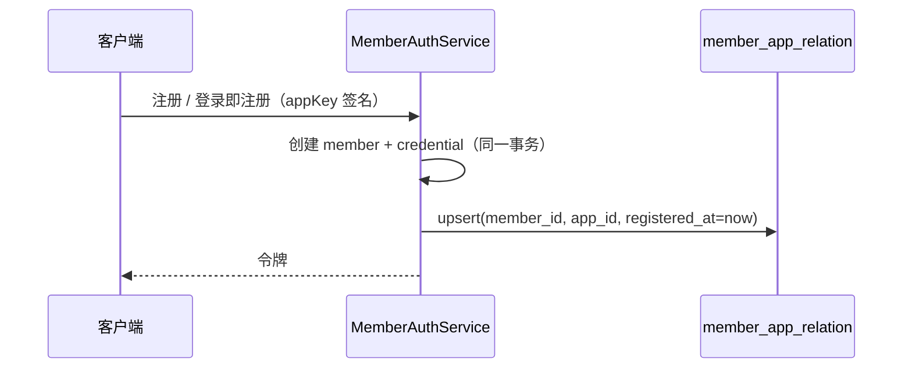
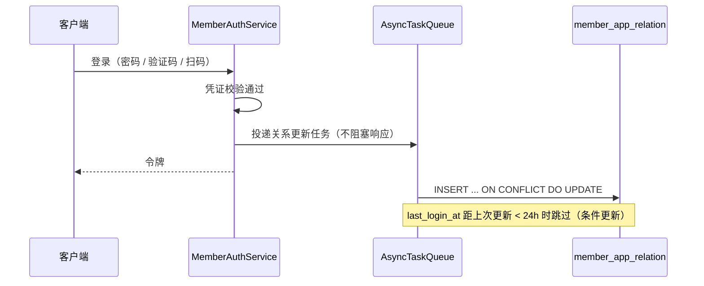

# 会员-应用关系设计

> 状态：设计待评审（独立立项，不阻塞 [工作台设计](工作台设计.md)）
> 关联文档：[统一认证设计](统一认证设计.md)、[应用与版本管理设计](应用与版本管理设计.md)、[订阅与支付设计](订阅与支付设计.md)、[应用管理员与数据范围设计](应用管理员与数据范围设计.md)

## 1. 背景与目标

会员是**平台级身份**：`member_credential` 的 `(credential_type, identifier)` 全表唯一，同一手机号 / 邮箱 / 第三方标识在整个平台只对应一个会员账号，跨应用共享。现有模型只记录了一个弱归属字段：

| 现有数据 | 能回答什么 | 局限 |
| --- | --- | --- |
| `member.registered_app_id` | 会员**首次**从哪个应用注册 | 只有一个应用；后续应用无法记录 |
| `member_login_log(app_key, member_id)` | 会员在哪个应用登录过 | 原始日志，需 appKey→appId 映射与去重；日志持续增长 |
| `subscription(member_id, app_id)` | 会员在哪个应用有订阅 | 只覆盖付费关系 |
| `order(member_id, app_id)` | 会员在哪个应用下过单 | 只覆盖订单 |

应用管理员（`app_admin`，`data_scope = app`）需要「只看自己应用的用户」。本设计新增一张物化的会员-应用关系表，把三种关系收敛到一行，作为**会员域数据范围收窄**的基础设施。

### 1.1 设计主张

| 编号 | 主张 |
| --- | --- |
| R1 | 一行 `(member_id, app_id)` 承载三种关系，用独立时间戳列表达，不用 `source` 枚举（一个会员在同一应用可能同时具备多种关系） |
| R2 | 「注册归属」只记录**首次创建会员**的应用；平台级身份模型下不存在「同一会员在多个应用分别注册」 |
| R3 | 登录关系异步写入并做 24h 节流；注册与订阅在业务事务内同步写入 |
| R4 | 所有写入使用 `INSERT ... ON CONFLICT DO UPDATE`，天然幂等，可安全重放 |
| R5 | 历史数据一次性回填，回填迁移本身幂等 |
| R6 | 关系表只作为**数据范围**依据，不改变会员身份与凭证的唯一性模型 |
| R7 | 应用管理员只能看到「本应用」的关系行，会员详情中其他应用的关系不返回 |
| R8 | 本期只新增只读筛选与展示；不做关系的手工绑定 / 解绑 |

## 2. 语义定义

| 关系 | 列 | 写入时机 | 说明 |
| --- | --- | --- | --- |
| 注册归属 | `registered_at` | 会员创建成功 | 仅首次；后续应用登录即注册不会新建会员（凭证全局唯一），故不写 |
| 登录活跃 | `first_login_at` / `last_login_at` | 开放 API 登录成功（含验证码 / 扫码） | 异步、节流；失败登录不写 |
| 订阅付费 | `subscribed_at` / `last_subscribed_at` | 订单 `markPaid` 成功（含线下备案与在线渠道） | 首次与最近一次分别记录 |

> **语义提醒**：`registered_at` 只表示「这个会员是在哪个应用第一次出现的」，不表示「他属于该应用」。如果业务需要「应用级注册」概念（同一身份在每个应用分别注册），那是认证模型变更，不在本设计范围。

## 3. 表设计

表名 `member_app_relation`，继承 `BaseEntity`（uuid 主键 + 审计列 + 软删）。

| 列 | 类型 | 约束 | 说明 |
| --- | --- | --- | --- |
| `id` | uuid | PK | BaseEntity |
| `member_id` | uuid | NOT NULL | 逻辑外键 `member.id` |
| `app_id` | uuid | NOT NULL | 逻辑外键 `app.id` |
| `registered_at` | timestamptz | NULL | 首次注册时间 |
| `first_login_at` | timestamptz | NULL | 首次成功登录时间 |
| `last_login_at` | timestamptz | NULL | 最近成功登录时间 |
| `subscribed_at` | timestamptz | NULL | 首次订阅成功时间 |
| `last_subscribed_at` | timestamptz | NULL | 最近订阅成功时间 |
| 审计列 | — | — | `creator` / `create_time` / `updater` / `update_time` / `deleted_at` |

索引：

```sql
CREATE UNIQUE INDEX uk_member_app_relation
  ON member_app_relation (member_id, app_id)
  WHERE deleted_at IS NULL;

-- 应用管理员反查：本应用有哪些会员
CREATE INDEX idx_member_app_relation_app
  ON member_app_relation (app_id, member_id)
  WHERE deleted_at IS NULL;

-- 活跃用户筛选（可选，按 last_login_at 排序 / 区间过滤时）
CREATE INDEX idx_member_app_relation_app_login
  ON member_app_relation (app_id, last_login_at)
  WHERE deleted_at IS NULL;
```

不建物理外键（与全仓逻辑外键约定一致）。

## 4. 写入设计

### 4.1 注册



- 时机：`MemberAuthService` 新建会员的分支（密码注册、验证码登录即注册、扫码登录即注册）。
- 需要 `appKey → appId` 映射。建议在 `AppLookupPort` 增加 `getByAppKey(appKey): Promise<AppOptionVo | null>`，由 appcenter 实现；member 侧通过 `AppLookupRegistry` 懒取，保持「member 不静态依赖 appcenter」的既有方向。
- 与会员创建同一事务；关系写入失败则整体回滚（注册是低频路径，强一致可接受）。

### 4.2 登录



- 登录高频，异步写入；失败只记日志，不影响登录结果。
- 节流 SQL：

```sql
INSERT INTO member_app_relation (member_id, app_id, first_login_at, last_login_at)
VALUES ($1, $2, now(), now())
ON CONFLICT (member_id, app_id) WHERE deleted_at IS NULL
DO UPDATE SET
  first_login_at = COALESCE(member_app_relation.first_login_at, EXCLUDED.first_login_at),
  last_login_at  = EXCLUDED.last_login_at
WHERE member_app_relation.last_login_at IS NULL
   OR member_app_relation.last_login_at < now() - interval '24 hours';
```

- `ON CONFLICT` 的部分唯一索引语法需与索引定义一致（PG 支持 `ON CONFLICT (member_id, app_id) WHERE deleted_at IS NULL`）。
- 关闭日志（登出）不写关系。

### 4.3 订阅

- 时机：`OrderService.markPaid` 状态机返回 `applied` 之后（线下备案与在线渠道共用）。
- 同步写入，与订单状态变更同事务；订单已带 `member_id` 与 `app_id`，无需映射。
- 续费只更新 `last_subscribed_at`，首次保留：

```sql
INSERT INTO member_app_relation (member_id, app_id, subscribed_at, last_subscribed_at)
VALUES ($1, $2, now(), now())
ON CONFLICT (member_id, app_id)
DO UPDATE SET
  subscribed_at      = COALESCE(member_app_relation.subscribed_at, EXCLUDED.subscribed_at),
  last_subscribed_at = EXCLUDED.last_subscribed_at;
```

### 4.4 一致性汇总

| 路径 | 一致性 | 失败影响 |
| --- | --- | --- |
| 注册 | 强一致（同事务） | 注册失败，无脏数据 |
| 订阅 | 强一致（同事务） | 订单状态回滚，无脏数据 |
| 登录 | 最终一致（异步 + 节流） | 关系表短暂缺行；登录不受影响 |

## 5. 历史回填

一条手写数据迁移（不建表，仅 `INSERT ... SELECT`），按顺序执行且幂等：

1. **订阅关系**：从 `subscription` 回填 `subscribed_at = start_at`、`last_subscribed_at = COALESCE(last_renew_at, start_at)`；或从 `order`（`status = paid`）取首次 / 最近 `paid_at`，两者取更准确者。推荐用 `order`，因为它保留了每次支付时间。
2. **注册关系**：从 `member.registered_app_id` 回填 `registered_at = member.create_time`。
3. **登录关系**：从 `member_login_log`（`log_type = 10`、`result_code = 0`）按 `(member_id, appKey)` 聚合 `MIN/MAX(login_time)`；`appKey → appId` 通过 `app` 表映射，映射不到的行跳过并记告警。
4. 每步使用 `ON CONFLICT DO UPDATE` 且只补空列（`COALESCE`），重复执行不覆盖新数据。

回填数据量按会员数 × 涉及应用数估算，实际远小于笛卡尔积；分页批量执行（如每批 5000 行），避免长事务锁表。

## 6. 查询与数据范围

### 6.1 会员列表筛选

`GET /api/member/member/page` 新增可选参数：

| 参数 | 取值 | 语义 |
| --- | --- | --- |
| `appId` | uuid | 限定应用 |
| `relation` | `registered` / `logged_in` / `subscribed` | 关系类型；缺省不过滤 |

查询实现：`EXISTS (SELECT 1 FROM member_app_relation r WHERE r.member_id = member.id AND r.app_id = $appId [AND r.<列> IS NOT NULL])`，避免 join 造成重复行。

### 6.2 数据范围收窄

1. `APP_SCOPE_DOMAINS` 由 `['appcenter', 'subscription']` 扩展为 `['appcenter', 'subscription', 'member']`。
2. `AppScopeService.resolve(userId, 'member')` 的判定逻辑与现有域一致：持有 `member:%` 权限的角色中任一 `data_scope = all` 即全量，否则取账户级应用授权集合。
3. member 域所有管理端接口收口：
   - 列表：注入 `member_id IN (SELECT member_id FROM member_app_relation WHERE app_id IN (...))`；
   - 单资源：**先 404 后 403**（与 M6 语义一致）；
   - 写操作（启停 / 删除 / 解绑 / 重置密码）：先校验归属，再执行。
4. 给 `app_admin` 预置角色补一条只读权限 `member:member:query`（迁移更新权限行）；写权限仍不授予。
5. 会员详情返回 `appRelations` 时，只返回调用者可见范围（`app_admin` 只看到本应用那一行）。

> 这是对 M6 权限模型的扩展，需同步更新 [应用管理员与数据范围设计](应用管理员与数据范围设计.md) 的域清单与 `app_admin` 权限清单。

### 6.3 会员详情展示

```ts
export interface MemberAppRelationVo {
  appId: string
  appName: string
  registeredAt: number | null
  firstLoginAt: number | null
  lastLoginAt: number | null
  subscribedAt: number | null
  lastSubscribedAt: number | null
}
```

按 `lastLoginAt` / `subscribedAt` 倒序返回，限制条数（如 50），避免异常会员拖垮详情页。

## 7. 隐私与边界

1. **跨应用识别是平台方能力**：凭证全局唯一已经隐含这一点，本表只是把它显式化。应用管理员只能看到「本应用与该会员的关系」，不得看到该会员在其他应用的关系行。
2. **不做反向暴露**：开放 API 不返回会员的其他应用关系；introspect 也不返回。
3. **软删语义**：会员被删除时，关系行不级联物理删除；查询侧通过 member 软删条件自然过滤。若需清理，由运维脚本按 `deleted_at` 归档。
4. **恢复场景**：会员恢复（当前不存在恢复功能）时关系行仍在，无需重建。

## 8. 测试计划

| 层 | 用例 |
| --- | --- |
| 单测 | 三种 upsert 的幂等性；登录节流（24h 内不更新、超过更新）；`COALESCE` 不覆盖首次时间；注册映射不到 appKey 时的失败路径 |
| 单测 | 列表 `relation` 三种筛选的 SQL 条件；数据范围 scoped 空集 fail-closed |
| 数据迁移 | 回填幂等（重复执行行数不变、新数据不被覆盖）；appKey 映射缺失只告警不中断 |
| 后端 e2e | 会员列表按 `appId + relation` 筛选；app_admin 越权访问他应用会员 → 404 / 403；详情不返回其他应用关系 |
| 浏览器 e2e | 应用管理员会员列表只出现本应用用户；平台管理员可见全部 |

## 9. 风险与不做清单

| 风险 | 处理 |
| --- | --- |
| 登录写放大 | 异步 + 24h 节流；实测 QPS 高时改为按天批量聚合 |
| 关系语义被误读 | 文档与 UI 文案明确「注册应用」= 首次出现，不表示当前归属 |
| 回填映射缺失 | appKey 在 app 表找不到时跳过并输出告警日志，迁移不失败 |
| 权限模型扩展影响存量 | `APP_SCOPE_DOMAINS` 增加 member 后，所有 member 接口必须逐一复核；`app_admin` 权限变更走迁移 |
| 表膨胀 | 行数上限为会员数 × 活跃应用数；`last_login_at` 节流后增长可控 |

### 9.1 不做

- 应用级注册（同一身份在每个应用分别建号）；
- 关系的手工绑定 / 解绑 / 归属转移；
- 会员跨应用画像、推荐、合并；
- 实时同步到数据仓库。

## 10. 开放问题（评审时确认）

| 编号 | 问题 | 建议 |
| --- | --- | --- |
| Q1 | 是否给 `app_admin` 授予 `member:member:query` | 建议授予只读；否则应用管理员无法使用会员筛选 |
| Q2 | 登录节流窗口 24h 是否足够 | 建议 24h，后续按写入量调整 |
| Q3 | 注册关系是否需要在 UI 上展示 | 会员详情展示全部三种关系，列表筛选提供三种选项 |
| Q4 | 是否保留 `registered_app_id` 列 | 保留（存量兼容 + 详情快速展示），关系表为准 |

## 11. 变更记录

| 日期 | 内容 |
| --- | --- |
| 2026-11-06 | 初版：三种关系物化、写入时机与节流、历史回填、member 域数据范围扩展、隐私边界 |
