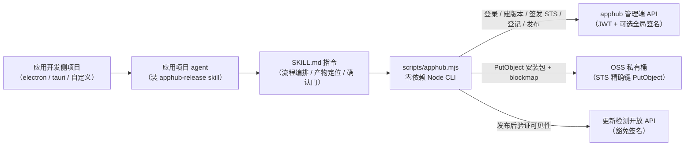
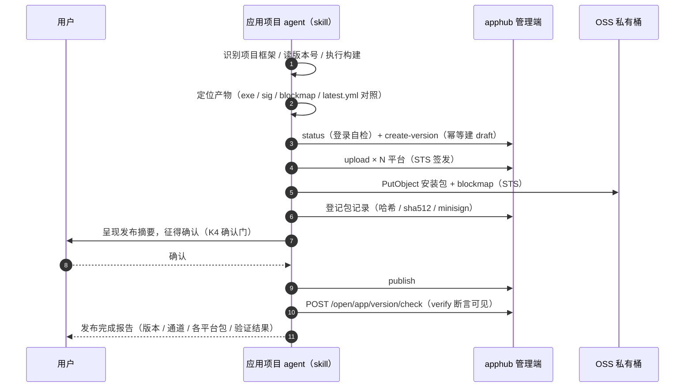

# 发版 Skill 设计（apphub-release）

> 本文是 apphub-release skill 的唯一设计依据：供**应用开发侧**项目的 agent 安装调用，完成「打包 → 上传 → 登记 → 发布 → 验证」发版全流程闭环与版本信息维护。
> 依赖能力来自 [应用与版本管理设计](应用与版本管理设计.md)（M1 已交付）的管理端接口与 STS 直传通道；请求签名算法遵循 [请求签名验证设计](指南/请求签名验证设计.md)。

## 1. 需求背景

应用发版的现状是「两栖操作」：开发者在本地构建安装包，再登录管理后台手工建版本、浏览器上传、点发布——动作分散、依赖人工逐步点击，无法进入开发侧的自动化流程（agent 会话 / CI）。

apphub-release skill 把发版能力下沉到应用开发侧：应用项目的 agent 装上该 skill 后，一句话即可完成新版本从构建产物到客户端可见的全流程，并可随时维护版本信息（改更新说明 / 强制标记、下线版本）。

**目标用户**：应用开发侧项目的 AI agent（Claude Code 等）；**不面向**平台运营人员（运营继续用管理后台）。

## 2. 设计主张（K1~K7，已经用户评审）

| 编号 | 主张 | 取舍理由 |
| --- | --- | --- |
| K1 | skill 落本仓库 `skills/apphub-release/`，作为平台交付物随仓库演进；应用项目拷贝到其 `.claude/skills/`（或用户级 `~/.claude/skills/`）安装 | 随平台接口演进统一维护版本；分发即拷贝目录 |
| K2 | 认证走**管理端 API**：平台为应用团队发「发版账号」（具 appcenter 权限），skill 登录换 JWT；平台开启签名时随账号下发 `SIGNATURE_SECRET` | M1 未提供发版开放 API；零后端改动，账号权限由平台 RBAC 收敛 |
| K3 | 上传脚本为**零依赖单文件 Node CLI**（Node ≥ 18 内置 fetch / crypto / https） | 应用侧项目环境不可控，免除 npm install；与前端 ali-oss 简单 PutObject 同语义（policy 仅精确键 PutObject，本就不允许 multipart） |
| K4 | publish 默认需 agent 向用户确认发布摘要后执行；用户明示全自动（CI）时跳过 | draft 上传登记不外显，publish 即客户端可见，属外向动作 |
| K5 | 内置 **electron-builder / tauri build** 双框架的打包指导与产物定位（含 .sig / blockmap / latest.yml 收集），其余项目走配置自定义 `buildCommand` | 平台目标客群以 electron / tauri 桌面应用为主；框架产物（sha512 / minisign 签名）只能构建时生成（主张 A5），skill 负责收集登记 |
| K6 | 配置文件 `.apphub-release.json` 只存非敏感项；凭据走**环境变量优先 + 配置 `credentials` 节兜底**双通道 | 配置文件可入库共享，凭据不误提交（SKILL.md 指导生成时写入 .gitignore） |
| K7 | 文档组织：本文（设计）+ SKILL.md（即使用说明）+ 接入手册 README 索引挂链接 | 遵循「文档先行」；不为 skill 再写独立使用手册，避免与 SKILL.md 双份维护 |

## 3. 总体架构



职责分层：

- **SKILL.md**（给 agent 读）：流程编排、项目类型识别、构建执行、产物定位与收集、publish 确认门、异常处置——所有「判断类」工作
- **apphub.mjs**（给 agent 调）：认证、签名、API 调用、哈希计算、OSS 直传——所有「精确执行类」工作；脚本不做交互、不猜值，参数一律显式传入

## 4. 目录与分发

```text
skills/apphub-release/
├── SKILL.md              # agent 指令（skill 的使用说明本体）
└── scripts/
    └── apphub.mjs        # 零依赖 Node CLI（命令集见 §6）
```

安装方式：将 `apphub-release` 整个目录拷贝至应用项目 `.claude/skills/apphub-release/`（项目级）或 `~/.claude/skills/apphub-release/`（用户级）。skill 不入 apphub 的 pnpm workspace、不被 lefthook lint 辖管（glob 仅覆盖 server/ web/），随仓库纯文件交付。

## 5. 配置契约

应用项目根目录 `.apphub-release.json`（非敏感，可入库）：

```jsonc
{
  "baseUrl": "https://appcenter.witice.top",  // 平台基址（本仓库线上环境，不带 /api 前缀）
  "appKey": "ah_xxxxxxxxxxxxxxxx",        // 应用标识（向平台方索取）
  "channel": "stable",                    // 默认发版通道
  "buildCommand": "pnpm electron-builder --win --x64",  // 可选：自定义构建命令（内置框架项目可不配）
  "platforms": [                          // 目标平台产物映射（glob，由 agent 展开为具体文件）
    {
      "platform": "windows",              // windows / macos / linux / android / ios
      "arch": "x64",                      // x64 / arm64 / universal；android / ios 省略
      "artifact": "dist/*Setup*.exe",     // 安装包 glob
      "blockmap": "dist/*Setup*.exe.blockmap",   // 可选：electron 差分文件 glob
      "sig": "src-tauri/target/release/bundle/nsis/*.exe.sig"  // 可选：tauri minisign 签名 glob
    }
  ]
}
```

凭据解析优先级（环境变量 → 配置节）：

| 凭据 | 环境变量 | 配置节字段 | 说明 |
| --- | --- | --- | --- |
| 发版账号 | `APPHUB_USERNAME` | `credentials.username` | 平台方发放（具 appcenter 权限） |
| 账号密码 | `APPHUB_PASSWORD` | `credentials.password` | — |
| 签名密钥 | `APPHUB_SIGN_SECRET` | `credentials.signSecret` | 平台开启 `SIGNATURE_ENABLED` 时必填，未开启可省 |

含 `credentials` 节的配置文件不得入库——SKILL.md 指导 agent 生成配置时同步把 `.apphub-release.json` 写入 `.gitignore`，或引导凭据仅走环境变量。版本号与更新说明不入配置：版本号由 agent 从项目文件（package.json / tauri.conf.json）读取，更新说明由用户给定或从 git log 生成草稿经用户确认。

## 6. 命令集（scripts/apphub.mjs）

统一形态：`node scripts/apphub.mjs <子命令> [参数]`；全局参数 `--config <path>`（默认 `./.apphub-release.json`）。输出中文；任何失败打印错误码与处置建议并以非零码退出。

| 子命令 | 关键参数 | 作用 |
| --- | --- | --- |
| `status` | — | 连通自检：登录 → 应用信息（appKey / framework / 状态）→ 通道清单 → 各通道最新版本。首次接入与排障第一步 |
| `create-version` | `--version` `--title` `[--notes]` `[--force]` `[--channel]` | 建草稿版本；**幂等**：同通道同版本已有 draft 直接复用并提示，已 published / offline 则报错 |
| `upload` | `--version` `--platform` `[--arch]` `--file` `[--blockmap]` `[--sig-file]` `[--replace]` | 单包上传全链：流式算 sha256（hex）/ sha512（base64）→ 读 minisign 签名 → 签发 STS → PutObject 安装包（及 blockmap）→ 登记包记录。**draft / published 均可**（offline 冻结）：槽位空闲即补包；`--replace` 替换已占用槽位（已发布版本换包用，服务端事务内软删旧包） |
| `remove-package` | `--version` `--platform` `[--arch]` | 删版本下的包记录（连带清理 OSS 对象）。draft / published 均可（offline 冻结）；published 下删除即撤回该平台分发，须先获用户确认 |
| `publish` | `--version` `[--channel]` | 发布版本（状态机校验与产物完整性校验由服务端兜底） |
| `verify` | `--expect` `--platform` `[--arch]` `[--channel]` `[--current]` | 调更新检测开放 API，断言 `latestVersion === expect` 且 `hasUpdate === true` |
| `update-version` | `--version` `[--title]` `[--notes]` `[--force]` | 维护版本信息（draft 全字段可改；published 仅 notes / force，服务端状态机校验） |
| `offline` | `--version` `[--channel]` | 下线版本（终态；下线后该通道回退到次新已发布版本） |
| `delete-version` | `--version` `[--channel]` | 删除草稿版本（连带清理包记录与 OSS 对象；仅 draft） |

脚本内共同行为：

- **登录**：`POST /api/system/auth/login`（双豁免接口）换取 token，命令内持有；JWT 有效期 8h 足够单次发版会话
- **应用 / 通道 / 版本解析**：appKey → `GET /appcenter/app` 分页遍历匹配；通道 code → `GET /appcenter/app/:id/channel`；版本号 → `GET /appcenter/app/:id/version` 遍历——三步均只读接口
- **写方法自动签名**：`credentials.signSecret` 存在（或环境变量）时，POST / PUT / DELETE 自动注入三件套头（见 §7）；未配置则裸发（适配平台未开启签名的部署）

## 7. 认证与请求签名实现

认证与签名完全复用平台既有契约（[请求签名验证设计](指南/请求签名验证设计.md) §2.2 / §2.6），脚本侧等价实现 web 前端 `http.ts` 拦截器行为：

1. `bodyText = body === undefined ? '' : JSON.stringify(body)`——**签的 = 发的**：同一字符串本体作为请求体发送并显式声明 `Content-Type: application/json`；无 body 的动作型请求（publish / offline / delete）空串占位、不发 body
2. 签名串五段 `\n` 连接：`[METHOD, 含 /api 前缀的 pathname（不含 query）, bodyText, Date.now(), 随机 nonce]`
3. `sign = HMAC-SHA256(签名串, signSecret)` 小写 hex；头三件套 `sign` / `timestamp` / `noncestr`
4. GET 只带 `Authorization: Bearer {token}`，不签名

## 8. OSS STS 直传实现（零依赖）

与 web 前端 `useOssUploader.ts` 的 ali-oss `client.put` 同语义（简单 PutObject），脚本用 Node 内置 `https` 流式实现：

- **Header 签名**：`Authorization: OSS {accessKeyId}:{base64(HMAC-SHA1(StringToSign, accessKeySecret))}`
- `StringToSign = "PUT\n" + Content-MD5(空) + "\n" + Content-Type(空) + "\n" + Date(GMT) + "\n" + CanonicalizedOSSHeaders + CanonicalizedResource`
  - `CanonicalizedOSSHeaders = "x-oss-security-token:{token}\n"`（STS 临时凭证必带，仅此一个 x-oss- 头）
  - `CanonicalizedResource = /{bucket}/{objectKey}`（**未 URL 编码的原始对象键**）
- **请求路径**单独按段 `encodeURIComponent`——签名用原始键、URL 用编码键，两者不可混用（OSS 签名经典坑）
- `Content-Length` 预先 stat 声明，body 为 `createReadStream` 管道输出——大安装包不整读内存
- 安装包与 blockmap 共用同一 STS 凭证（policy 本就签发两键 PutObject 权限），顺序：上传安装包 → 上传 blockmap → 回调登记
- 凭证时效 1h 覆盖单命令周期；PutObject 单请求上限 5GB，超限属平台侧需引入分片的场景（当前 STS policy 不含 multipart 权限，与前端一致不支持断点续传，明确为边界）

## 9. 发版标准流程



## 10. 框架适配（SKILL.md 内置指导）

### 10.1 electron（electron-builder）

- 构建：项目自带脚本（`electron-builder` / `build:win` 等），产物目录默认 `dist/`
- 产物定位：安装包 `*.exe`（nsis）/ `*.dmg` / `*.AppImage` + 同名 `.blockmap` + `latest.yml`
- 产物收集：sha256 / sha512 由脚本流式计算（**与 `latest.yml` 的 sha512 对照**，防产物错位——不一致即停止并报告）；blockmap 推荐上传（客户端白拿差分更新）；`minisign` 不适用
- 发布校验硬约束（003004003）：包记录必须有 sha512——脚本必算必传，天然满足

### 10.2 tauri（tauri build）

- 构建：`pnpm tauri build`（须配置 `TAURI_SIGNING_PRIVATE_KEY` 环境变量，否则不产出 .sig）
- 产物定位：`src-tauri/target/release/bundle/` 下 `nsis/*.exe`、`msi/*.msi`、`macos/*.app.tar.gz`、`deb/*.deb` 等 + 同名 `.sig` 文件
- 产物收集：`.sig` 文件内容即 `minisignSignature`（读文件文本，trim）；找不到 .sig 时提示私钥未配置并停止（framework=tauri 发布强制校验）

### 10.3 自定义 / 其他

- 配置 `buildCommand` 由 agent 代执行；产物 glob 由 `platforms[].artifact` 声明，agent 展开后逐一 upload；框架产物字段按需（平台 framework 为空 / custom 不强制）

## 11. 错误处置对照（SKILL.md 指导 agent 自动处置）

| 错误码 / 现象 | 含义 | agent 处置 |
| --- | --- | --- |
| 401 `签名校验失败` | signSecret 缺失或错误 | 检查平台是否开启签名 → 补配 `APPHUB_SIGN_SECRET` |
| 401 token 失效 | JWT 过期 / 无权限 | 脚本自动重登仍失败则检查账号权限 |
| `300300002`（003003002） | 版本号非 semver | 修版本号格式（MAJOR.MINOR.PATCH） |
| `300300003`（003003003） | 通道内版本号重复 | 已有 draft 则复用（脚本幂等）；已发布则递增版本号 |
| `300300004`（003003004） | 状态机不允许 | 读版本状态分流（draft / published 可维护平台包与说明；offline 终态） |
| `300300005`（003003005） | 发布校验失败无可用包 | 先完成各平台 upload |
| `300400001`（003004001） | STS 签发失败 | OSS / STS 配置问题，联系平台方 |
| `300400002`（003004002） | 平台架构槽位重复 | 已发布版本换包用 `upload --replace`；草稿也可 remove-package 后重传 |
| `300400003`（003004003） | 框架产物缺失 | electron 查 sha512 对照 / tauri 查 .sig 产出 |
| `300400004`（003004004） | 包对象不存在 | 上传未完成即登记（脚本不产生；出现则重试 upload） |
| `300400007`（003004007） | 替换目标不存在 | `--replace` 指向的槽位本无包：去掉 `--replace` 按新增补包重试 |
| OSS `AccessDenied` 等 | 直传被拒 | 检查 STS 凭证时效与对象键；持续失败联系平台方 |

## 12. 边界与异常

1. **发版账号权限收敛**：账号仅需 appcenter 读 + 版本域写权限点（`appcenter:app:query` / `channel:query` / `version:*`），平台方按此建「发版角色」；凭据等同管理后台登录能力，泄密风险由账号维度控制（禁用即失效）
2. **签名密钥定位**（诚实边界）：`SIGNATURE_SECRET` 与 web 前端构建产物内的密钥同源（本就随前端下发），skill 再分发不扩大泄露面；签名层是防伪不是身份认证（设计文档 §1.2 原文），身份与权限仍由 JWT + RBAC 承担
3. **publish 即对外生效**：K4 确认门是 skill 的流程约定（agent 指令层），服务端无二次确认——CI 全自动场景由用户显式授权跳过
4. **非直传平台**：`ios` 仅元信息登记（sha256 全零占位、无 objectKey）、`web` 无包记录——SKILL.md 指导 agent 跳过 upload 直接登记 / 仅建版本
5. **多包版本**：一次发版 N 平台包逐个 upload；中断可续（draft 状态可反复增删包），完成后再 publish
6. **发布后平台包维护**：published 下可补新平台包（槽位空闲）、`--replace` 换包、`remove-package` 撤回某平台分发；offline 版本一律拒绝（重新分发须新建版本）。**替换 / 删除不推动已安装客户端**（版本号未变，客户端按 semver 判断无更新），要修复存量用户必须发新版本——skill 须在动作前后明确告知
7. **并发发版**：同账号多处并发操作同一 draft 由服务端唯一约束与状态机兜底（槽位冲突 003004002 / 状态机 003003004），skill 不做本地锁

## 13. 验收标准

1. `skills/apphub-release/` 交付完整（SKILL.md + scripts/apphub.mjs），拷贝即安装、零依赖可运行
2. 本地平台真机冒烟全闭环（真实 OSS）：`status` 自检 → 建测试应用 → `create-version`（含 draft 复用幂等分支）→ `upload`（sha256 / sha512 落库正确、blockmap 直传成功）→ `publish` → `verify` 断言通过 → `update-version` → **published 下补包 / `--replace` 换包 / `remove-package` 撤包** → `offline` → 清理测试数据（版本下线后删应用）
3. 错误路径抽验：未配签名密钥调写接口 401、重复版本号、槽位重复——错误码与 §11 处置一致
4. `pnpm check` 全绿（skill 目录不参与 lint / workspace，需验证不破坏现有门禁）
5. 接入手册 README 选册导航与 docs/README.md 索引挂接本设计文档
