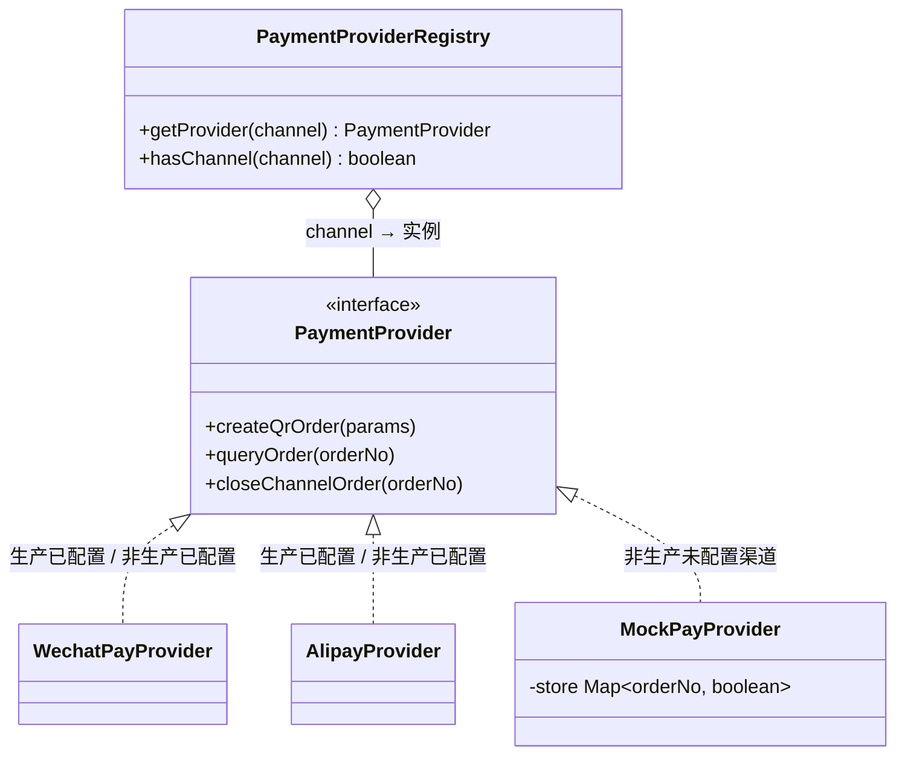
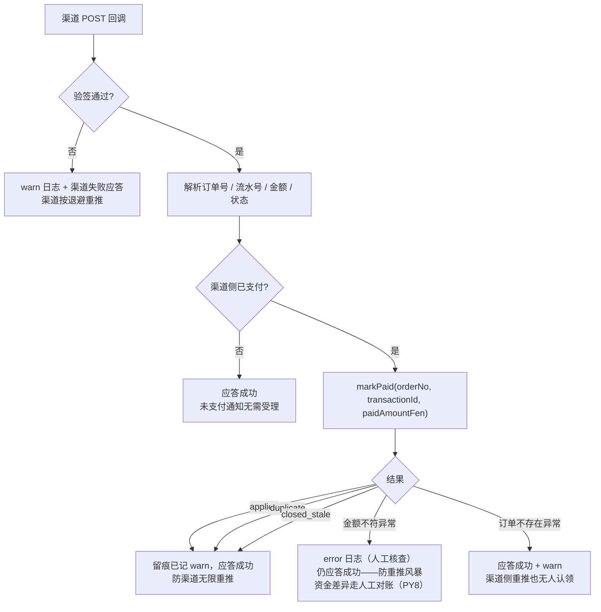
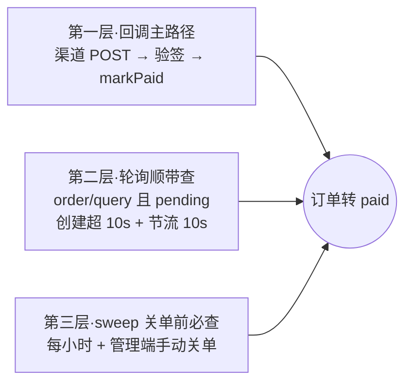

# 在线支付渠道接入附录（M5）

> 定位：[订阅与支付设计](订阅与支付设计.md) §2.4 约定「SDK 选型与回调验签细节在 M5 开工前补一份渠道接入附录」——本文即该附录，M5 实现的唯一依据。
> 前置：M3 已交付订单状态机（markPaid 幂等 / 惰性关单 + 定时兜底）、三端点结构预留、错误码 005200005 预留；本文在其上补渠道适配层、回调验签、兜底查单联动与配置矩阵。
> 决策记录：P1~P10 已经用户评审定稿（§3），实现级主张 PY1~PY16 见 §9 待评审。

## 1. 背景与范围

M5 = 在线支付：终端应用内发起扫码支付（微信 Native / 支付宝当面付），渠道异步回调驱动订单转 paid 并顺延订阅。范围：

- 渠道适配层（`PaymentProvider` 抽象 + 微信 / 支付宝 / Mock 三实现）
- 三个 HTTP 端点：开放下单、订单轮询、渠道回调（微信 / 支付宝各一）
- 回调验签接 `markPaid`（幂等状态机 M3 已就绪，零改动复用）
- 兜底查单三层联动（回调主路径 + 轮询顺带查 + 关单前必查）
- Mock 触发端点（非生产环境条件注册，验收与 e2e 用）

不在范围：退款、对账单下载、H5/JSAPI 支付、管理后台前端改动（订单页已就绪）、浏览器 e2e 新用例（无管理界面变化）。

商户资质现状（P3）：微信 / 支付宝商户号均未落地，本文按通用形态设计，交付以 Mock 渠道全链路验收；真实联调待资质落地后按 §10 验收项 4 补测。

## 2. SDK 选型与能力核实

### 2.1 wechatpay-node-v3（微信支付 v3，P1 定稿）

社区最主流的 v3 封装（基于 axios），锁定 **2.2.1**。已核实 `.d.ts` 全量能力：

| 能力 | API | 说明 |
| --- | --- | --- |
| 构造 | `new Pay(options)` | `options`: `{ appid, mchid, serial_no（商户证书序列号）, publicKey（商户 API 证书公钥）, privateKey（商户 API 私钥）, key（APIv3 密钥）, authType? }`；私钥 / 公钥传 PEM **Buffer** |
| Native 下单 | `transactions_native(params)` | `params`: `{ description, out_trade_no, notify_url?, time_expire?, amount: { total（分） } }`，返回 `{ code_url }` |
| 查单 | `query({ out_trade_no })` | 返回 `{ trade_state, transaction_id, amount: { total } }` |
| 关单 | `close(out_trade_no)` | 本地超时关单时同步关渠道单（渠道单 2h 自动关，此调用为对齐） |
| 回调验签 | `verifySign({ timestamp, nonce, body, serial, signature })` | 验签公钥从静态表 `Pay.certificates`（`serial → 公钥 PEM` 的 Map）按 `Wechatpay-Serial` 头取 |
| 回调解密 | `decipher_gcm(ciphertext, associated_data, nonce, key?)` | AES-256-GCM，解出回调业务报文 `{ out_trade_no, transaction_id, trade_state, amount: { total } }` |
| 平台证书下载 | `Pay.fetchCertificates()` / 实例 `get_certificates(apiSecret)` | 拉取平台证书填充 `Pay.certificates`（平台证书模式用） |

回调应答约定：受理成功返回 HTTP 200 + `{"code":"SUCCESS"}`；失败返回 4xx/5xx + `{"code":"FAIL","message":"..."}`，渠道将按退避策略重推。

### 2.2 alipay-sdk（支付宝官方，P2 定稿)

官方 SDK，锁定 **4.14.0**（CommonJS 双格式发布，Nest CJS 兼容无碍）。已核实能力：

| 能力 | API | 说明 |
| --- | --- | --- |
| 构造 | `new AlipaySdk(config)` | `config`: `{ appId, privateKey（应用私钥）, alipayPublicKey（支付宝公钥，验签用）, signType（默认 RSA2）, gateway（默认正式网关） }`；证书模式另有 `appCertContent` 等参数，本项目按**公钥模式**接入（附录通用形态，PY6 仅微信需要双模） |
| 当面付预下单 | `exec('alipay.trade.precreate', { bizContent, notifyUrl? })` | `bizContent`: `{ out_trade_no, total_amount（元字符串）, subject, timeout_express? }`，`code === '10000'` 时返回 `{ qr_code }`；`notify_url` 为网关公共参数 |
| 查单 | `exec('alipay.trade.query', { bizContent: { out_trade_no } })` | 返回 `{ code, trade_status, trade_no, total_amount（元字符串） }` |
| 异步通知验签 | `checkNotifySignV2(postData)` | 对 form-urlencoded 解析后的键值对象验签（V2 不对 value 做 decode，官方推荐） |

`trade_status` 映射：`TRADE_SUCCESS` / `TRADE_FINISHED` → 已支付；`WAIT_BUYER_PAY` → 未支付；`TRADE_CLOSED` → 已关闭。

回调应答约定：受理成功返回纯文本 `success`（其余任意文本视为失败，渠道重推）。

### 2.3 金额单位约定

订单 `amount` 为**分**（int，M3 既定）。微信回调 / 查单原生即分，直接比对；支付宝 `total_amount` 为元字符串，统一换算 `Math.round(Number(total_amount) * 100)` 后比对（PY5）。

## 3. 决策回溯：P1~P10（已评审定稿）

| 编号 | 决策 | 结论 |
| --- | --- | --- |
| P1 | 微信 SDK | wechatpay-node-v3 2.2.1 |
| P2 | 支付宝 SDK | 官方 alipay-sdk 4.14.0 |
| P3 | 商户资质 | 未落地，Mock 先行；附录按通用形态写，真实联调后补验收 |
| P4 | 降级策略 | 非生产未配置渠道降级 MockPayProvider（预下单返 `mock://` 二维码串）；生产不降级 |
| P5 | 兜底查单 | 三层联动：回调主路径 + 应用轮询顺带查（pending 且距创建超 10s，按单节流）+ 每小时 sweep 关单前必查 |
| P6 | 微信验签凭据 | 公钥 + 平台证书双模（一个配置分支兼容 2024 前后两类商户） |
| P7 | 回调地址 | `PAY_PUBLIC_BASE_URL` 可选；配置则预下单显式传 `notify_url`，未配置不传——微信回落商户平台默认、支付宝回落应用网关配置；查单兜底兼收 |
| P8 | Mock 支付触发 | 专用端点 `POST /api/pay/mock/settle`，走 markPaid 同一幂等逻辑；控制器仅非生产注册 |
| P9 | 重复下单 | 不限制（对齐渠道原生语义，超时自动关单兼收，幂等已防重复顺延） |
| P10 | fail-fast 粒度 | 按渠道独立判定；两渠道全部未配生产才启动 fail-fast，单渠道下单报 005200005。**2026-10-20 修订（上线批次 DEP-5）**：`ALLOW_CHANNEL_FALLBACK=true`（默认 false）豁免「全部未配」的 fail-fast——商户资质未齐的上线窗口期降级运行（渠道不注册、下单报 005200005，线下收款备案不受影响）；「部分填写」属配置错误，不豁免 |


## 4. 渠道适配层设计

### 4.1 PaymentProvider 接口

只抽象「服务端主动调渠道」的三个动作（下单 / 查单 / 关单），回调（渠道调我方）单独走 PayCallbackService，不进接口：

```ts
/** 支付渠道适配器：渠道差异收敛于此，OrderService 只见标准形态 */
export interface PaymentProvider {
  /** 预下单（Native / 当面付）：返回二维码内容串（应用侧自行渲染二维码图片） */
  createQrOrder(params: QrOrderParams): Promise<{ qrCodeUrl: string }>
  /** 渠道查单：返回标准化结果（金额已统一为分） */
  queryOrder(orderNo: string): Promise<ChannelQueryResult>
  /** 渠道关单（关单兜底时尽力而为；渠道订单自动失效的实现空实现即可） */
  closeChannelOrder(orderNo: string): Promise<void>
}

export interface QrOrderParams {
  orderNo: string
  /** 订单金额（分）——支付宝侧换算为元字符串 */
  amountFen: number
  /** 商品描述（计划名 + 应用名） */
  description: string
  /** 订单过期时刻（本地 expireAt，渠道二维码同步过期对齐） */
  expireAt: Date
  /** 回调地址（PAY_PUBLIC_BASE_URL 已配置时非空） */
  notifyUrl?: string
}

export interface ChannelQueryResult {
  /** 渠道侧是否已支付 */
  paid: boolean
  /** 渠道流水号（paid 时必有） */
  transactionId?: string
  /** 实收金额（分，paid 时必有；null 表示渠道未返回，跳过金额核对） */
  paidAmountFen?: number
  /** 渠道原始状态（日志留痕） */
  channelStatus: string
}
```

### 4.2 三个实现与装配（对齐 M4 CodeSender 模式）



- **WechatPayProvider / AlipayProvider**：渠道配置齐备（§7 矩阵）时装配，内部持有 SDK 客户端实例
- **MockPayProvider**：预下单返回 `mock://pay/{orderNo}`（应用侧渲染占位二维码即可验收）；`queryOrder` 恒返回未支付（Mock 支付经 settle 端点直达 markPaid，不经查单）；内存 `Map` 记录已结算单号供 settle 幂等参考
- **装配规则**：某渠道配置齐备 → 真实 Provider；非生产未配置 → MockProvider；生产未配置 → **不注册**该渠道（registry `hasChannel` 为 false，下单即 005200005，P10）
- 签名/验签所需的 PEM 一律经**文件路径**配置（`.env` 单行风格放多行 PEM 不现实，PY15）

### 4.3 微信回调验签双模（P6 落地路径）

`Pay.verifySign` 从静态表 `Pay.certificates`（`serial → 公钥 PEM`）按回调头 `Wechatpay-Serial` 取验签公钥，双模收敛为「往这张表放什么」：

| 模式 | 判定 | 填充方式 |
| --- | --- | --- |
| 平台证书模式（2024 前老商户默认） | 未配 `WECHAT_PAY_PUBLIC_KEY_SERIAL` | 模块初始化时调 `Pay.fetchCertificates()` 自动拉取平台证书填充 |
| 公钥模式（2024 后新商户默认） | `WECHAT_PAY_PUBLIC_KEY_SERIAL` + `WECHAT_PAY_PUBLIC_KEY_PATH` 配齐 | 启动时读公钥 PEM，按公钥序列号注入 `Pay.certificates`（`set(serial, pem)`），**不调** fetchCertificates（避免覆盖注入条目） |

两模式下回调解密均用 APIv3 密钥（`decipher_gcm`），`WECHAT_PAY_APIV3_KEY` 无条件必配。

### 4.4 回调受理流程（两渠道共用骨架）



微信额外步骤：验签前取 `req.rawBody`（main.ts `rawBody: true` 已就绪）与四个 `Wechatpay-*` 头；验签后 `decipher_gcm` 解密 `resource`。支付宝：`checkNotifySignV2` 验签 form 表单体，金额元转分。

**裸响应（PY1）**：回调控制器经 `@Res()` 注入原生 response 手动发送——微信 `res.status(200).json({ code: 'SUCCESS' })`（失败 `status(500).json({ code: 'FAIL', ... })`）、支付宝 `res.status(200).send('success')`（失败 `send('failure')`）。Nest 在 `@Res()` 模式下跳过 TransformInterceptor 与全局异常过滤器包装，渠道拿到的是协议约定的原始应答，框架零改动。

### 4.5 MemberAuthGuard 跨模块挂载（实现期修正）

下单 / 轮询端点挂在 SubscriptionModule，而 MemberAuthGuard 归属 MemberModule。**方法级 `@UseGuards` 引用的守卫类在宿主模块（使用方）上下文实例化**——若走构造注入，守卫的依赖链（MemberTokenService / MemberAuthService 及其仓储与 token）必须全部从 MemberModule 导出，消费方模块才能解析，导出面滚雪球且脆弱。

修正：守卫依赖改为 `ModuleRef.get(..., { strict: false })` 懒解析（Nest 官方 DI 特性，全应用容器查找），首次请求解析后缓存于实例字段——守卫在任何模块挂载都零导出负担，member 域自身的守卫单测以 ModuleRef 桩分发还原该行为。

## 5. 端点契约

### 5.1 开放下单 `POST /api/open/subscription/order/create`

鉴权：`@Public()` + `@UseSignature(APP_SCHEME_NAME)` + `@RateLimit({ appKeyFrom: 'header' })` + `@UseGuards(MemberAuthGuard)`（与开放会员接口同链：AppKey HMAC 验签 → member JWT → 令牌 appKey 与 X-App-Key 一致性 D19）。

请求：

```json
POST /api/open/subscription/order/create
{ "planId": "…", "channel": "wechat" }
```

校验链（PY11）：

1. `channel` ∈ { wechat, alipay }（offline 不开放）
2. 渠道已注册（生产未配置渠道 → 005200005）
3. 计划存在且在售，且计划所属应用的 appKey === 令牌 appKey（跨应用计划不可购，PY2 同族）
4. `assertNotPeriodToPermanent`（S5 主拦截复用）
5. 落库 pending 订单（快照字段同线下备案）→ 渠道预下单 → 预下单失败立即将该单置 closed 并抛 005200005（**先落库后预下单**：渠道侧永不出现本地查无的孤儿单，对账干净，PY10）

响应：`{ orderNo, amount, qrCodeUrl, expireAt }`

### 5.2 订单轮询 `POST /api/open/subscription/order/query`

鉴权同 5.1。请求 `{ orderNo }`。

越权校验（PY2）：订单的 appId → app.appKey 必须等于请求 X-App-Key，且 order.memberId 必须等于令牌 member.id，任一不符按订单不存在处理（防跨应用 / 跨会员枚举订单号）。

响应 `{ status: 'pending' | 'paid' | 'closed', paidAt? }`——不含订阅信息，应用侧确认 paid 后走 introspect 取订阅态。

轮询顺带查单（P5 第二层，PY3）：订单为 pending 且距创建超 10s 且距上次渠道查单超 10s（内存 `Map<orderNo, timestamp>` 节流）时，同步向渠道查一次——渠道已支付则当场 markPaid 再返回 paid。终态（paid / closed）即从节流表清除条目。

### 5.3 渠道回调 `POST /api/pay/callback/:channel`

双豁免 `@Public()` + `@SkipSignature()`，不挂 AppKey 限流（回调来自渠道服务器，无 X-App-Key 可解析；验签即防线）。受理流程见 §4.4。

### 5.4 Mock 触发端点 `POST /api/pay/mock/settle`（P8）

仅非生产环境注册（工厂条件装配，生产无此路由）。双豁免 + 不限流（同回调理由，且仅非生产存在）。请求 `{ orderNo }`，行为：订单存在且 pending → `markPaid(orderNo, 'MOCK-' + 时间戳, null)`（金额 null 跳核对——Mock 是模拟器，金额恒等于订单额）；非 pending 返回当前状态（幂等）。对任意渠道的 pending 单生效（非生产环境下微信 / 支付宝渠道本身就可能是 Mock 装配，PY14）。

## 6. 兜底查单三层联动（P5）



第三层改造（`closeExpiredPending` 与 `closeOrder`，PY4）：

- 原批量 UPDATE 改为**逐单**：查超时 pending 单 → 逐单向渠道查（sweep 是最后防线，不受节流限制）
- 渠道返回已支付 → markPaid（订单照转 paid，订阅顺延）
- 渠道返回未支付 → 关单，微信渠道同步调 `close(out_trade_no)` 对齐渠道侧
- **渠道查单异常（网络错 / 渠道超时）→ 跳过该单不关**，留待下一轮 sweep 重试——资金安全优先，宁可不关不可错关（未付单不关的代价是渠道侧 2h 自动关 + 本地下轮再试）
- channel = offline 的单不可能是 pending（备案即 paid），channel = mock 的单查单恒未支付、超时正常关

## 7. 配置项与装配矩阵

### 7.1 环境变量（追加至 `server/.env.example`）

```ini
# —— 在线支付（M5，详见 docs/应用管理平台/在线支付渠道接入附录.md）——
# 微信支付 Native（以下五项齐备视为微信渠道已配置）
WECHAT_PAY_APP_ID=
WECHAT_PAY_MCH_ID=
WECHAT_PAY_CERT_SERIAL=        # 商户 API 证书序列号
WECHAT_PAY_PRIVATE_KEY_PATH=   # 商户 API 私钥文件路径（apiclient_key.pem）
WECHAT_PAY_APIV3_KEY=          # APIv3 密钥（回调解密 / 平台证书下载）
# 微信支付公钥模式（可选）：以下两项配齐则公钥验签（2024 后新商户），
# 不配则启动后自动拉取平台证书验签（老商户）
WECHAT_PAY_PUBLIC_KEY_SERIAL=  # 微信支付公钥序列号（PUB_KEY_ID_ 开头）
WECHAT_PAY_PUBLIC_KEY_PATH=    # 微信支付公钥文件路径（wechatpayPublicKey.pem）

# 支付宝当面付（以下三项齐备视为支付宝渠道已配置）
ALIPAY_APP_ID=
ALIPAY_PRIVATE_KEY_PATH=       # 应用私钥文件路径
ALIPAY_PUBLIC_KEY_PATH=        # 支付宝公钥文件路径（异步通知验签）
ALIPAY_GATEWAY=                # 可选；默认 https://openapi.alipay.com/gateway.do，沙箱改沙箱网关

# 回调公网地址（可选）：配置后预下单显式传 notify_url；
# 未配置时不传——微信回落商户平台默认、支付宝回落应用网关配置，查单兜底兼收
PAY_PUBLIC_BASE_URL=

# 通道降级开关（上线批次 DEP-5，跨 M4 验证码 / M5 支付）：默认 false 生产 fail-fast；
# true 时生产环境未配置的通道降级运行（短信/邮件→log 通道，支付→渠道不注册下单 005200005）。
# 仅豁免「全部未配置」——部分填写仍属配置错误照常 fail-fast；Mock 支付永不进生产。
# 用途：资质报备未齐的上线窗口期显式豁免；资质就绪后配置真实通道并移除本开关
ALLOW_CHANNEL_FALLBACK=false
```

### 7.2 fail-fast 与降级矩阵（P4 / P10）

| 环境 | 渠道配置状态 | 行为 |
| --- | --- | --- |
| 生产 | 两渠道全部未配置 | **启动 fail-fast**（支付模块生产至少接一个真实渠道） |
| 生产 | 两渠道全部未配置 + `ALLOW_CHANNEL_FALLBACK=true` | **降级运行**（DEP-5）：渠道不注册、在线下单报 005200005，线下收款备案不受影响；启动 WARN 提示，Mock 仍不进生产 |
| 生产 | 某渠道部分填写（非全空且不齐） | **启动 fail-fast**（配置错误显式失败，不静默降级） |
| 生产 | 某渠道齐备 | 该渠道真实 Provider；另一渠道未配置时下单报 005200005 |
| 非生产 | 渠道齐备 | 该渠道真实 Provider（可对沙箱联调） |
| 非生产 | 渠道全空 | 该渠道降级 MockProvider（warn 日志提示一次） |
| 非生产 | 渠道部分填写 | **warn + 降级 Mock**（本地开发宽松：只想配一个渠道时另一个不必补全，PY16） |

配置读取统一走 `configuration.ts` 新增 `pay` 段（业务代码不直接读 `process.env`）；私钥 / 公钥文件在 Provider 构造时读取，读不到即抛错（启动 fail-fast 覆盖到文件可读性）。

## 8. 错误码与日志

**错误码不新增**：下单侧渠道错误复用 M3 预留的 `005200005 ORDER_CHANNEL_ERROR`（支付渠道错误或未接入）；金额不符 `005002004`、订单状态冲突、计划下架等业务码全部复用。回调侧验签失败不进业务码体系（对渠道是 HTTP 失败应答 + warn 日志，非面向应用的 JSON 错误）。

日志要点：回调受理（渠道 / 订单号 / markPaid 结果）、金额不符（error + 人工核查提示）、closed_stale（warn 留痕）、渠道查单异常（warn + 下轮重试）、Mock 装配（warn 一次）。

## 9. 实现级主张汇总（PY1~PY16，待评审）

| 编号 | 主张 | 备选与否决理由 |
| --- | --- | --- |
| PY1 | 回调经 `@Res()` 裸响应：微信 200 + `{"code":"SUCCESS"}`，支付宝纯文本 `success`；验签失败分别 500 FAIL / `failure` | 否决走统一响应包装：渠道只认协议原文，`{code,data}` 包装会被当作失败无限重推 |
| PY2 | order/query 越权双校验：order.appId→appKey === X-App-Key 且 memberId === 令牌 member，不符按不存在处理 | 否决仅返回状态不校验：订单号含时间戳但可枚举面大，泄露他人支付态 |
| PY3 | 查单节流：内存 Map 按 orderNo 10s 一查，终态清除；sweep 不受节流 | —— |
| PY4 | sweep / 手动关单前逐单查渠道；渠道异常跳过不关留下轮；未支付才关（微信同步 close） | 否决异常时照常关单：网络抖动即可能「已付被关」，资金事故 |
| PY5 | 支付宝金额 `Math.round(Number(元字符串) * 100)` 转分后比对 | —— |
| PY6 | 微信验签双模经 `Pay.certificates` 静态表统一：公钥模式注入条目、平台证书模式 fetchCertificates 拉取 | 否决自研 crypto.verify：算法交给 SDK，注入点单一（启动时一次），2.x 稳定 |
| PY7 | Mock 二维码串 `mock://pay/{orderNo}`，queryOrder 恒未支付，settle 端点直达 markPaid | —— |
| PY8 | 回调金额不符：error 日志 + **对渠道仍应答成功**（防重推风暴），资金差异走人工对账 | 否决应答失败：渠道按退避重推 8 次皆为同样结果，只产生日志风暴 |
| PY9 | markPaid 三态（applied / duplicate / closed_stale）对渠道一律应答成功 | —— |
| PY10 | 下单顺序：先落库 pending → 预下单，预下单失败立即置 closed + 抛 005200005 | 否决先预下单后落库：渠道侧产生本地查无的孤儿单，回调无人认领 |
| PY11 | order/create 校验链：channel 合法性 → 渠道已注册 → 计划在售且应用归属一致 → S5 拦截 → 落库 → 预下单 | —— |
| PY12 | 渠道二维码有效期与本地对齐：微信传 `time_expire`（RFC3339 = expireAt）、支付宝传 `timeout_express: '2h'` | 否决不传用渠道默认：渠道默认过期时刻与本地 2h 关单漂移，出现「本地已关渠道可付」窗口 |
| PY13 | 回调请求体：微信取 `req.rawBody` 原始字节验签（rawBody: true 已就绪）；支付宝 form-urlencoded 解析后 `checkNotifySignV2` | —— |
| PY14 | mock settle 对任意渠道 pending 单生效（非生产端点；非生产下真实渠道也可能是 Mock 装配） | 否决仅 mock 渠道：e2e 想验「wechat 渠道名 + Mock 装配」组合时无法触发支付 |
| PY15 | 私钥 / 公钥一律文件路径配置（.env 放多行 PEM 不现实），Provider 构造时读取 | —— |
| PY16 | 非生产渠道部分填写：warn + 降级 Mock（本地开发宽松）；生产部分填写 fail-fast | 否决非生产也 fail-fast：本地只想配单渠道时被迫补全另一渠道配置 |

## 10. 测试与验收

**单元测试**（风险驱动，`*.spec.ts` 同目录）：

- WechatPayProvider / AlipayProvider：SDK 客户端 mock 边界——预下单参数形态（金额换算 / 二维码提取 / notify_url 条件传递）、查单状态映射（trade_state / trade_status → paid）、渠道错误抛 005200005
- PayCallbackService：微信验签失败 / 解密成功各状态、支付宝验签失败 / 金额不符应答、markPaid 三态应答映射、裸响应调用断言
- 查单节流：10s 内不重复、终态清除、sweep 不受限
- 关单防护：渠道已支付→markPaid、渠道异常→跳过不关、未支付→关单
- 装配矩阵：生产全空 fail-fast / 生产部分 fail-fast / 非生产降级 Mock / 齐备装真实 Provider

**后端 e2e**（`server/test/`，Mock 渠道全链路）：

下单（mock 二维码）→ order/query 轮询 pending → mock settle → order/query paid → introspect 订阅生效；越权 query 拒绝；生产 mock settle 路由不存在（条件装配）。

**验收项对照**（设计 §5）：

1. 回调幂等（重复回调不重复顺延）——markPaid 单测 + e2e 重复 settle
2. 金额核对拒收——单测构造不符金额
3. 兜底查单三层——单测 + sweep 用例
4. 真实渠道联调——**待商户资质落地后补**（P3，沙箱网关配置已预留 `ALIPAY_GATEWAY`）

## 11. 与既有实现的衔接清单

| 既有 | 衔接 |
| --- | --- |
| `OrderService.markPaid` | 零改动复用（回调 / 查单 / settle 共用入口） |
| `OrderService.closeExpiredPending` | 按 §6 改逐单查后关 |
| `OrderService.closeOrder` | 同上补查单防护 |
| `assertNotPeriodToPermanent`（S5） | order/create 校验链第 4 步复用 |
| `OpenSubscriptionController` | 追加 order/create、order/query 两端点（同鉴权链） |
| `005200005 ORDER_CHANNEL_ERROR` | 渠道未注册 / 预下单失败 / 渠道查单异常统一复用 |
| `rawBody: true`（main.ts） | 微信回调验签直接受益，零改动 |
| M4 CodeSender 装配哲学 | Provider 注册表照此模式（配置齐备判定 + 生产 fail-fast / 非生产降级） |
