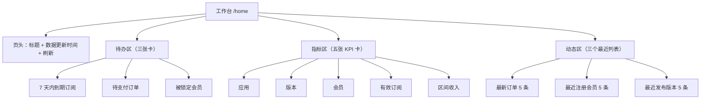

# 工作台设计

> 状态：设计待评审（M7）
> 关联文档：[应用管理员与数据范围设计](应用管理员与数据范围设计.md)、[订阅与支付设计](订阅与支付设计.md)、[统一认证设计](统一认证设计.md)、[布局与风格设计](../前端/布局与风格设计.md)
> 会员维度的跨应用归属另立设计，见 [会员-应用关系设计](会员应用关系设计.md)（独立立项，不阻塞本文交付）

## 1. 需求背景

当前首页 [HomeView.vue](../../web/src/views/HomeView.vue) 是底座框架遗留的演示页：Pinia counter 计数器 + `/api/health` 连通性检查，副标题仍为「企业级全栈项目框架底座」。M1~M6 已全量交付、v1.6.0 已发布，该页面既不是产品功能，也向用户暴露了无意义的开发自检内容。

本期把首页改造为**运营工作台**：登录后第一眼看到「今天要处理什么」，其次是平台核心指标与最近动态。

### 1.1 设计主张

| 编号 | 主张 |
| --- | --- |
| W1 | 定位是运营工作台，不是数据大屏；信息优先级为 **待办 → 指标 → 动态**，趋势只做 KPI 卡内的迷你 sparkline |
| W2 | 后端提供一个聚合端点，前端不并发拼多个列表接口取 `total`（口径统一、避免请求风暴） |
| W3 | 所有统计遵守 M6 数据范围：`appcenter` / `subscription` 两域按 `AppScopeService` 收窄，fail-closed |
| W4 | 权限裁剪到字段级：用户无权查看的块返回 `null`，前端不渲染而不是显示 0 或 403 |
| W5 | 统计口径写死在本文第 6 节，时区一律 `Asia/Shanghai`，金额一律以「分」传输 |
| W6 | 不引入图表库；迷你 sparkline 用纯 SVG 手写，消费 `--apphub-*` token，明暗自动跟随 |
| W7 | 保留路由 `/home` 与 `name: 'Home'`，只改菜单标题与页面实现（不破坏多页签 fullPath 与 e2e 契约） |
| W8 | 工作台 **不开启 keep-alive**：每次进入都拉取新数据 |
| W9 | 卡片点击下钻一期不做；列表页 `route.query` 初始化与「即将到期」筛选列为后续迭代 |
| W10 | 一期不做独立趋势图 / 分布图 / 自定义布局 / 导出 / 定时自动刷新 |
| W11 | 会员卡片对 `app_admin` 天然不可见：其预置 20 项权限不含 `member:*`，不发明额外规则 |
| W12 | 旧首页的连通性检查与 counter 演示从产品页面移除；`/api/health` 端点保留给部署探活 |

## 2. 段位登记

| 项 | 取值 | 说明 |
| --- | --- | --- |
| 模块注册名 / 权限前缀 | `dashboard:` | 权限点 `dashboard:overview:query` |
| 表前缀 | 无 | 纯只读聚合模块，不建业务表 |
| 错误码模块段 | **006**（预留） | 本期无业务错误，段位先登记占用，避免后续模块撞号 |
| 种子固定 id 段 | 无 | 无种子数据 |

接入后权限点总数由 65 → **66**，需同步 [auth.e2e-spec.ts](../../server/test/auth.e2e-spec.ts) 与 [system-extension.e2e-spec.ts](../../server/test/system-extension.e2e-spec.ts) 两处断言。指南段位表需补登 006（见 [新模块接入指南](../指南/新模块接入指南.md) 第 0 节）。

## 3. 页面设计

### 3.1 结构



### 3.2 卡片清单

| 区块 | 展示内容 | 权限点 | 数据范围 | 空/无权 |
| --- | --- | --- | --- | --- |
| 待办·到期订阅 | 7 天内到期订阅数 | `subscription:sub:query` | `subscription` | 无权 → 不渲染 |
| 待办·待支付订单 | `pending` 且未超时的订单数 | `subscription:order:query` | `subscription` | 无权 → 不渲染 |
| 待办·锁定会员 | `locked_until > now()` 的条目数 | `member:member:query` | 平台级 | 无权 → 不渲染 |
| KPI·应用 | 总数 / 启用数 | `appcenter:app:query` | `appcenter` | 无应用 → 引导注册 |
| KPI·版本 | 总数 / 已发布数 | `appcenter:version:query` | `appcenter` | 显示 0 |
| KPI·会员 | 总数 / 区间新增 + sparkline | `member:member:query` | 平台级 | 显示 0 |
| KPI·有效订阅 | 有效数 / 7 天内到期数 | `subscription:sub:query` | `subscription` | 显示 0 |
| KPI·区间收入 | 已支付金额（元）+ sparkline | `subscription:order:query` | `subscription` | 显示 ¥0.00 |
| 动态·订单 | 最新 5 条订单 | `subscription:order:query` | `subscription` | 空态文案 |
| 动态·会员 | 最近注册 5 位会员 | `member:member:query` | 平台级 | 空态文案 |
| 动态·版本 | 最近创建 5 个版本 | `appcenter:version:query` | `appcenter` | 空态文案 |

> 会员模块当前未做应用级数据收窄（M6 只收口 `appcenter` / `subscription`）。`app_admin` 预置角色不含 `member:*`，因此会员相关块对其天然隐藏。若将来给应用管理员授予会员权限，该授权即为平台级授权，语义在权限设计文档中已有登记。

### 3.3 交互

- 页头右上角：`数据更新于 HH:mm:ss` + 刷新按钮（手动触发）。
- 区间切换：`近 7 天 / 近 30 天` 两个页签，只影响「区间新增」「区间收入」「sparkline」「待办中的到期窗口不由它控制」——到期窗口固定 7 天。
- 卡片不做下钻（W9）；待办卡右上角可放「去处理」文字链，指向对应列表页（不带筛选参数，仅导航）。
- 加载态：`el-skeleton` 骨架屏，避免布局跳动。
- 错误态：保留页面结构，指标区显示「加载失败」+ 重试按钮；不整页白屏。
- 全部块均无权（如仅有系统管理权限的账号）：显示「暂无可查看的数据」，不发起多余查询。

### 3.4 视觉与响应式

- 全部色值消费 `--apphub-*` token；卡片沿用 `.apphub-card` 的边框 + 阴影 + 10px 圆角。
- 栅格：待办三卡 `el-col :xs=24 :sm=12 :lg=8`；KPI 五卡 `:xs=24 :sm=12 :lg=8 :xl=6`（第五张自动换行）；动态三块 `:xs=24 :lg=8`。
- 992px 断点由主布局统一处理，工作台自身不重复实现折叠。
- 深色模式：sparkline 使用 token 活引用，无需单独判断主题。

## 4. 接口设计

### 4.1 端点

```text
GET /api/dashboard/overview?range=7d|30d
```

- 挂 `@RequirePermissions(DASHBOARD_PERMISSION_CODES.OVERVIEW_QUERY)`。
- `range` 缺省 `7d`；非法值由 ValidationPipe 拒绝。
- `@OperateLog` 不挂（只读查询，且会污染操作日志）。

### 4.2 响应契约

```ts
export type DashboardRange = '7d' | '30d'

/** 待办：null 表示当前用户无权查看该块 */
export interface DashboardTodoVo {
  expiringSubscriptions: number | null
  pendingOrders: number | null
  lockedMembers: number | null
}

/** 指标：null 表示当前用户无权查看该块；0 表示有权且确实为 0 */
export interface DashboardMetricsVo {
  appTotal: number | null
  appEnabled: number | null
  versionTotal: number | null
  versionPublished: number | null
  memberTotal: number | null
  memberNewInRange: number | null
  subscriptionActive: number | null
  subscriptionExpiringSoon: number | null
  /** 区间内已支付订单金额合计（分） */
  revenueInRange: number | null
}

export interface DashboardSparklineVo {
  /** 按自然日聚合，缺日补 0；元素形如 { date: '2026-11-01', count: 12 } */
  memberDaily: Array<{ date: string, count: number }> | null
  /** 按自然日聚合，缺日补 0；amount 单位分 */
  revenueDaily: Array<{ date: string, amount: number }> | null
}

export interface DashboardLatestVo {
  orders: Array<{
    id: string
    orderNo: string
    memberNickname: string
    appName: string
    amount: number
    channel: string
    status: string
    createTime: number
  }> | null
  members: Array<{
    id: string
    nickname: string
    registeredAppName: string | null
    createTime: number
  }> | null
  versions: Array<{
    id: string
    appName: string
    version: string
    status: string
    createTime: number
  }> | null
}

export interface DashboardOverviewVo {
  /** 服务端生成时间（毫秒时间戳，与前端时间列约定一致） */
  generatedAt: number
  range: DashboardRange
  todos: DashboardTodoVo
  metrics: DashboardMetricsVo
  sparkline: DashboardSparklineVo
  latest: DashboardLatestVo
}
```

### 4.3 权限裁剪与范围收窄

1. 取当前用户权限串集合：`PermissionService.getUserPermissionCodes(userId)`。
2. 按权限点决定各字段是否为 `null`（第 3.2 节表格）。
3. 需要应用收窄的域，调用 `AppScopeService.resolve(userId, domain)`：
   - `mode: 'all'` → 不追加条件；
   - `mode: 'scoped'` → 以 `appIds` 追加 `app_id IN (...)`（应用表用 `id IN (...)`）；
   - 空集 → 相关计数返回 0、列表返回空数组（fail-closed）。
4. `resolve` 在「有权限点但角色未授予该域权限」的防御分支会抛 403。dashboard 侧统一包一层 `resolveScopeSafe`，捕获业务错误后按空集处理，避免整页 500；其他异常照常抛出。
5. 应用/版本/订单/订阅的列表与计数全部经 `appId` 收窄；会员相关字段不使用应用收窄（见 3.2 说明）。

### 4.4 缓存

一期**不做缓存**。接口为只读聚合，数据规模与应用/会员数同阶；上线后实测 P95，若超过 300ms 再引入 30s 进程内缓存（键 `userId + range`），并在文档登记。多实例部署下不做跨进程一致性承诺。

## 5. 后端实现要点

### 5.1 模块结构

```text
server/src/modules/dashboard/
├── dashboard.module.ts        # 装配 + onModuleInit 注册权限点
├── dashboard.controller.ts    # 薄壳：取权限点后转 Service
├── dashboard.service.ts       # 权限裁剪 + 范围收窄 + 聚合查询
├── dashboard.range.ts         # 区间换算纯函数（可单测）
├── dashboard.service.spec.ts
├── dashboard.range.spec.ts
├── dto/dashboard.dto.ts       # 出参 VO + 查询 DTO
└── permissions.ts             # 权限点常量与清单
```

### 5.2 装配与依赖

```ts
@Module({
  imports: [TypeOrmModule.forFeature([
    AppEntity,
    AppVersionEntity,
    MemberEntity,
    OrderEntity,
    SubscriptionEntity,
    MemberLoginLockEntity,
  ])],
  controllers: [DashboardController],
  providers: [DashboardService],
})
export class DashboardModule implements OnModuleInit { /* registerModule */ }
```

- `PermissionService` / `AppScopeService` 由 `@Global()` 的 `SystemModule` 导出，直接注入。
- 不注入 appcenter / member / subscription 的业务 Service：统计是只读聚合，不需要状态机与写校验逻辑；直接使用实体 Repository 可避免为统计去改造四个模块的对外接口。依赖方向为 dashboard → 业务实体 / system，不产生反向依赖。
- 在 [app.module.ts](../../server/src/app.module.ts) 的 imports 追加 `DashboardModule`。

### 5.3 聚合查询

- 计数用 `repository.count({ where })` 或 `createQueryBuilder().select('COUNT(*)')`；
- 分布/趋势用 `GROUP BY` 后在前端或服务端补齐缺失日期（建议服务端补齐，保证 sparkline 定长）；
- 最新列表用 `find({ order: { createTime: 'DESC' }, take: 5 })`，再批量查应用名 / 会员昵称做映射，避免 N+1；
- QueryBuilder 涉及软删实体时显式确认 `deleted_at IS NULL` 条件（TypeORM 默认会加，但不要依赖隐式行为）；
- 禁止把整表拉到内存再过滤。

### 5.4 索引迁移

随本期新增一条 migration（只加索引，不改表）：

| 索引 | 表 | 用途 |
| --- | --- | --- |
| `idx_member_create_time` | `member` | 区间新增会员、会员 sparkline |
| `idx_subscription_expire`（部分索引 `WHERE deleted_at IS NULL`） | `subscription` | 有效订阅计数、7 天内到期扫描 |
| `idx_member_login_lock_locked_until` | `member_login_lock` | 锁定会员计数 |

> `member_login_lock` 无软删列，使用普通索引。迁移通过 `pnpm --filter server migration:generate -- src/migrations/AddDashboardIndexes` 从实体派生后人工复核，避免 generate 误带其他变更。

## 6. 统计口径

所有时间区间按 **`Asia/Shanghai`** 计算；表达式统一形如：

```sql
-- 区间起点（含）：近 N 天包含今天，起点为 N-1 天前的本地 00:00
( date_trunc('day', now() AT TIME ZONE 'Asia/Shanghai') - ($N - 1) * interval '1 day' )
  AT TIME ZONE 'Asia/Shanghai'
```

| 指标 | 口径 |
| --- | --- |
| `appTotal` / `appEnabled` | `app` 未软删；`appEnabled` 追加 `status = enabled` |
| `versionTotal` / `versionPublished` | `app_version` 未软删（经 `appId` 收窄）；已发布追加 `status = published` |
| `memberTotal` | `member` 未软删全部 |
| `memberNewInRange` | `member.create_time >= 区间起点` |
| `subscriptionActive` | `subscription` 未软删且 `expire_at > now()`（永久哨兵自然包含） |
| `subscriptionExpiringSoon` / `expiringSubscriptions` | `now() < expire_at <= now() + interval '7 day'` 且 `expire_at < 永久哨兵`（排除永久买断） |
| `pendingOrders` | `order.status = pending` 且 `expire_at > now()`（待支付且未超时） |
| `lockedMembers` | `member_login_lock.locked_until > now()` |
| `revenueInRange` | `order.status = paid` 且 `paid_at >= 区间起点`，`SUM(amount)`（分） |
| `memberDaily` | 按 `(create_time AT TIME ZONE 'Asia/Shanghai')::date` 分组计数 |
| `revenueDaily` | 按 `(paid_at AT TIME ZONE 'Asia/Shanghai')::date` 分组求和 |
| `latest.orders` | `order` 未软删，`create_time DESC` 取 5 |
| `latest.members` | `member` 未软删，`create_time DESC` 取 5 |
| `latest.versions` | `app_version` 未软删，`create_time DESC` 取 5 |

补充约定：

- 金额在接口层始终为整数「分」，前端展示时 `(amount / 100).toFixed(2)`；不做浮点累加。
- 软删：所有聚合必须带 `deleted_at IS NULL`（`member_login_lock` 除外，其无软删语义）。
- 区间定义统一为「含今天、共 N 个自然日」，sparkline 返回恰好 N 个点，缺日补 0。
- 会员/订单的昵称与应用名通过批量查询映射；已删除应用返回 `'-'` 占位，不阻断列表。

## 7. 前端实现要点

### 7.1 目录与文件

```text
web/src/api/dashboard.ts                       # VO 类型 + getDashboardOverview
web/src/views/dashboard/index.vue              # 页面装配、loading/error/空态
web/src/views/dashboard/components/StatCard.vue
web/src/views/dashboard/components/TodoCard.vue
web/src/views/dashboard/components/RecentList.vue
web/src/views/dashboard/components/MiniSparkline.vue
```

- 页面 `defineOptions({ name: 'Home' })` 保持不变。
- 路由 [router/modules/home.ts](../../web/src/router/modules/home.ts) 仅把组件指向 `views/dashboard/index.vue`，`meta.title` 改为「工作台」，`icon` 改为 `dashboard`；[menu-icon.ts](../../web/src/utils/menu-icon.ts) 新增 `dashboard: Odometer`。
- **不设置 `meta.keepAlive`**（W8）。
- 删除 `views/HomeView.vue` 与 `stores/counter.ts` 及其 spec（已确认 counter 仅被首页引用）。

### 7.2 迷你 sparkline

- 纯 SVG `polyline` + 渐变面积（`<linearGradient>`）。
- 输入 `number[]`，按 `min/max` 归一化到 `viewBox`；全零或单点时绘制水平基线，不抛错。
- 描边 `var(--apphub-color-primary)`，填充 `var(--apphub-color-primary-bg-light)`，网格/基线 `var(--apphub-divider)`。
- 组件不引入任何图表依赖；`aria-label` 提供「近 N 天趋势」的无障碍描述。

### 7.3 列表与表格

动态区是**只读简报**，使用 `el-table` 或语义化列表，不使用 `ApphubTable`：后者带列宽/列序拖拽与 localStorage 持久化，对本场景是负担。此豁免在本文登记，避免与「列表表格一律 ApphubTable」的约定冲突（后续若出现排序/筛选需求，再切回 `ApphubTable`）。

### 7.4 数值与时间

- 数字使用 `Intl.NumberFormat('zh-CN')` 千分位；金额单独格式化。
- 时间列复用现有 `dateTimeColumnFormatter` 约定（毫秒时间戳 → `YYYY-MM-DD HH:mm:ss`）。
- 空值统一渲染 `'-'`，不用 `0` 冒充缺失。

## 8. 测试计划

### 8.1 单元测试（server）

| 对象 | 用例 |
| --- | --- |
| `dashboard.range.ts` | 7d / 30d 起点换算；跨月、跨年；时区边界（本地 00:00 恰好命中） |
| `DashboardService` | 无权限 → 对应字段全 `null`；scoped 空集 → 计数 0 / 列表空；`mode: all` → 不追加条件；`resolveScopeSafe` 捕获 403 → 空集；软删与永久哨兵排除 |
| 金额与补齐 | `revenueDaily` 缺日补 0、返回定长 N 点 |

Controller 薄壳不写单测（由 e2e 守护）。

### 8.2 后端 e2e

- `GET /api/dashboard/overview` 未登录 → 401；无 `dashboard:overview:query` → 403。
- super_admin → 统一响应结构、字段齐全、`range` 透传。
- 权限点总数断言 65 → 66（两处）。

### 8.3 浏览器 e2e

新增 `e2e/tests/dashboard.spec.ts`：

- super_admin 登录后可见五张 KPI 卡与三个动态块；
- 应用管理员登录后**不出现**会员卡片，且应用/订阅数字可见；
- 刷新按钮触发重新请求；
- 暗色模式下页面无白底残留（可选，若现有 e2e 已有主题用例则并入）。

## 9. 风险与遗留

| 风险 | 处理 |
| --- | --- |
| 数据范围漏收窄导致越权 | 所有 appcenter / subscription 查询必须经 `resolveScopeSafe`；单测覆盖空集与 scoped 分支 |
| 时区错误导致「今日/近 7 天」偏 8 小时 | 统一使用第 6 节 SQL 表达式；单测覆盖边界 |
| 会员维度无法按应用收窄 | 一期按权限点隐藏；后续见 [会员-应用关系设计](会员应用关系设计.md) |
| 聚合查询拖慢首页 | 先补索引；实测超阈值再加缓存 |
| 旧首页删除影响首页 e2e | 同步调整既有首页用例的文案断言（如「后端连通性检查」） |

### 9.1 明确不做

- 卡片点击下钻与列表页 `route.query` 初始化；
- 订阅「即将到期」筛选参数；
- 独立趋势图、分布图、图表库；
- 自定义卡片排序 / 布局持久化；
- 导出与订阅推送；
- 自动定时刷新。

## 10. 变更记录

| 日期 | 内容 |
| --- | --- |
| 2026-11-06 | 初版：运营工作台定位、待办优先精简范围、聚合接口契约、统计口径与索引补齐；会员-应用关系独立立项 |
