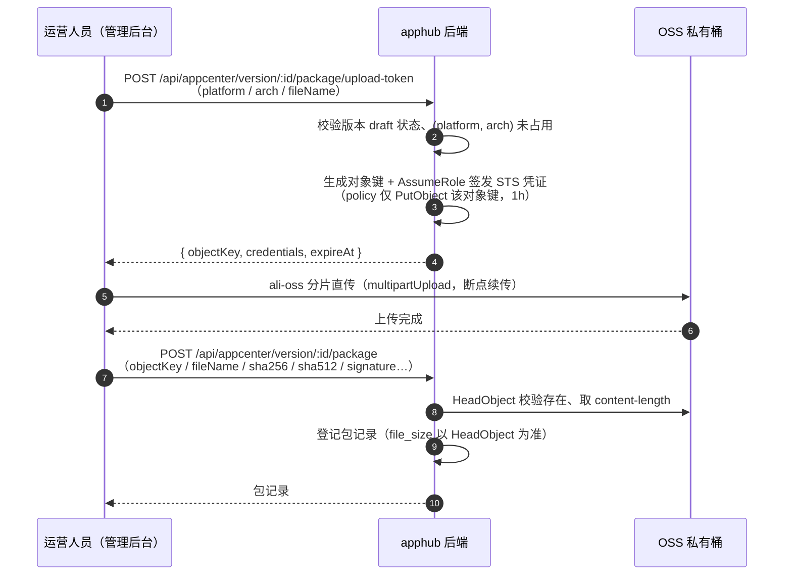
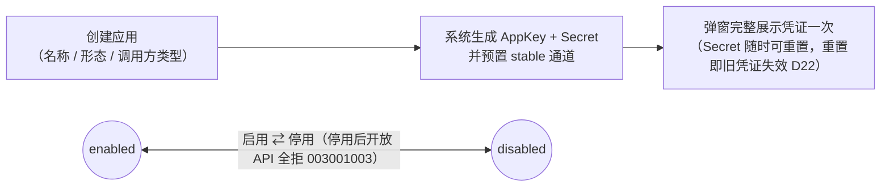
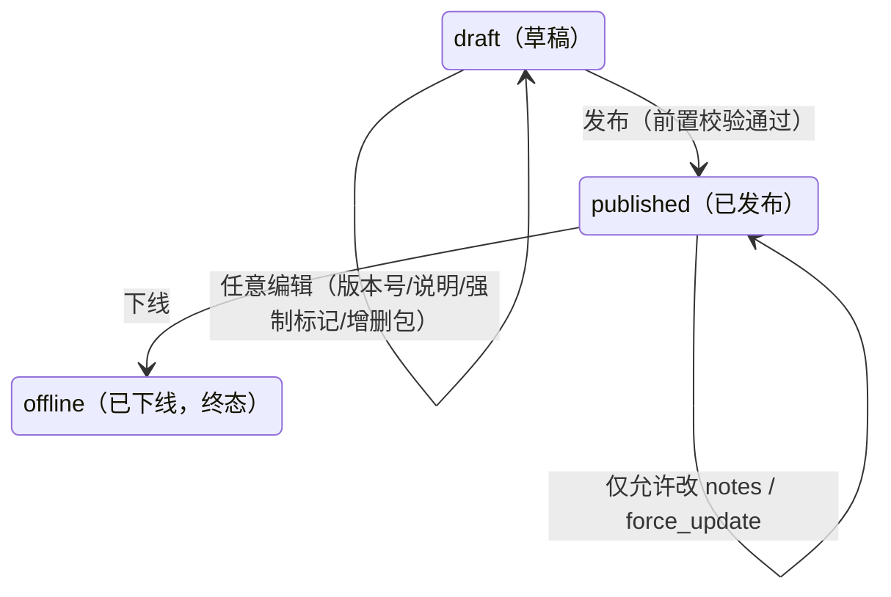

# 应用与版本管理设计（appcenter）

> 本文是 appcenter 域的唯一设计依据：应用注册与凭证、更新通道、版本发布与安装包管理、更新检测开放 API 与框架内建更新器适配端点。
> 遵循总体设计决策 D1 / D9 / D10 / D11 / D15 / D17 / D22 / D23 / D24（见 [总体设计](总体设计.md) §2）。

## 1. 需求背景

平台以「应用」为基本管理单元：运营人员在管理后台注册应用、发放调用凭证（AppKey / AppSecret）、按通道发布版本与安装包；应用客户端（或应用后端）经开放 API 完成更新检测并从 OSS 下载安装包。Electron / Tauri 桌面应用可改用框架内建更新器直连平台适配端点，零适配接入（D24）。

首期范围：多通道（应用自定义）、强制更新、全量包、OSS 私有桶存储、Electron / Tauri 协议适配；不做灰度发布（D9 / D11）。

## 2. 数据模型

四张表，实体一律继承 `BaseEntity`（uuid 主键 + 审计列 + 软删），表名蛇形。

### 2.1 app（应用）

| 字段 | 类型 | 说明 |
| --- | --- | --- |
| app_key | varchar(32)，唯一 | 应用标识，格式 `ah_` + 16 位随机小写字母数字，创建时生成，展示与接口携带用 |
| app_secret | varchar(64) | 调用凭证，32 位随机串；**明文存库**（数据库已独立部署隔离），管理端仅创建 / 重置后完整显示一次 |
| name | varchar(64)，必填 | 应用名称 |
| app_type | varchar(32)[] | 形态标签：`desktop` / `web` / `mobile` 的组合，仅作管理归类与页面提示 |
| client_type | varchar(16)，必填 | 调用方类型：`confidential`（有后端，Secret 存服务端）/ `public`（客户端直连，Secret 编译进二进制）——风控差异化依据，不影响鉴权分支（D17） |
| framework | varchar(16)，可空 | 技术框架归类：`electron` / `tauri` / `custom`——适配端点产物登记的校验依据（D24，主张 A5），纯管理归类不影响运行时 |
| icon_url | varchar(512)，可空 | 应用图标（OSS 地址） |
| description | varchar(512)，可空 | 应用描述 |
| status | varchar(16) | `enabled` / `disabled`（停用后其开放 API 调用全部拒绝） |
| sort | int | 排序 |

凭证轮换（D22）：管理端「重置 Secret」生成新串，旧 Secret **立即失效**；配合发布新版应用（可标记强制更新）完成客户端切换。app_key 不变。

### 2.2 app_channel（更新通道）

| 字段 | 类型 | 说明 |
| --- | --- | --- |
| app_id | uuid，FK → app | 所属应用 |
| code | varchar(32) | 通道代码，应用内唯一，如 `stable` / `beta` / `internal` |
| name | varchar(64) | 通道显示名 |
| status | varchar(16) | `enabled` / `disabled`（停用后该通道的更新检测返回无更新） |
| sort | int | 排序 |

**主张 A1**：通道由应用自定义（D9），但创建应用时**自动预置 `stable` 通道**且不可删除，保证客户端默认有通道可用。唯一约束 `(app_id, code)`（软删参与唯一性冲突由应用层校验）。

### 2.3 app_version（应用版本）

| 字段 | 类型 | 说明 |
| --- | --- | --- |
| app_id | uuid，FK | 所属应用 |
| channel_id | uuid，FK | 所属通道（一个版本只属于一个通道，跨通道发布需新建版本） |
| version | varchar(32) | 版本号，**semver 格式强制校验**（`MAJOR.MINOR.PATCH`，可选预发布后缀） |
| title | varchar(128) | 版本标题（如「1.3.0 性能优化版」） |
| notes | text | 更新说明（多行纯文本） |
| force_update | bool | 强制更新标记，默认 false |
| status | varchar(16) | 状态机：`draft` → `published` → `offline`（见 §3.2） |
| published_at | timestamptz，可空 | 发布时间 |

唯一约束 `(app_id, channel_id, version)`。版本比较按 semver 语义（预发布 < 正式版）。

### 2.4 app_package（版本平台包）

| 字段 | 类型 | 说明 |
| --- | --- | --- |
| version_id | uuid，FK | 所属版本 |
| platform | varchar(16) | `windows` / `macos` / `linux` / `android` / `ios` / `web` |
| arch | varchar(16)，可空 | `x64` / `arm64` / `universal`，桌面端按架构区分；`web` / `android` / `ios` 填 null |
| file_name | varchar(255) | 原始文件名 |
| file_size | bigint | 字节数 |
| sha256 | char(64) | 安装包哈希（自研协议客户端校验用，必填） |
| sha512 | varchar(96)，可空 | **base64 编码**的安装包 sha512（electron-updater 校验用，D24；framework=electron 的桌面包必填） |
| minisign_signature | text，可空 | Tauri 更新包的 minisign 签名（构建时 `tauri signer sign` 生成的 .sig 内容，D24；framework=tauri 必填） |
| blockmap_object_key | varchar(512)，可空 | Electron `.blockmap` 差分文件的 OSS 键（可选上传；未上传则客户端退回全量下载，不违背 D11） |
| blockmap_sha512 | varchar(96)，可空 | blockmap 文件哈希（latest.yml 的 files 数组需要） |
| oss_object_key | varchar(512) | OSS 对象键（下载地址动态生成签名 URL，不落库） |

唯一约束 `(version_id, platform, arch)`。`web` 平台**无包记录**（版本仅登记，更新检测只做提示）；`ios` 仅登记元信息（D1，不分发安装包，`oss_object_key` 为空）。

**主张 A2（版本-平台包模型）**：一次发版 = 一个 `app_version` + N 个 `app_package`（如 v1.3.0 同时挂 windows-x64 / macos-arm64 / android 三个包），符合「一次发版多端产物」的直觉，版本说明与强制标记全平台共享。

**主张 A5（框架产物登记，D24）**：sha512 / minisign_signature / blockmap 是框架协议的**硬性要求产物**（electron-updater 校验 base64 sha512，Tauri 更新器强制 minisign 验签），只能构建时生成、上传时登记，平台无法补算。校验时机在**发布前置校验**：app.framework=electron 的桌面包必须有 sha512（blockmap 可选）；framework=tauri 必须有 minisign_signature；framework 为空或 custom 不强制（适配端点对缺失产物的包直接跳过渲染，该版本对该框架不可见，管理端上传界面按 framework 提示配套产物）。

### 2.5 OSS 存储设计（主张 A3）

- **私有桶**，对象键规范：`packages/{appKey}/{channelCode}/{version}/{platform}[-{arch}]/{fileName}`；blockmap 等配套产物放包同目录：`{fileName}.blockmap`
- **上传：STS 直传**（后端带宽有限，包体不经服务器中转）：管理后台向后端申请 STS 临时凭证 → 浏览器用 ali-oss 分片直传私有桶 → 回调后端登记包记录（时序见下）；对象键由**后端生成下发**（前端不自由拼键），STS policy 收敛为仅允许 `PutObject` 到该对象键，凭证时效 1h（大文件分片续传中过期由前端 STS provider 自动刷新重取）
- **下载**：更新检测响应中的 `downloadUrl` 为**带签名的临时 URL**（有效期 2h），不暴露公共读，防盗链
- **哈希与大小登记**：管理端为受信操作（运营人员 + RBAC 鉴权），sha256 / sha512（base64）由前端上传时计算声明，后端登记时 HeadObject 校验对象存在并以服务端侧 content-length 为准落库 file_size，不回读包体校验哈希（哈希登记错误表现为客户端更新校验失败，draft 阶段可删包重传兜底）
- 配置经 `server/.env` 注入：`OSS_REGION` / `OSS_BUCKET` / `OSS_ACCESS_KEY_ID` / `OSS_ACCESS_KEY_SECRET`（服务端签名 URL 与对象管理用）+ `STS_ROLE_ARN` / `STS_SESSION_NAME`（直传凭证签发用，RAM 角色策略仅授 `packages/*` 前缀 PutObject）（业务代码经 ConfigService 读取，不直接访问 process.env）
- **部署前提**：OSS 桶配置 CORS——允许管理后台 Origin 的 `PUT / POST / GET` 方法与 `ETag` 暴露头，否则浏览器直传被拦

**STS 直传时序**：



## 3. 方案设计

### 3.1 应用生命周期与凭证发放



### 3.2 版本状态机



- **发布前置校验**：至少挂一个非 `web` 平台的包记录（`web` 版本除外）且包已上传完成；版本号在通道内未与已发布版本重复；framework 产物完整性（主张 A5：electron 包须有 sha512、tauri 包须有 minisign_signature，缺失返回 003004003）
- **draft**：可任意编辑（版本号、说明、强制标记、增删包）
- **published**：只允许改 notes / force_update（发版后发现遗漏补救）；下线后客户端更新检测不再返回该版本
- **offline**：终态，不可回退（历史可追溯，重新发布建新版本）

### 3.3 更新检测协议（开放 API）

`POST /api/open/app/version/check` —— **豁免签名**（`@Public` + `@SkipSignature`，D23 救生通道）：仅校验 AppKey 头有效性（路由 / 统计用途，无效即拒）+ 限流（按 AppKey + IP），无用户态。设计动机：该接口是旧客户端自我更新的唯一入口，必须对「Secret 已失效的存量客户端」保持可用（§4.1）。

```jsonc
// 请求
{
  "channel": "stable",        // 通道 code，缺省 stable
  "platform": "windows",      // 必填
  "arch": "x64",              // 桌面端必填，其余 null
  "currentVersion": "1.2.0"   // 客户端当前版本，semver；首次安装可传 null
}
// 响应（有更新）
{
  "hasUpdate": true,
  "latestVersion": "1.3.0",
  "title": "1.3.0 性能优化版",
  "notes": "……",
  "forceUpdate": true,          // 见下方判定规则
  "package": { "fileName": "app-1.3.0-x64.exe", "fileSize": 88123456, "sha256": "…",
               "downloadUrl": "https://oss…（2h 签名 URL）" }
}
// 响应（无更新 / 通道停用 / 无已发布版本）
{ "hasUpdate": false }
```

- **候选版本**：该应用该通道下 `status = published` 且挂有该 platform（+arch）包的最新版本（semver 最大）
- **强制更新判定（主张 A4）**：`forceUpdate = 候选版本的 force_update 标记`（只看目标版本，不叠加中间版本的标记）——语义直白：升级到最新版前是否被强制
- `currentVersion` 语义校验放宽：非 semver 传入按「必有更新」处理（容忍旧客户端脏数据）
- `web` 平台：返回版本提示与说明，`package` 为 null（应用自行决定提示形态）
- 应用停用 / 通道停用：返回 `{ hasUpdate: false }`（不暴露状态细节）

### 3.4 框架内建更新器适配端点（D24）

自研协议服务于自定义客户端与 Android；Electron / Tauri 桌面应用可直接使用框架内建更新器指向平台——平台按框架协议**动态渲染 manifest**（数据源与自研协议同一套查询逻辑：应用 + 通道 + 平台的最新 published 版本）。

**端点清单**（全部 `@Public` + `@SkipSignature`，同 D23 逻辑——内建更新器只能发普通 GET 请求，无法携带 HMAC 头；AppKey 从 URL 路径提取校验有效性 + 按 AppKey + IP 限流）：

| 端点 | 框架机制 |
| --- | --- |
| `GET /api/update/{appKey}/{channel}/electron/latest.yml` | electron-updater（Windows，generic provider 拉取） |
| `GET /api/update/{appKey}/{channel}/electron/latest-mac.yml` | 同上（macOS） |
| `GET /api/update/{appKey}/{channel}/electron/latest-linux.yml` | 同上（Linux） |
| `GET /api/update/{appKey}/{channel}/tauri/{target}/{currentVersion}` | tauri-plugin-updater v2（endpoint 模板） |

**electron-updater 响应**（latest.yml，版本比较在客户端 semver 完成；无 published 版本返回 404，应用侧容错）：

```yaml
version: 1.3.0
path: app-setup-1.3.0.exe
sha512: OWRlY2Fk…（base64）
releaseDate: '2026-10-16T10:00:00.000Z'
releaseNotes: "[force]\n修复登录闪退"        # 强制标记注入规则见下
files:
  - url: https://oss…（2h 签名 URL，绝对地址直用）
    sha512: OWRlY2Fk…
    size: 88123456
  - url: https://oss…/app-setup-1.3.0.exe.blockmap（签名 URL，未上传 blockmap 时省略此条目）
    sha512: …
    size: 234567
```

**tauri-plugin-updater 响应**（服务端完成版本比较：currentVersion ≥ 最新版本或无 published 版本返回 **204 No Content**；Tauri target 由平台 / 架构映射到 `app_package` 的 `(platform, arch)`：`windows-x86_64`→(windows,x64)、`windows-aarch64`→(windows,arm64)、`darwin-x86_64`→(macos,x64)、`darwin-aarch64`→(macos,arm64)、`linux-x86_64`→(linux,x64)，未识别 target 返回 204）：

```jsonc
{
  "version": "1.3.0",
  "pub_date": "2026-10-16T10:00:00Z",
  "notes": "[force]\n修复登录闪退",
  "platforms": {
    "windows-x86_64": {
      "signature": "（minisign .sig 内容，登记于 app_package.minisign_signature）",
      "url": "https://oss…（2h 签名 URL）"
    }
  }
}
```

**强制更新标记渲染（单一事实源两种渲染，D24）**：`app_version.force_update` 为 true 时——自研协议响应 `forceUpdate: true`；框架 manifest 的 notes / releaseNotes **首行前置 `[force]`**。应用在更新回调中解析标记决定阻断式或温和式 UI（框架只负责检查 / 下载 / 安装机制，「何时安装」的控制权天然在应用侧）；向终端用户展示更新说明前剔除标记行。标记读取与框架检查同响应到达，无额外请求。

**通道映射**：通道 code 直接作为 URL 路径段，每通道一个独立 feed URL（electron-updater 的 setFeedURL / Tauri 的 endpoints 配置，应用打包时或运行时切换）。

### 3.5 管理端接口（RBAC，前缀 /api/appcenter）

| 接口 | 权限点 | 说明 |
| --- | --- | --- |
| `GET/POST /app` | `appcenter:app:query` / `:create` | 列表（分页 / 关键字）/ 创建（响应含完整凭证，仅此一次） |
| `GET/PUT /app/:id` | `appcenter:app:query` / `:update` | 详情（不含 Secret）/ 编辑元数据 |
| `DELETE /app/:id` | `appcenter:app:remove` | 软删（有已发布版本的应用不允许删，先下线版本） |
| `PUT /app/:id/status` | `appcenter:app:update` | 启用 / 停用 |
| `PUT /app/:id/secret` | `appcenter:app:reset-secret` | 重置 Secret（响应完整显示一次） |
| `GET/POST/PUT/DELETE /app/:id/channel` | `appcenter:channel:*` | 通道管理（stable 不可删） |
| `GET/POST /app/:id/version`、`PUT/DELETE /version/:id` | `appcenter:version:*` | 版本管理 |
| `POST /version/:id/package/upload-token` | `appcenter:version:update` | 签发 STS 直传凭证：校验版本 draft 状态、(platform, arch) 未占用，返回对象键 + 临时凭证（A3 直传方案） |
| `POST /version/:id/package` | `appcenter:version:update` | 登记包记录（前端直传完成后回调：objectKey / fileName / 哈希 / sha512 / minisign 签名；后端 HeadObject 校验，D24 产物同表登记） |
| `DELETE /version/:id/package/:pkgId` | `appcenter:version:update` | 删除包（仅 draft 版本，后端同步删除 OSS 对象与配套产物） |
| `POST /version/:id/publish`、`POST /version/:id/offline` | `appcenter:version:publish` / `:offline` | 状态流转 |

权限点首段 `appcenter`，全集 15 项（app 5 + channel 4 + version 6），按 OR 语义挂载（对齐底座权限注册表机制，`permissions.ts` + `onModuleInit` 注册）。

### 3.6 错误码（模块段 003）

| 错误码 | 场景 |
| --- | --- |
| 003001001 | 应用不存在 |
| 003001002 | AppKey 无效（开放 API 签名校验时查无应用） |
| 003001003 | 应用已停用 |
| 003001004 | 应用存在已发布版本，不允许删除 |
| 003002001 | 通道不存在 |
| 003002002 | 通道 code 重复 |
| 003002003 | stable 通道不允许删除 |
| 003003001 | 版本不存在 |
| 003003002 | 版本号不符合 semver |
| 003003003 | 通道内版本号重复 |
| 003003004 | 版本状态不允许该操作（状态机校验） |
| 003003005 | 发布校验失败（无可用平台包） |
| 003004001 | STS 凭证签发失败（RAM / STS 配置异常或服务不可用） |
| 003004002 | 平台 / 架构组合重复 |
| 003004003 | 框架产物缺失（electron 包无 sha512 / tauri 包无 minisign 签名，发布前置校验，D24） |
| 003004004 | 包对象不存在（登记时 HeadObject 校验失败——未上传或对象键不符） |

子域分段：001 应用 / 002 通道 / 003 版本 / 004 安装包与存储。

## 4. 边界与异常

1. **签名失效的老客户端（救生通道）**：更新检测豁免签名（D23），Secret 轮换后旧客户端仍能完成「检查更新 → 拿下载链接 → 自我更新」闭环——新版内嵌新 Secret，升级即完成凭证切换；轮换可随时执行，无需先发版铺垫。客户端对更新检测的容错要求：接口不可达（网络异常等）时兜底提示官网 / 人工渠道下载
2. **签名 Guard 的密钥源扩展**：开放 API 的签名校验从「全局单密钥」改为「`X-App-Key` 头 → 查 app 表取 Secret 验签」，底座 HMAC 算法、时间戳 ±5min、nonce 防重放机制不变；管理端 API 继续走全局密钥（两套密钥源按路由前缀分流）
3. **OSS / STS 不可用**：凭证签发失败返回 003004001；浏览器直传失败由前端断点续传重试（ali-oss multipartUpload 分片级续传）；登记时对象不存在返回 003004004。均不影响已发布版本的检测（签名 URL 由 OSS 独立生成，上传与下载都不消耗应用服务器带宽）
4. **适配端点签名 URL 时效（D24）**：manifest 中的 OSS 签名 URL 有效期 2h；electron-updater 的正常流程「check（拉 manifest）→ download（用本次 manifest 的 URL）」在同一会话内完成不受影响；若应用使用缓存的 update-info 隔日续传遇 URL 过期，其下载失败重试机制会重新 checkForUpdates 拿新 manifest，应用侧接入指南注明「下载失败先重查」
5. **blockmap 缺失退化**：未上传 blockmap 的包，latest.yml 省略对应 files 条目，electron-updater 自动退回全量下载（D11 全量包原则不受影响；上传 blockmap 则白拿差分下载，不作为发布强制项）
6. **软删与唯一约束**：app_key / channel code / 版本号唯一性校验含软删数据（避免删后重建撞历史数据），由应用层查询时不过滤软删做冲突检查

## 5. 验收标准

1. 管理端闭环：应用创建（凭证一次性展示）→ 通道管理 → 版本发布（草稿 → STS 直传包 → 登记 → 发布 → 下线）→ Secret 重置 → 停用
2. 更新检测开放 API：有更新 / 无更新 / 强制标记 / 签名 URL 下载 / 无签名可访问（D23 豁免生效）/ 无效 AppKey 拒绝 / 超限流拒绝 / 停用应用返回无更新，场景 e2e 覆盖
3. 框架适配端点（D24）：latest.yml / latest-mac.yml 渲染正确（files 含签名 URL 与 sha512，blockmap 可选条目）；Tauri JSON 渲染正确、无更新 204、未识别 target 204；force_update 时 notes 首行 `[force]` 注入两种协议；豁免签名可访问；发布前置校验拦截框架产物缺失（003004003）
4. 前端页面：应用管理（含凭证弹窗）、版本发布流程页，挂 RBAC 权限点并进菜单
5. `pnpm check` 全绿 + 浏览器 e2e 补充本域用例
