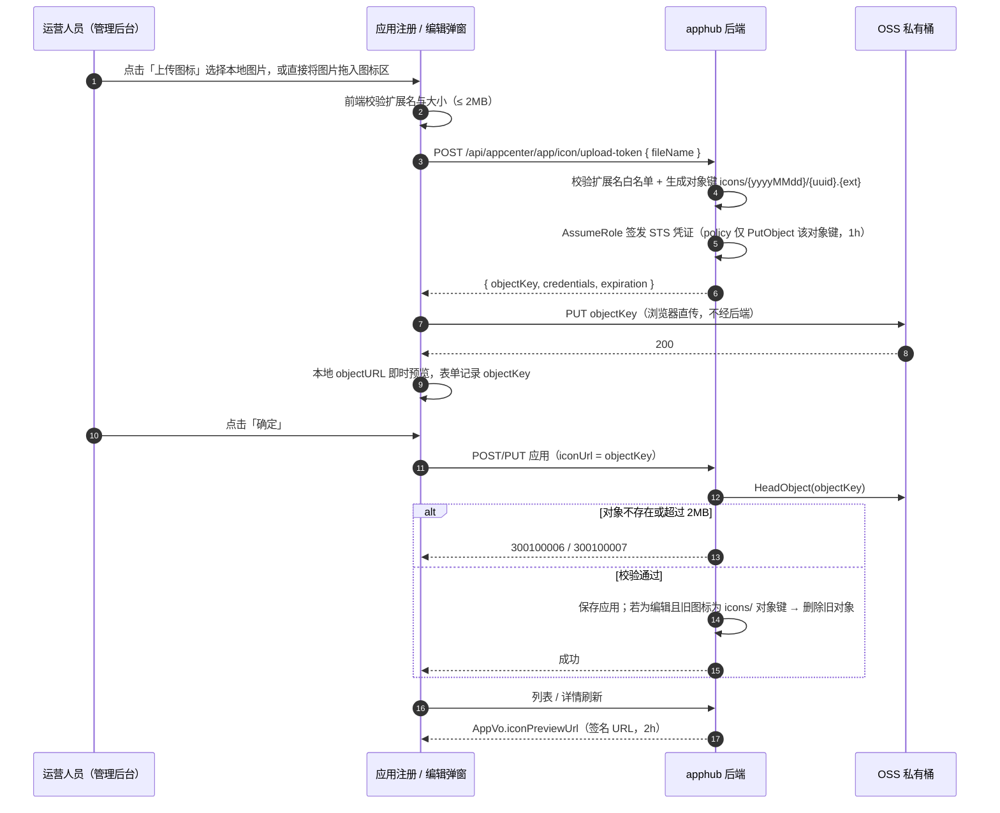

# 应用图标上传设计（appcenter）

> 本文档定义应用图标的「管理端直传 OSS」方案：注册 / 编辑应用时不再手填 OSS 地址，改为选择图片后经 STS 临时凭证直传私有桶，表单自动携带对象键提交。它是 `app.icon_url` 字段的唯一设计依据；应用域其余设计见 [应用与版本管理设计](应用与版本管理设计.md)。

## 1. 背景与目标

应用注册 / 编辑弹窗的「图标地址」当前是一个自由输入框，要求运营人员先自行把图片传到 OSS、再抄写完整地址。这带来三个实际问题：

1. **链路割裂**：运营人员通常没有 OSS 控制台权限，也无法自行生成对象键，填不出合法地址。
2. **无法校验**：手填地址可以指向任意内容，甚至指向桶内其他应用的私有对象；错误地址在列表与表单里表现为「静默不显示」。
3. **与既有方案不一致**：同一域内的安装包早已是「后端签发凭证 → 浏览器 STS 直传 → 回传对象键登记」（[应用与版本管理设计](应用与版本管理设计.md) §2.5 主张 A3），图标却仍是手填。

目标：

- 选择图片即直传，表单自动携带对象键，运营人员全程无需接触 OSS。
- 对象键由后端生成下发，前端不自由拼键；STS policy 收敛到精确对象键。
- 图标可在表单与列表中预览（私有桶经签名 URL 访问）。
- 替换 / 清空图标、删除应用时同步清理 OSS 对象，不遗留孤儿文件。

## 2. 范围与边界

**纳入**：应用图标字段（`app.icon_url`）的上传、预览、保存校验与对象清理。

**同类项排查（2026-10-23）**：对全仓库表单逐项核对「要求用户填写 URL / 路径」的字段，结论如下——本次无需扩大范围：

| 位置 | 现状 | 结论 |
| --- | --- | --- |
| 应用注册 / 编辑 → 图标地址 | 手填 OSS 地址 | **本次改造** |
| 版本下钻 → 安装包 / blockmap | 已是 STS 直传 + 流式哈希 + 登记回调 | 无需改造 |
| 通道新增 / 编辑 | 仅填写通道代码与显示名，placeholder 中的「OSS 对象键」是说明文字 | 无 URL 字段 |
| 会员、订阅、系统管理各表单 | 无文件 / 图片字段 | 无同类项 |

**不纳入**：

- 开放 API 下发应用图标（当前更新检测协议不返回图标，另开需求时再评估）。
- 图标 CDN 加速、多尺寸裁剪、格式转换。
- 历史 `http(s)://` 外部地址的迁移（保持原样可用，见 IC4）。

## 3. 设计决策

| 编号 | 决策 | 理由 |
| --- | --- | --- |
| IC1 | 图标改为**前端直传**：选择文件 → 申请 STS 凭证 → 浏览器直传 OSS → 表单携带对象键 | 与安装包同款链路，复用既有 `ali-oss` 直传能力；管理端不占后端带宽 |
| IC2 | 对象键 **`icons/{yyyyMMdd}/{uuid}.{ext}`**，由后端生成下发 | 注册应用时尚未生成 appKey，不能按应用分目录；日期分目录便于按批次排查与清理 |
| IC3 | 凭证端点 `POST /appcenter/app/icon/upload-token`，权限复用 `app:create` / `app:update`（OR 语义） | 注册与编辑两个场景都要上传，不新增权限点 |
| IC4 | `app.icon_url` 列继续存**对象键**；历史 `http(s)://` 外部地址原样保留 | 不新增列、不迁移数据；私有桶必须签名访问，存完整 URL 反而不可用 |
| IC5 | 应用出参新增 **`iconPreviewUrl`**（后端签发的 2h GET URL），`iconUrl` 保持原值供编辑回填 | 一个字段用于提交、一个用于展示，避免「出参被签名改写成不可回填的地址」 |
| IC6 | 保存时对 `icons/` 前缀值做 **HeadObject 校验**：对象必须存在且 `content-length ≤ 2MB` | RAM policy 无法限制上传体积，STS 直传后由保存动作兜底，防止伪造键与超大文件 |
| IC7 | 替换 / 清空图标、删除应用时**尽力删除旧对象**（失败仅告警不阻断） | 与删包清理 OSS 的既有语义一致；图标体积小，偶发残留可人工清理 |
| IC8 | 仅接受 **png / jpg / jpeg / webp，≤ 2MB** | 不接 SVG（可内嵌脚本，签名 URL 直出浏览器有 XSS 面）；不收 GIF（图标不需要动图） |
| IC9 | 前端**选图或拖拽即上传**（拖入图片与选图共用同一校验 / 直传链路，仅取首个文件），本地 `URL.createObjectURL` 即时预览，上传中 loading，失败可原地重试 | 提交前即可确认图标正确；失败不丢已填表单；拖拽省去「点按钮 → 文件对话框」两步 |
| IC10 | 应用列表在名称前展示 **32px 圆角缩略图**，无图标时显示名称首字占位 | 上传后立刻可见，避免「传了却看不到」的认知断裂 |
| IC11 | 不新增权限点；图标上传与保存各记既有操作日志口径 | 权限粒度不变，应用管理员与超管行为一致 |

## 4. 数据模型

**无新增列**，仅收敛 `app.icon_url` 的取值语义：

| 取值形态 | 来源 | 返回 `iconUrl` | 返回 `iconPreviewUrl` | 清理策略 |
| --- | --- | --- | --- | --- |
| `icons/...`（对象键） | IC2 签发后直传 | 原值 | 后端签名 URL（2h） | 替换 / 清空 / 删除应用时删对象 |
| `http(s)://...`（外部地址） | 历史手填数据 | 原值 | 原样返回 | 不动（无归属对象） |
| 空 | 未设置 | `null` | `null` | — |

## 5. 接口约定

### 5.1 签发图标直传凭证

`POST /api/appcenter/app/icon/upload-token`，权限 `appcenter:app:create` **或** `appcenter:app:update`。

```jsonc
// 请求
{ "fileName": "logo.png" }

// 响应
{
  "region": "oss-cn-hangzhou",
  "bucket": "apphub-private",
  "objectKey": "icons/20261023/6f1c…-…-….png",   // 后端生成，前端原样回传
  "accessKeyId": "STS.…",
  "accessKeySecret": "…",
  "securityToken": "…",
  "expiration": "2026-10-23T11:00:00.000Z"        // 1h
}
```

- `fileName` 扩展名须为 `png / jpg / jpeg / webp`，否则 400 参数校验失败（`图标仅支持 png / jpg / jpeg / webp 格式`）。
- STS policy 收敛为**仅允许 `PutObject` 到该精确对象键**（与安装包凭证同款实现）。
- OSS 未配置或 `STS_ROLE_ARN` 缺失时返回 `300400001`。

### 5.2 应用出参新增预览地址

`AppVo` 在原字段基础上增加：

| 字段 | 类型 | 说明 |
| --- | --- | --- |
| `iconUrl` | `string \| null` | 原值（对象键或历史外部地址），**编辑表单回填与提交用** |
| `iconPreviewUrl` | `string \| null` | 展示用地址：对象键 → 2h 签名 URL；外部地址 → 原样；未设置 → `null` |

列表与详情的逐行签名在服务端本地完成（HMAC 计算，不发网络请求），O(n) 无额外 I/O。

### 5.3 保存入参

`AppCreateDto` / `AppUpdateDto` 的 `iconUrl` 继续接收字符串，语义扩展为「对象键或外部地址」：

- 空 / 缺省 → `null`；
- `icons/` 前缀 → HeadObject 校验存在且 ≤ 2MB，否则 `300100006` / `300100007`；
- `http(s)://` 前缀 → 按历史数据放行，不做对象校验；
- 其他前缀 → 按外部字符串原样保存（前端已不再产生此类值，保留兼容）。

## 6. 交互与时序



## 7. 安全与边界

1. **前端不自由拼键**：对象键与 STS policy 均由后端生成，凭证只对单个精确键有效，无法越权写入其他应用目录或安装包前缀。
2. **保存兜底校验**：RAM policy 不支持限制对象体积，因此「≤ 2MB」由前端即时提示 + 保存时 HeadObject 双重把关；伪造或未完成上传的键在保存时被 `300100006` 拒绝，不会落库。
3. **SVG 排除**：签名 URL 直出 SVG 会让浏览器执行其中脚本（同源风险取决于桶域名），图标场景无矢量刚需，直接排除。
4. **孤儿对象**：用户选择图片后取消弹窗会留下未登记对象。图标体积小且管理端低频，按已知前缀 `icons/` + 日期目录可批量清理；不为此引入上传会话表。
5. **存储未配置降级**：OSS 未配置时上传端点返回 `300400001`；列表的 `iconPreviewUrl` 为 `null`（签名失败被吞掉），应用列表与其余功能不受影响。
6. **预览地址时效**：签名 URL 2h；列表图片由浏览器缓存，长时间停留后过期表现为占位图，刷新页面即重新签发。

## 8. 运维前提

RAM 角色策略需从「仅 `packages/*` PutObject」扩展为「`packages/*` + `icons/*` PutObject」（对象键前缀由 STS session policy 再次收敛到单个精确键，角色策略只做前缀级授权）：

```json
{
  "Version": "1",
  "Statement": [
    {
      "Effect": "Allow",
      "Action": ["oss:PutObject"],
      "Resource": [
        "acs:oss:*:*:<OSS_BUCKET>/packages/*",
        "acs:oss:*:*:<OSS_BUCKET>/icons/*"
      ]
    }
  ]
}
```

未补授权时：安装包上传不受影响，图标直传在 OSS 侧返回 403（前端提示上传失败）。桶侧 CORS 已为管理端配置，无需新增。

## 9. 错误码

| 错误码 | 场景 |
| --- | --- |
| 300100006 | 图标对象不存在（保存时 HeadObject 校验失败——未上传完成或对象键不符） |
| 300100007 | 图标文件超过大小上限（2MB） |
| 300400001 | 存储未配置 / STS 凭证签发失败（沿用既有码） |
| 400（参数校验） | 扩展名不在 png / jpg / jpeg / webp 白名单 |

## 10. 验收标准

1. 注册应用：选择本地图片（或直接拖拽图片到图标区）→ 表单显示预览 → 提交后列表名称前出现该图标；编辑时图标回显，可更换、可移除。
2. 后端：未完成上传的对象键在保存时被 `300100006` 拒绝；超过 2MB 的对象被 `300100007` 拒绝；扩展名不合法的凭证申请返回 400。
3. 编辑替换 / 清空图标、删除应用后，旧 `icons/` 对象被删除（失败仅告警）。
4. 历史手填的外部 `http(s)` 图标地址在列表与表单中仍可见，不被误删。
5. `pnpm check` 全绿；浏览器 e2e 覆盖「选图 → 直传 → 表单携带对象键」与「拖拽图片 → 同一链路直传」两条入口，server e2e 覆盖凭证签发与保存校验。
