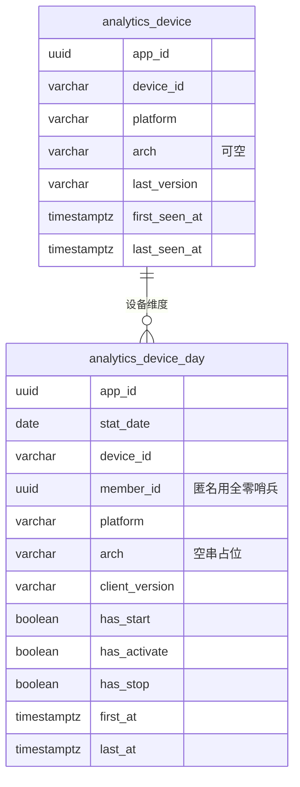
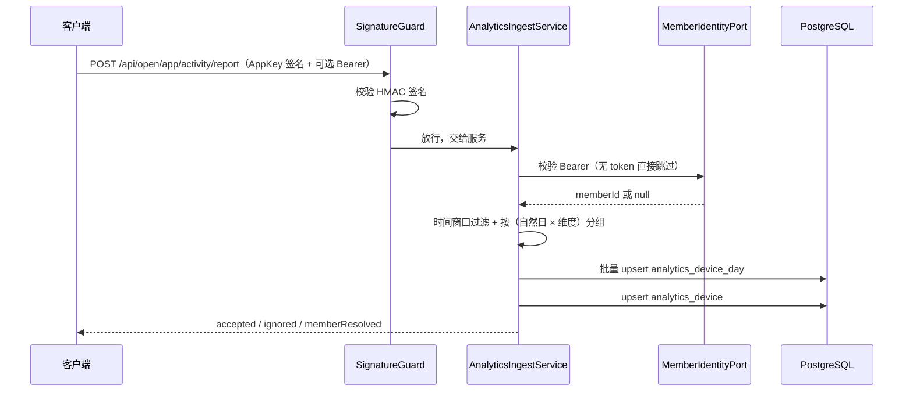
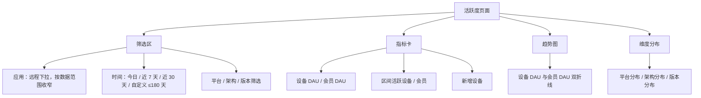

# 应用活跃度统计设计

> 状态：已实施（2026-11-13，M8）；客户端接入见 [应用活跃度接入手册](../接入手册/应用活跃度接入手册.md)
> 关联文档：[应用与版本管理设计](应用与版本管理设计.md)、[统一认证设计](统一认证设计.md)、[工作台设计](工作台设计.md)、[应用管理员与数据范围设计](应用管理员与数据范围设计.md)、[会员应用关系设计](会员应用关系设计.md)、[新模块接入指南](../指南/新模块接入指南.md)

## 1. 背景与目标

平台已具备应用、版本、安装包、终端会员与订阅能力，但没有**应用侧使用数据**：无法回答「有多少人在用」「哪些平台/版本在用」「新增与活跃趋势」。本期新增应用活跃度统计，为运营与应用管理员提供数据支撑。

需求来源（2026-11-13 评审确认）：

- 统计应用活跃度：时间维度 **日活 / 月活 / 自定义区间**；平台维度 **平台（Windows / macOS / Linux 等）、架构（x64 / arm64）、版本**
- 设备与会员**双口径**：设备唯一标识若与现有会员匹配，则同时计入该会员；未注册设备不关联，**注册后的活跃自动归入该会员**
- 安装包下载量统计：**本期不做**（口径另议，见 §12）

### 1.1 评审决策记录

以下决策已于 2026-11-13 经评审确定，后续设计与实现以此为基准：

| # | 决策项 | 结论 |
| --- | --- | --- |
| AD1 | 采集通道 | **新增独立上报接口 + 客户端埋点**，不复用更新检测接口（语义污染：检查更新 ≠ 用户使用，且框架内建更新器 URL 形态固定） |
| AD2 | 下载量统计 | **本期不做**，待口径确定后另行立项；本期不建下载事件模型 |
| AD3 | 活跃事件集合 | **启动 + 窗口激活 + 退出**；不设无条件心跳。窗口激活事件 **1 小时内不重复发送**（客户端节流）；**跨天补偿**——窗口保持激活且本地日期翻篇时补发一条激活事件，避免持续前台使用跨天漏计 |
| AD4 | 匿名→会员归因 | **严格时间切分**：只把「带上会员态之后」的活跃计入会员，匿名期活跃保持匿名；**不建设备-会员绑定表**，上报请求直带会员态 |
| AD5 | 模块归属 | **新建 `analytics` 模块**，错误码领 **007** 段；dashboard 保持「纯只读聚合、不建表」定位 |
| AD6 | 应用管理员权限 | 授予只读权限点，并通过 `AppScopeService` 按数据范围收窄到本应用 |
| AD7 | 存储粒度 | **统计最小粒度为自然日**：同一设备、同一自然日、同一会员键、同一维度组合只保留**一行状态数据**，后续上报只更新该行，不插入新行；**不保留原始事件流**，定时聚合任务取消 |
| AD8 | 活跃信号精简 | **取消心跳**，活跃以「窗口处于激活状态」为准；接受两个已知边界——持续前台使用跨天由补偿事件覆盖，前台挂机仍会被计为活跃（不做系统空闲检测） |

### 1.2 设计主张

| 编号 | 主张 |
| --- | --- |
| AT1 | **日粒度状态行即事实源**：上报直接 upsert「设备-日」行，不落事件明细；统计需要的最小粒度是自然日，事件流是多余精度（AD7） |
| AT2 | 双口径并行：同一行同时承载**设备口径**与**会员口径**，两个数字都出，不互相推导 |
| AT3 | 严格时间切分（AD4）：行的 `member_id` 只由**本次上报请求的会员态**决定，不做设备维度的历史回溯，不事后 UPDATE 其他行 |
| AT4 | 事件时间与接收时间分离：`occurred_at` 决定归属自然日，`received_at` 仅用于风控与延迟观测；客户端时间不可信，超窗事件静默丢弃 |
| AT5 | 日表**冗余维度快照**（平台 / 架构 / 版本），报表查询只扫 analytics 自有表，不跨模块 join |
| AT6 | **upsert 语义即幂等**：`first_at = LEAST(...)`、`last_at = GREATEST(...)`、`has_* = has_* OR ...`，重复上报与离线补报重放结果不变，不依赖事件 ID |
| AT7 | 上报**批量 + 离线重试**：单次 ≤ 50 条，事件时间窗口 7 天，超出窗口丢弃并计数，不让客户端因个别脏数据无限重试 |
| AT8 | 会员态**可选且宽松**：请求可带 Bearer，校验失败按匿名处理（不报错），避免 token 过期阻断埋点 |
| AT9 | 会员口径即「登录态活跃」：未登录使用不计入会员 DAU/MAU，文档与 UI 必须显式标注 |
| AT10 | 日表唯一键包含会员键与维度快照，匿名用全零 UUID 哨兵填充（规避 PG 唯一索引对 NULL 不判等的坑，同 `app_package.arch` 先例） |
| AT11 | 补报直接修正历史日行（`LEAST` / `GREATEST` 保证乱序到达也能收敛），无需重跑聚合 |
| AT12 | 本期**不做**小时级分布与启动次数：状态行不保存单次事件，若未来需要，另建轻量明细表并重新评审 |
| AT13 | 上报限流按 **AppKey + 设备** 维度，不复用现有 AppKey + IP 策略（NAT 后大量设备共享出口 IP 会互相挤占） |
| AT14 | 日表保留 24 个月（可配置），设备表长期保留；无事件明细表，清理任务极轻 |
| AT15 | 本期只做**桌面端**（Electron / Tauri / 自研客户端）；协议对 Web / 移动端通用，但「启动 / 退出」语义需各形态另行定义 |
| AT16 | 活跃信号来自**用户交互**（启动 / 窗口激活 / 退出），不做无条件心跳；窗口激活 1h 节流 + 跨天补偿。前台挂机过滤（系统空闲检测）列为后续增强，本期不做 |

## 2. 指标口径

所有时间区间按 **`Asia/Shanghai`** 自然日计算，与 [工作台设计](工作台设计.md) §6 一致。

| 指标 | 口径 |
| --- | --- |
| 设备 DAU | 某自然日内 **`has_activate = true`** 行的去重设备数（`count(distinct device_id)`）；仅有启动 / 退出、没有窗口激活的不计 |
| 会员 DAU | 某自然日内 `has_activate = true` 且 `member_id` 非空行的去重会员数 |
| 设备 MAU / 区间活跃设备 | 指定区间内 `has_activate = true` 的去重设备数（**不能由日活加总**，读日表的 `distinct device_id`） |
| 会员 MAU / 区间活跃会员 | 指定区间内 `has_activate = true` 且 `member_id` 非空的去重会员数 |
| 新增设备 | 设备**首次出现窗口激活**的日期落在区间内（`analytics_device.first_seen_at`，按 `(app_id, device_id)`） |
| 平台 / 架构 / 版本分布 | 区间内 `has_activate = true` 的行按对应维度分组的去重设备数与去重会员数；版本取行上的 `client_version` 快照 |
| 趋势 | 区间内逐自然日的设备 DAU / 会员 DAU，服务端补齐定长 N 点，缺日补 0 |
| 使用时长（辅助） | 同一 `(设备, 日)` 所有行的 `MIN(first_at)` 到 `MAX(last_at)`；跨会员行 / 维度行合并计算。`last_at` 为最后一次启动 / 窗口激活 / 退出时间，非持续心跳，仅作粗略参考 |
| 区间定义 | 「含今天、共 N 个自然日」，起点为本地 00:00；自定义区间上限 **180 天** |

补充约定：

- **严格切分的直接结果**：会员在注册前的匿名活跃**永远不会**计入任何会员；「注册后自动归类」只对注册之后的活跃生效。这与「设备当前绑定回溯」是互斥的两种口径，本设计选择前者。
- 同一设备一天内既匿名又登录时，日表产生两行（匿名哨兵行 + 会员行）；设备 DAU 仍按 `distinct device_id` 计 1，会员 DAU 计 1。
- 版本升级当天，旧版本与新版本各占一行（维度快照不同）；设备 DAU 去重后仍计 1，版本分布则各自计入当天。
- 一天内多次启动 / 多次切窗**不增加行数**，只更新 `first_at`、`last_at` 与 `has_*` 标记；因此本期给不出「启动次数」指标（AT12）。
- **活跃判定以窗口激活为准**：日表行可能由 `start` / `stop` 创建，但只有 `has_activate = true` 才计入日活 / 区间活跃 / 新增设备。开机自启、托盘常驻等「没有窗口激活」的场景不污染指标。
- 与事件条数无关：当天多次激活仍只算 1 台设备 / 1 位会员。

## 3. 数据模型

两张表，均不继承 `BaseEntity`（聚合产物，无审计与软删语义，先例 `member_login_log`）。

> 实现补充：两表各带一个 `id uuid` 代理主键（TypeORM 需要主键定位行），业务唯一性仍由下方唯一索引保证；`id` 不参与任何口径计算。



### 3.1 `analytics_device_day`（设备-日状态行，唯一事实源）

| 列 | 类型 | 约束 | 说明 |
| --- | --- | --- | --- |
| `app_id` | uuid | NOT NULL | 服务端由签名层 AppKey 解析，不信任客户端自报 |
| `stat_date` | date | NOT NULL | `occurred_at` 在 `Asia/Shanghai` 下的自然日 |
| `device_id` | varchar(64) | NOT NULL | 客户端生成并持久化的随机标识 |
| `member_id` | uuid | NOT NULL | 严格切分：本次请求会员态有效则填，匿名用全零 UUID 哨兵 |
| `platform` | varchar(16) | NOT NULL | 快照，取值同 `PACKAGE_PLATFORM` |
| `arch` | varchar(16) | NOT NULL | 快照，空值用空串 `''` 占位（规避 NULL 唯一性语义） |
| `client_version` | varchar(32) | NOT NULL | 客户端自报版本（semver） |
| `has_start` | boolean | NOT NULL | 当天是否上报过启动（仅窗口可见的启动，不含托盘 / 自启） |
| `has_activate` | boolean | NOT NULL | 当天是否发生过窗口激活（含跨天补偿） |
| `has_stop` | boolean | NOT NULL | 当天是否上报过退出 |
| `first_at` | timestamptz | NOT NULL | 当天该组合最早事件时间 |
| `last_at` | timestamptz | NOT NULL | 当天该组合最晚事件时间 |

索引：

```sql
CREATE UNIQUE INDEX uk_analytics_device_day
  ON analytics_device_day (app_id, stat_date, device_id, member_id, platform, arch, client_version);
CREATE INDEX idx_analytics_device_day_app_date ON analytics_device_day (app_id, stat_date);
CREATE INDEX idx_analytics_device_day_app_member ON analytics_device_day (app_id, member_id, stat_date);
```

**写入语义（幂等）**：

```sql
INSERT INTO analytics_device_day
  (app_id, stat_date, device_id, member_id, platform, arch, client_version,
   has_start, has_activate, has_stop, first_at, last_at)
VALUES ($1, $2, $3, $4, $5, $6, $7, $8, $9, $10, $11, $12)
ON CONFLICT (app_id, stat_date, device_id, member_id, platform, arch, client_version)
DO UPDATE SET
  has_start    = analytics_device_day.has_start    OR EXCLUDED.has_start,
  has_activate = analytics_device_day.has_activate OR EXCLUDED.has_activate,
  has_stop     = analytics_device_day.has_stop     OR EXCLUDED.has_stop,
  first_at     = LEAST(analytics_device_day.first_at, EXCLUDED.first_at),
  last_at      = GREATEST(analytics_device_day.last_at, EXCLUDED.last_at);
```

- 重复上报、乱序补报、同一批内多次激活，结果都收敛到同一行，天然幂等（AT6 / AT11）。
- `first_at` / `last_at` 允许跨天补报修正：7 天窗口内的迟到事件仍会修改对应历史日行。
- 同一天多次启动只保留「发生过」与首末时间，**不保留次数**（AT12）。

### 3.2 `analytics_device`（设备画像）

| 列 | 类型 | 约束 | 说明 |
| --- | --- | --- | --- |
| `app_id` | uuid | NOT NULL | 设备按应用分别建档（同一安装实例装多个应用时各占一行） |
| `device_id` | varchar(64) | NOT NULL | |
| `platform` | varchar(16) | NOT NULL | 最近一次上报值 |
| `arch` | varchar(16) | NULL | 最近一次上报值 |
| `last_version` | varchar(32) | NOT NULL | 最近一次上报版本 |
| `first_seen_at` | timestamptz | NOT NULL | 首次**窗口激活**时间（新增设备口径），首写后不再覆盖 |
| `last_seen_at` | timestamptz | NOT NULL | |

```sql
CREATE UNIQUE INDEX uk_analytics_device ON analytics_device (app_id, device_id);
CREATE INDEX idx_analytics_device_first_seen ON analytics_device (app_id, first_seen_at);
```

写入语义：

```sql
INSERT INTO analytics_device (app_id, device_id, platform, arch, last_version, first_seen_at, last_seen_at)
VALUES (...)
ON CONFLICT (app_id, device_id) DO UPDATE SET
  platform     = EXCLUDED.platform,
  arch         = EXCLUDED.arch,
  last_version = EXCLUDED.last_version,
  last_seen_at = GREATEST(analytics_device.last_seen_at, EXCLUDED.last_seen_at);
```

> 设备表**不记录会员归属**——严格切分下设备与会员没有持久绑定关系，会员只存在于日表行。设备表**只在批次包含 `activate` 事件时维护**（`first_seen_at` 因此语义为首次窗口激活，而非首次上报）；`first_seen_at` 不参与 `DO UPDATE`。

### 3.3 容量与保留

| 表 | 行数估算 | 保留 |
| --- | --- | --- |
| `analytics_device_day` | 设备数 × 每日维度组合数（通常 1~1.3，升级 / 会员切换会多 1 行） | 24 个月（可配置） |
| `analytics_device` | 设备数（按应用分别建档） | 长期，不清理 |

以 1 万设备计：日表约 1.2 万行/天、90 天约 108 万行、24 个月约 876 万行；10 万设备约 8760 万行。**一期不需要分区**；单表超过 **3000 万行**时按 `stat_date` 年分区改造（迁移预留）。窗口激活事件只产生 UPDATE（客户端 1h 节流），索引列不变时可走 HOT 更新，不新增行与索引项。

清理任务：每日删除 `stat_date < 今天 - 24 个月` 的日表行；设备表不清理。无事件明细表，清理量极小。

## 4. 上报接口

### 4.1 端点与鉴权

```text
POST /api/open/app/activity/report
```

- 控制器级 `@UseSignature('app')`：走 M2 已落地的应用级 HMAC（`X-App-Key` + 标准签名头），复用 `AppSecretRegistry`，analytics 不重复实现密钥来源。
- `@Public()`：不走管理端 JWT。
- `@RateLimit`：新增**按设备维度**的策略（`X-Device-Id` 头参与限流键），见 §7.3。
- 会员态：可选 `Authorization: Bearer <access token>`。analytics 经 `MemberIdentityPort` 校验（member 模块启动期注册），**缺失或校验失败一律按匿名处理**，不返回错误（AT8）。

### 4.2 请求契约

```ts
export interface ActivityReportDto {
  /** 设备标识：客户端首次启动生成 UUID 并持久化 */
  deviceId: string
  /** 平台：windows / macos / linux / android / ios / web */
  platform: string
  /** 架构：桌面端必填 */
  arch?: string
  /** 客户端版本（semver） */
  clientVersion: string
  /** 事件批量，单次 1~50 条 */
  events: {
    /** start / activate / stop */
    type: 'start' | 'activate' | 'stop'
    /** 事件发生时间（ISO 8601 带时区） */
    occurredAt: string
  }[]
}
```

> 事件不再需要客户端生成 `eventId`：服务端 upsert 本身幂等（AT6）。若客户端为排障保留本地事件编号，可作为可选字段透传到日志，不落库、不做唯一索引。

响应：

```ts
export interface ActivityReportVo {
  accepted: number   // 被接受并参与 upsert 的事件数
  ignored: number    // 超窗 / 非法被丢弃的事件数
  memberResolved: boolean
}
```

### 4.3 服务端处理流程



规则：

1. **时间窗口**：`occurred_at` 早于 7 天前或晚于服务器时间 5 分钟的事件丢弃（AT4/AT7）；丢弃不报错，避免客户端重试风暴。
2. **批量上限**：单次 50 条，超出由 ValidationPipe 拒绝（`007300002`）。
3. **服务端分组**：同一请求内按 `(stat_date, platform, arch, clientVersion, memberId)` 归并，每个组合只做一次 upsert，避免同批重复写同一行。
4. **应用解析**：`app_id` 一律由签名层的 AppKey 解析；应用停用由签名守卫 / 服务前置校验拒绝。
5. **写入**：日表 upsert 与本批含 `activate` 时的设备表 upsert 同一事务，不阻塞在统计计算上；仅含 `start` / `stop` 的批次不维护设备表。

### 4.4 会员态解析端口

```ts
/** analytics 定义的消费方端口，member 模块在 onModuleInit 注册实现（与 AppLookupPort 同款方向） */
export interface MemberIdentityPort {
  /** 校验会员 access token：有效返回 memberId，无效 / 过期返回 null（不抛错） */
  verifyAccessToken(token: string): Promise<{ memberId: string, appKey: string } | null>
}
```

- 令牌 `appKey` 声明必须与本次请求 AppKey 一致（D19），否则按匿名处理。
- 端口未注册时上报按匿名处理并输出告警日志（不影响可用性）。

## 5. 查询接口

全部挂 `@RequirePermissions('analytics:activity:query')`，只读，不挂 `@OperateLog`。

### 5.1 概览

```text
GET /api/analytics/activity/summary?appId=&startDate=YYYY-MM-DD&endDate=YYYY-MM-DD&platform=&arch=&version=
```

- `appId` 可选：缺省为调用者数据范围内全部应用的合计。
- `platform` / `arch` / `version` 可选：与上报同值域，下推到 SQL 条件（`d.platform = ...` 等）；`version` 为客户端 `clientVersion` 快照。
- `startDate` / `endDate` 必填，区间含首尾，跨度 ≤ 180 天（超出 `007300004`）。
- 数据范围：注入 `app_id IN (授权集合)`；显式传 `appId` 但不在范围内 → 403（`007300005`）。

```ts
export interface ActivitySummaryVo {
  deviceDau: number          // 区间最后一天的设备日活
  memberDau: number          // 区间最后一天的会员日活
  deviceActive: number       // 区间去重设备数（MAU / 自定义区间活跃）
  memberActive: number       // 区间去重会员数
  newDevices: number         // 区间内首次出现的设备数
  trend: { date: string, deviceDau: number, memberDau: number }[]  // 定长 N 点，缺日补 0
}
```

### 5.2 维度分布

```text
GET /api/analytics/activity/distribution?appId=&startDate=&endDate=&dimension=platform|arch|version&platform=&arch=&version=
```

```ts
export interface ActivityDistributionItemVo {
  key: string        // platform 值 / arch 值 / 版本号
  deviceCount: number
  memberCount: number
}
```

- 仅统计 `has_activate = true` 的行，与 §2 日活口径一致；`platform` / `arch` / `version` 筛选同样下推 SQL。
- `version` 维度按字符串排序，前端可按 semver 二次排序。
- 平台 / 架构维度的小值不合并（由前端决定是否归入「其他」）。

### 5.3 查询实现约束

- 全部区间（含今天）只读 `analytics_device_day`，上报即写，无聚合延迟。
- 禁止把整表拉进内存聚合，所有计数下推数据库。
- 数据范围空集（app_admin 未授权任何应用）→ fail-closed 返回 0 / 空数组，不报 500。
- 应用名称、图标通过 `AppLookupRegistry` 批量补齐；已删除应用返回占位名。
- **新增设备口径的筛选差异**：`newDevices` 应用 `platform` / `arch` 筛选，但**不应用** `version` 筛选——设备表只保存最近一次版本，无法还原首次激活时的版本（实现补充）。

## 6. 任务与生命周期

本方案**没有定时聚合任务**（AD7）：日表由上报直接维护，查询即最新。

| 任务 | 频率 | 行为 |
| --- | --- | --- |
| 数据清理 | 每日 03:00 | 删除 `stat_date < 今天 - 24 个月` 的日表行（幂等，重复执行无害） |
| 设备表维护 | 随上报实时 | upsert `last_seen_at` / `platform` / `last_version`，`first_seen_at` 不覆盖 |

实现要点：

1. `setInterval` + `unref()` + `onApplicationShutdown` 清理，沿用 subscription 模块先例。
2. 清理任务无分布式锁需求（`DELETE` 条件幂等，多实例重复执行无副作用）。
3. 异常只记 `Logger.error`（含堆栈），下一周期自动重试。

## 7. 模块接入与横切改动

### 7.1 analytics 模块

按 [新模块接入指南](../指南/新模块接入指南.md) 八步接入：

| 项 | 取值 |
| --- | --- |
| 模块注册名 / 权限前缀 | `analytics:` |
| 表前缀 | `analytics_` |
| 错误码模块段 | **007** |
| 权限点 | `analytics:activity:query`（新增后全局 66 → **67**） |
| 数据范围域 | `APP_SCOPE_DOMAINS` 追加 `analytics` |
| app_admin 预置权限 | 追加 `analytics:activity:query`（21 → **22** 项，迁移插入） |

错误码（`analytics/error-codes.ts`）：

| 码 | 含义 |
| --- | --- |
| 007300001 | 设备标识缺失或格式非法 |
| 007300002 | 单次上报事件数超过 50 条 |
| 007300003 | 上报应用不可用（停用 / 不存在，兜底） |
| 007300004 | 查询区间超过 180 天 |
| 007300005 | 请求的应用不在数据授权范围内（403） |

### 7.2 跨模块端口

| 端口 | 定义方 | 实现方 | 用途 |
| --- | --- | --- | --- |
| `MemberIdentityPort` | analytics | member（onModuleInit 注册） | 可选的会员 token 校验 |
| `AppLookupPort` **扩展** | system（现有） | appcenter（现有） | 新增 `getByAppKey(appKey): AppOptionVo \| null`，供上报解析 appId |

> `AppLookupPort` 目前只有 `assertAppsExist` / `listAppsByIds`（[app-lookup.port.ts](../../server/src/modules/system/app-scope/app-lookup.port.ts)），需新增按 AppKey 反查；该扩展同时被 [会员应用关系设计](会员应用关系设计.md) §4.1 需要，建议一次补齐。

### 7.3 限流组件扩展

现有 `@RateLimit({ appKeyFrom: 'header' | 'path' })` 只支持 AppKey + IP 维度（[rate-limit.guard.ts](../../server/src/common/rate-limit/rate-limit.guard.ts)），默认 60 次/分钟。上报接口需要：

```ts
@RateLimit({ appKeyFrom: 'header', deviceFrom: 'header' })
// 限流键：`${appKey}:${deviceId}`，阈值 120 次/分钟/设备（覆盖离线批量补报；显式阈值不参与公开客户端减半）
```

- 未携带 `X-Device-Id` 时退化为 `unknown` 占位（仍受限）。
- 这是**横切组件变更**，需补齐 `rate-limit.guard.spec.ts` 的分支用例（按 [rules/testing.md](../../rules/testing.md) §3）。

### 7.4 迁移

一条 migration 同时完成：两张表建表 + 索引、`analytics:activity:query` 权限行、`app_admin` 角色权限关联（幂等 `INSERT ... SELECT ... WHERE NOT EXISTS`）。回滚按逆序删除。

## 8. 前端

### 8.1 页面

新增「数据分析 / 活跃度」页面，路由 `/analytics/activity`，`name: 'AnalyticsActivity'`（PascalCase 契约），`meta.permission = 'analytics:activity:query'`。



- 指标卡与趋势区需显式标注「会员口径 = 登录态活跃」。
- 应用筛选复用 `/appcenter/app/options`（按数据范围天然收窄）。
- 表格类明细本期不做，分布用柱状图或简单表格。

### 8.2 图表库

前端目前**没有任何图表库**（工作台 sparkline 为手写 SVG）。活跃度页需要折线图与柱状图，两个选项留在开放问题 Q1：

- 按需引入 ECharts（**已定稿并落地**：`echarts/core` + LineChart / BarChart 按需注册，`ApphubChart` 薄封装负责尺寸自适应）；
- 继续手写 SVG（无新依赖，但交互与多维度组合成本高）。

## 9. 客户端接入约定

| 项 | 约定 |
| --- | --- |
| `deviceId` | 首次启动生成 UUID v4，持久化到应用数据目录；重装会变化（语义为「安装实例」，不是机器指纹） |
| `start` | 主窗口**首次对用户可见**时上报一次；开机自启 / 托盘静默启动**不上报**，直到窗口首次激活 |
| `activate` | 窗口获得焦点时上报；**1 小时内不重复发送**（客户端节流，避免频繁切窗刷量）。冷启动首次可见时同时发送 `start` + `activate` |
| 跨天补偿 | 窗口保持激活、本地日期翻篇时补发一条 `activate`（每天最多一次，不受 1h 节流限制），保证持续前台使用不漏日活（AD3 / AT16） |
| `stop` | 正常退出时上报；强杀 / 崩溃无法保证，不影响日活（当天已有启动或激活事件即可） |
| 离线队列 | 本地最多缓存 200 条，恢复联网后按 ≤ 50 条/批补报；仅保留 7 天内事件 |
| 本地合并（可选优化） | 客户端可在发送前把同一自然日、同一类型的事件合并为一条（只保留首末时间），进一步降低请求量；服务端对两种形态都兼容 |
| 签名 | 与现有开放 API 一致：`X-App-Key` + 标准签名头；公开客户端 Secret 编译进二进制（D17） |
| 会员态 | 已登录时携带 `Authorization: Bearer`；token 过期不阻塞上报，刷新后下一次带新 token |
| 版本 | `clientVersion` 必须是可解析的 semver |
| 登录即活跃 | 客户端登录成功后立即补发一次 `activate`，使会员口径及时生效（服务端不额外耦合） |

接入文档建议在实施时补一份 [docs/接入手册](../接入手册/) 的客户端章节，本文只约定协议。

## 10. 与既有设计的关系

1. **[会员应用关系设计](会员应用关系设计.md) 不复用**：该设计的 `last_login_at` 是登录关系，服务于数据范围与归属；本设计的活跃是使用行为，二者口径不同。严格切分（AD4）下也不需要设备-会员绑定表。该设计仍处于待评审状态，两者互不阻塞。
2. **dashboard 保持只读**：工作台不建表、不做明细查询。后续若要展示活跃度 KPI，由 dashboard 通过 analytics 的查询服务或端口取数，而非直连日表。
3. **数据范围与权限**：analytics 纳入 `APP_SCOPE_DOMAINS` 后，`app_admin` 只读权限按 appId 收窄；平台角色默认全量。
4. **签名与密钥**：完全复用 M2 的应用级 HMAC，不新增密钥体系。

## 11. 测试计划

| 层 | 用例 |
| --- | --- |
| 单测 | 区间换算（含跨月 / 跨年 / 时区边界）；严格切分（匿名行与会员行分离、哨兵值不参与会员计数）；事件时间窗口过滤（7 天前 / 未来 5 分钟）；批量上限；**upsert 幂等**（重复上报行数不变、`first_at` 取更早、`last_at` 取更晚、`has_*` 只增不减）；跨天补偿事件计入正确自然日；跨天补报修正历史行；设备表 `first_seen_at` 不被覆盖 |
| 单测 | **活跃口径**：仅有 `start` / `stop`、无 `activate` 的行不计入 DAU / 区间活跃 / 新增设备；含 `activate` 的批次才维护设备表 |
| 单测 | `RateLimitGuard` 新增设备维度的键生成与退化分支；`MemberIdentityPort` 未注册 / token 无效 / appKey 不一致均返回 null |
| 后端 e2e | 上报：匿名成功、带会员 token 成功、重复请求结果一致（幂等）、超窗丢弃、超批量 400、无效签名 401、限流 429 |
| 后端 e2e | 查询：未登录 401、无权限 403、app_admin 只能看本应用、显式越权 appId → 403、区间超限 400、空数据返回 0 / 空数组 |
| 浏览器 e2e | 页面筛选联动、指标与趋势渲染、无权账号菜单隐藏、自定义区间超限提示 |
| 契约 | 权限点总数断言 66 → 67（两处 e2e 文件）；`app_admin` 预置权限 21 → 22 |

## 12. 风险与不做清单

| 风险 | 处理 |
| --- | --- |
| 客户端改造覆盖慢，指标从 0 爬坡 | 页面标注「数据自上报版本上线起统计」；版本维度天然区分可上报版本 |
| deviceId 可伪造刷量 | 设备维度限流 + 同 IP 海量设备告警；本期不做设备黑名单（见不做清单） |
| 重装导致设备 ID 变化 | 文档指明语义为「安装实例」；新增设备数会含重装设备，属于已知偏差 |
| 激活事件集中上报（如上班高峰） | 客户端 1h 节流 + 随机抖动（建议 ±5 分钟），服务端限流按设备维度 |
| **前台挂机仍计为活跃** | 本期不做系统空闲检测（AD8）；若业务要求「真实在用」，后续接入 Electron / Tauri 的系统 idle API 并补充防御 |
| **无原始事件流，不可精确重算** | 统计只依赖日表状态行，补报可修正 7 天内数据；若某日数据异常，只能依赖客户端补报或接受偏差（AT12） |
| **无法给出启动次数 / 小时级分布** | 本期明确不做；若业务需要，另建轻量明细表重新评审（AT12） |
| 高频 UPDATE 产生死元组 | 单设备激活事件经 1h 节流，热点行压力低；PG 自动 VACUUM，必要时调参 |
| 会员活跃偏低（严格切分 + 未登录不计） | UI 明确口径；如需追溯历史活跃，另立「设备-会员绑定」方案重新评审 |
| 隐私 | 只存客户端随机生成的 deviceId 与业务事件；不采集机器码、文件路径、应用使用内容；不存 IP（无明细表） |

### 12.1 不做清单（本期）

- 安装包下载量 / 下载-安装转化（AD2，口径另议）
- 启动次数、小时级活跃分布、留存、漏斗、使用时长排行、付费转化分析
- 前台挂机过滤（系统空闲检测）——列为后续增强
- 报表导出与定时邮件
- 实时大屏 / 秒级刷新
- 设备黑名单与设备管理后台
- Web / 移动端专属活跃语义（协议通用，接入按需）
- 会员跨应用画像与合并
- 历史数据回填（无可回填数据源）

## 13. 定稿结论（原开放问题）

| 编号 | 问题 | 定稿结论 |
| --- | --- | --- |
| Q1 | 前端图表库引入 ECharts 还是继续手写 SVG | **按需引入 ECharts**，与工作台 sparkline 并存互不影响 |
| Q2 | 日表保留 24 个月是否合适 | **采用 24 个月**；单表超 3000 万行时按年分区 |
| Q3 | 自定义区间上限 | **180 天**；更长区间后续改为按月视图 |
| Q4 | 工作台是否接入活跃度 KPI | **一期不接**，页面稳定后再评估 |
| Q5 | 下载量后续口径 | **本期不做**，由需求方另定口径后另行立项 |
| Q6 | 登录事件是否由服务端写入活跃日表 | **由客户端登录后补发 activate**，服务端不反向依赖 |
| Q7 | 设备 ID 是否跨应用共用 | **客户端 SDK 全局一个 ID**，统计按 `(app_id, device_id)` 分别建档 |
| Q8 | 「启动次数」是否列为本期指标 | **不提供**。接受日粒度方案的副作用，不建明细表；未来若需要，另立设计重新评审 |

## 14. 变更记录

| 日期 | 内容 |
| --- | --- |
| 2026-11-13 | 初版：独立上报协议、双口径、严格时间切分、analytics 模块接入、聚合与保留策略；下载量统计列为不做项 |
| 2026-11-13 | 按评审意见调整粒度：取消事件明细表与定时聚合，改为设备-日状态行实时 upsert；数据量由约 28 万行/天降至约 1.2 万行/天（1 万设备），新增 AD7 / AT12 |
| 2026-11-13 | **定稿**：接受日粒度方案的副作用（不提供启动次数与小时级分布），开放问题 Q1~Q8 全部关闭，进入待实施状态 |
| 2026-11-13 | **定稿后补充 AD8**：取消心跳，活跃信号改为启动 / 窗口激活 / 退出；窗口激活 1h 节流 + 跨天补偿；`has_heartbeat` 改为 `has_activate`；日活以 `has_activate = true` 为准（自启 / 托盘不污染），设备表仅在含 `activate` 的批次维护；前台挂机过滤列为后续增强 |
| 2026-11-13 | **实施（M8）**：analytics 模块落地（上报 / 查询 / 清理 + 权限点 67 项 + `app_admin` 22 项）；查询接口补充 `platform` / `arch` / `version` 可选筛选（下推 SQL）；两表增加 `id` 代理主键；图表按 Q1 按需引入 ECharts；新增[客户端接入手册](../接入手册/应用活跃度接入手册.md) |
