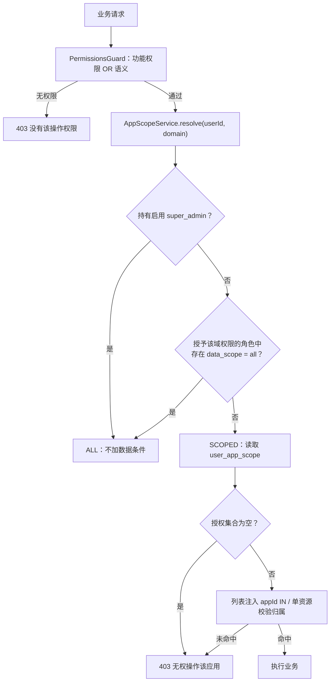
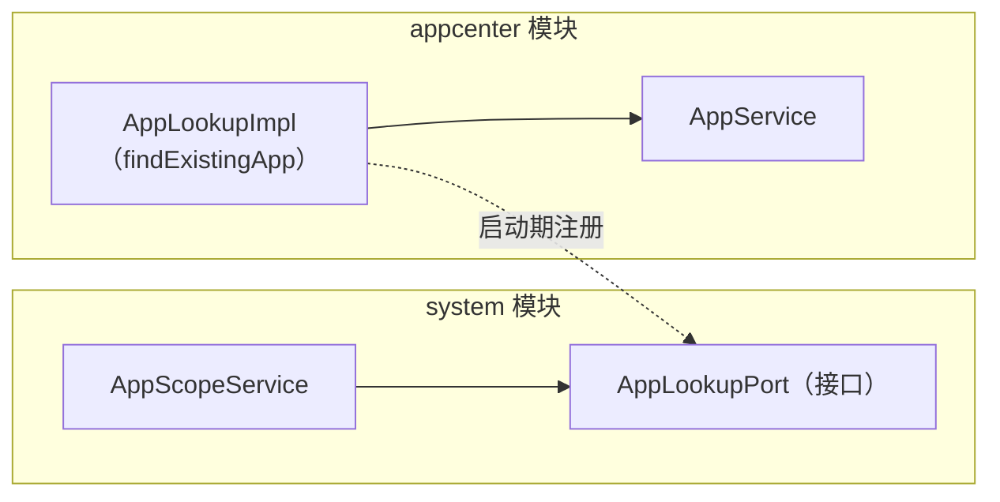

# 应用管理员与数据范围设计

> 本文档定义「应用管理员」角色与应用级数据范围（行级权限）的设计。它是数据范围的唯一设计依据；权限点与角色模型见 [权限设计](../指南/权限设计.md)，应用域见 [应用与版本管理设计](应用与版本管理设计.md)，订阅域见 [订阅与支付设计](订阅与支付设计.md)。

## 1. 背景与目标

平台进入多应用运营阶段后，应用不再只由平台超管维护：每个应用通常有对应的维护人员，或一个代表该应用执行发布、配置订阅的自动化 agent。把这类账户直接授予现有角色会带来两个问题：

1. **功能权限过宽**：无法表达「只能改应用信息、发版本，但不能删应用、不能重置凭证」。
2. **没有数据边界**：只要拿到 `appcenter:*` 权限，就能操作平台上所有应用。

本设计引入**应用级数据范围**：账户持有「应用管理员」角色时，其业务操作被收窄到被授权的应用集合，且该集合在账户级绑定（同一角色可被不同人绑不同应用）。

目标：

- 新增 `app_admin` 角色：维护人员与自动化 agent 的最小可用权限集。
- 账户可绑定一个或多个应用；未授权的应用在列表不可见、直调接口被拒。
- 数据范围与功能权限正交：角色决定「能做什么」，授权决定「对哪些应用做」。
- 与现有逐请求查库的权限语义一致，授权与解除**即时生效**。

## 2. 范围与边界

| 纳入 | 说明 |
| --- | --- |
| appcenter | 应用信息、通道、版本、安装包 |
| subscription | 订阅计划、订单、订阅实例 |

**不纳入**：

- **member 会员域**：会员账号是跨应用的全局身份（`member` / `member_credential` 无 `appId`），按应用隔离只能得到「看得到全部会员」的假隔离，因此不纳入数据范围。
- **system 域**：用户、角色、字典、参数等平台级配置与应用无关，不受数据范围影响。
- **开放 API**：无用户态（AppKey 签名），不受影响。

**明确不做**（应用管理员默认不持有）：

- 新增应用、删除应用、停用/启用应用、重置 AppSecret。
- 平台级配置、用户与角色管理、会员管理。

## 3. 设计决策

| 编号 | 决策 | 理由 |
| --- | --- | --- |
| A1 | 数据范围挂在**角色**上（`data_scope: all / app`），具体应用授权挂在**账户**上 | 角色是权限模板，同一角色必须能被不同人绑不同应用；范围类型决定该角色授予的权限是否收窄 |
| A2 | 一个账户可绑定**多个应用** | 应用—账户多对多，运维人员可同时负责多个应用 |
| A3 | 授权内部存 `appId`，界面以 AppKey / 名称呈现与搜索 | `appId` 是稳定主键；AppKey 创建后不变，仅作展示与检索 |
| A4 | 范围按**域**判定（`appcenter` / `subscription`），只看「授予该域权限的角色」 | 避免一个与业务无关的 `all` 角色意外解除应用限制；域内页面行为一致 |
| A5 | **fail-closed**：角色为 `app` 范围且授权集合为空时，拒绝该域全部操作 | 漏配授权只会「看不到」，不会退化为全量 |
| A6 | `super_admin` 不受数据范围限制 | 平台超管职责是跨应用管理，沿用现有全集语义 |
| A7 | 预置 `app_admin` 为**普通角色**（可改名、改权限、删除），不作为内置保护角色 | 运营策略会调整，不必为改权限而改代码；内置保护只留给 `super_admin` |
| A8 | 删除版本/包允许；新增/删除/停用应用、重置 AppSecret 不允许 | 发布运维是应用方日常职责；影响全体客户端或凭证的操作保留给平台 |
| A9 | 应用启停拆为独立权限点 `appcenter:app:toggle-status` | 现有 `app:update` 同时承载「编辑元数据」与「启停」，无法表达 A8 |
| A10 | 应用授权使用独立接口 + 独立权限点 `system:user:assign-app-scope` | 授权是敏感操作，单独授权、单独记操作日志，不与修改用户混在一个请求里 |
| A11 | 越权访问返回 **403 + 专用错误码** | 语义准确、便于运维排障；与现有 403 权限语义一致 |
| A12 | 范围逐请求现查库，不缓存、不写入 JWT | 与现有权限判定同款语义，变更即时生效 |
| A13 | 自动化 agent 本期沿用账号密码登录（8h token） | 先把范围隔离做扎实；长期 API Token 另开一期 |
| A14 | 订阅域为**全量管理**（计划增删改上下架、订单备案与关闭、实例查询） | 应用方自主运营定价与订单 |
| A15 | 授权表与角色生命周期解耦 | 用户失去 `app` 范围角色后授权行自动失效（判定时不会读取），保留供重新分配 |

## 4. 数据模型

### 4.1 角色增加数据范围

`system_roles` 新增列：

| 列 | 类型 | 说明 |
| --- | --- | --- |
| `data_scope` | `varchar(16) NOT NULL DEFAULT 'all'` | `all` 全局 / `app` 按应用收窄 |

- 存量角色迁移后一律 `all`，行为不变。
- `app_admin` 种子角色为 `app`。
- 写入侧校验枚举值；`super_admin` 的内置保护已禁止更新，无需额外特判。
- 数据范围只对**应用维度模块**（appcenter / subscription）生效，system 域不受影响。

### 4.2 账户-应用授权表

新增 `system_user_app_scope`：

| 列 | 类型 | 说明 |
| --- | --- | --- |
| `id` | uuid 主键 | |
| `user_id` | uuid | 逻辑外键 → `system_users.id` |
| `app_id` | uuid | 逻辑外键 → `app.id` |
| `created_at` | timestamptz | 绑定时间 |

- 唯一索引 `(user_id, app_id)`。
- **纯关联值对象，不继承 `BaseEntity`，物理删除**（与 `system_user_role` 同一约定，差集增量写入）。
- 应用软删后不改授权行：查询时以 `app` 表为准过滤，授权自然失效；重建应用是新 uuid，不会误继承。

### 4.3 种子角色

迁移创建普通角色：

| 字段 | 值 |
| --- | --- |
| `name` | 应用管理员 |
| `code` | `app_admin` |
| `data_scope` | `app` |
| `status` | 启用 |
| `remark` | 预置角色：仅能操作被授权的应用 |

权限行（20 项）：

| 域 | 权限点 |
| --- | --- |
| 应用 | `appcenter:app:query`、`appcenter:app:update` |
| 通道 | `appcenter:channel:query` / `create` / `update` / `remove` |
| 版本 | `appcenter:version:query` / `create` / `update` / `remove` / `publish` / `offline` |
| 订阅 | `subscription:plan:query` / `create` / `update` / `remove` |
| 订阅 | `subscription:order:query` / `offline-create` / `close` |
| 订阅 | `subscription:sub:query` |

> 安装包接口复用 `version:query` / `version:update`，无需独立权限点。

## 5. 范围判定

### 5.1 算法

```
resolve(userId, domain)   // domain ∈ { appcenter, subscription }
  1. roles ← 用户「启用」角色（停用角色不参与）
  2. 若任一 role.code = super_admin              → ALL
  3. G ← roles 中「权限行包含 domain 任一权限点」的角色
  4. 若 G 为空                                   → NOT_GRANTED
  5. 若 G 中存在 data_scope = all                → ALL
  6. 否则                                        → SCOPED(user_app_scope 中该 userId 的 appId 集合)
```

判定要点：

- **第 3 步是核心**：范围跟着「授予该域权限的角色」走。只有 system 权限的 `all` 角色不会解除应用限制；显式授予了 `all` 范围且含业务权限的角色才代表全量授权。
- `NOT_GRANTED` 属防御分支：正常请求已被 `PermissionsGuard` 以 403 拦截，不会走到范围判定。
- `SCOPED` 且集合为空（第 6 步）→ 该域所有业务操作均拒绝（A5）。

### 5.2 判定流程



### 5.3 与功能权限的关系

两层判定严格分离：

| 层 | 问题 | 实现 |
| --- | --- | --- |
| 功能权限 | 这个人能不能做这类操作 | `@RequirePermissions` + 全局 Guard |
| 数据范围 | 这个人能对哪些应用做 | Controller 传入 `@CurrentUser().id`，Service 调 `AppScopeService` |

范围判定**不能替代**功能权限：没有 `version:publish` 的人，即使被授权了应用也发不了版本。

## 6. 权限点变更

| 权限点 | 变化 | 说明 |
| --- | --- | --- |
| `appcenter:app:toggle-status` | 新增 | 应用启用/停用；`PUT /appcenter/app/:id/status` 从 `app:update` 改挂此点 |
| `system:user:assign-app-scope` | 新增 | 分配应用授权 |

现行 63 项 → **65 项**。新增点在模块自己的 `permissions.ts` 登记（appcenter / system），启动期注册表校验不变。

## 7. 接口设计

### 7.1 应用授权

| 方法 | 路径 | 权限点 | 说明 |
| --- | --- | --- | --- |
| GET | `/system/user/:id/app-scope` | `system:user:assign-app-scope` | 回显 `{ appIds, apps: [{ id, appKey, name }] }`，仅返回未软删的应用 |
| PUT | `/system/user/:id/app-scope` | `system:user:assign-app-scope` | body `{ appIds: string[] }`，**全集差集增量**（物理删除多余行、插入新增行） |

写入校验：

1. 目标用户存在；
2. `appIds` 去重；
3. 每个 `appId` 对应应用存在且未软删，否则抛 `APP_NOT_EXISTS`；
4. `@OperateLog` 记录授权前后差异。

授权与角色解耦：允许给未持有 `app` 范围角色的用户预先授权（A15），该授权在用户获得 `app` 范围角色后才生效。

### 7.2 应用下拉

| 方法 | 路径 | 权限点 | 说明 |
| --- | --- | --- | --- |
| GET | `/appcenter/app/options` | `appcenter:app:query` | 当前用户可管理的应用精简列表（`id / appKey / name`），按 `appcenter` 域范围过滤；可选 `keyword` 同时匹配名称与 AppKey（授权弹窗远程搜索用） |

用于授权弹窗与订阅页应用筛选。只持有订阅权限、没有 `appcenter:app:query` 的纯订阅角色不显示应用下拉（这是边缘场景，后续如出现再扩展）。

### 7.3 appcenter 收口点

| 接口 | 收口方式 |
| --- | --- |
| `GET /appcenter/app`（列表） | `SCOPED` 时注入 `id IN (appIds)`；空集合返回空页 |
| `GET /appcenter/app/:id`、`PUT /:id`、`PUT /:id/secret`、`DELETE /:id` | 先按 id 查应用，不存在 404；存在但不在范围 → 403 |
| `PUT /appcenter/app/:id/status` | 同上，权限点改为 `app:toggle-status` |
| `/appcenter/app/:id/channel/*` | 路径 `:id` 即 appId，先 assert |
| `/appcenter/app/:id/version/*` | 同上 |
| `/appcenter/version/:id`（更新 / 删除 / 发布 / 下线） | 按 versionId 查版本取 `appId`，再 assert |
| `/appcenter/version/:id/package/*` | 同上（含 `upload-token` 与删除） |

> 包实体没有 `appId`，只能经 `versionId → app_version.appId` 反查。

### 7.4 subscription 收口点

| 接口 | 收口方式 |
| --- | --- |
| `GET /subscription/plan` | `SCOPED` 时注入 `appId IN`；请求显式传入未授权 `appId` → 403 |
| `POST /subscription/plan` | 校验 body `appId` 在范围内 |
| `PUT/DELETE /subscription/plan/:id` | 按 id 查计划取 `appId` 再 assert |
| `GET /subscription/order` | 同计划列表 |
| `POST /subscription/order/offline` | 按 body `planId` 查计划取 `appId` 再 assert（订单 appId 由计划带出） |
| `POST /subscription/order/:id/close` | 按 id 查订单取 `appId` |
| `GET /subscription/sub` | 同计划列表 |

开放 API（`/api/open/**`）与支付回调不涉及。

### 7.5 错误码

| 错误码 | 含义 |
| --- | --- |
| `300100005` | 无权操作该应用（`APP_SCOPE_FORBIDDEN`） |

- 单资源越权、列表显式查询未授权应用统一使用该码。
- 应用不存在仍用 `300100001`。

## 8. 前端设计

| 页面 | 变更 |
| --- | --- |
| 角色管理 | 新增/编辑弹窗增加「数据范围」下拉（全部应用 / 按应用）；列表增加一列；`super_admin` 行保持禁用 |
| 用户管理 | 操作列增加「应用授权」按钮（`v-hasPermi="system:user:assign-app-scope"`）；弹窗远程搜索 AppKey / 名称多选，回显已授权应用 |
| 应用管理 | 无 `app:create` 时不渲染新增按钮（现有 `v-hasPermi` 即可）；列表由后端收窄；直改 URL 访问未授权应用时由 403 提示承接 |
| 订阅三页 | 应用筛选下拉改用 `/appcenter/app/options`，天然只含授权应用 |
| 全局 | 403 专用码展示后端错误文案「无权操作该应用」 |

前端不做数据范围的本地计算，一切以后端收窄结果为准（与「后端是唯一安全边界」一致）。

## 9. 跨模块依赖

`AppScopeService` 位于 system 模块（角色、用户、授权表都在 system），`@Global` 或显式导出给 appcenter / subscription 注入——业务模块依赖 system 的现有方向不变。

授权接口需要校验应用存在性，但 **system 不能静态依赖 appcenter**（appcenter 已在依赖 system 的权限注册表）。采用**端口注册**：



- system 定义端口与注入 token，`@Optional()` 注入（模块装配顺序无关）。
- appcenter 在 `onModuleInit` 注册实现（与 `AppSecretRegistry` 同款方向）。
- 授权接口在端口缺失时抛启动期/运行期明确错误，避免静默放行无效 appId。

## 10. 迁移与兼容

| 步骤 | 内容 |
| --- | --- |
| 1 | `system_roles` 加 `data_scope`，默认 `all` |
| 2 | 建 `system_user_app_scope` 表与唯一索引 |
| 3 | 插入 `app_admin` 种子角色与 20 条权限行 |
| 4 | 无数据回填：存量角色全 `all`、存量用户无授权行，行为不变 |

- 迁移是唯一建表通道（ADR-005），本地与生产一致。
- 新增表纳入 `autoLoadEntities`（业务模块 `forFeature` 注册即可）。
- 回滚：删除种子角色与关联行、删表、删列（`migration:revert`）。

## 11. 安全分析

| 风险 | 对策 |
| --- | --- |
| 漏配授权退化为全量 | 范围判定 fail-closed（A5），空集合拒绝全部 |
| 用无关 `all` 角色绕过 | 只认「授予该域权限的角色」（A4） |
| 直调未授权应用接口 | 每个接口服务层 assert，前端不参与安全边界 |
| 通过子资源绕过 | version / package / plan / order / sub 一律反查 `appId` 后判定 |
| STS 直传凭证越权签发 | `upload-token` 同样校验版本归属 |
| 授权残留 | 判定时以 `app` 表现存未删行为准；授权行不产生权限 |
| 授权变更延迟 | 逐请求现查库，即时生效 |
| 越权探测 | 返回专用 403 错误码；不返回未授权资源内容 |

## 12. 测试策略

按 [测试规则](../../rules/testing.md) 风险分级：

**单元测试（重点）**

- `AppScopeService.resolve` 全分支：超管、全 `all`、混合角色、`SCOPED`、空集合、停用角色剔除、无授权域角色。
- 列表条件构造：`ALL` 不加条件、`SCOPED` 注入集合、空集合返回空页。
- 单资源 assert：归属命中 / 未命中 403 / 资源不存在 404。
- 授权差集写入：新增、删除、无变化、重复 appId 去重、不存在应用拒绝。
- 权限点注册表：新增两项全局唯一与首段校验（现有契约测试覆盖）。

**后端 e2e**

- 授权接口读写回显 → `app_admin` 登录 → 应用列表只含授权应用。
- 直连未授权应用 / 版本 / 订阅计划 → 403 专用码。
- `super_admin` 不受限。
- 停用角色后范围即时失效。

**浏览器 e2e**

- 管理员在用户管理页授权两个应用 → 以该账户登录 → 应用管理页只显示两个应用、无新增按钮；订阅页应用筛选项一致。

## 13. 变更记录

| 日期 | 内容 |
| --- | --- |
| 2026-10-23 | 初版：应用管理员角色（A1~A15）、角色数据范围、账户级应用授权、appcenter + subscription 收口、启停权限拆分、授权独立接口 |
