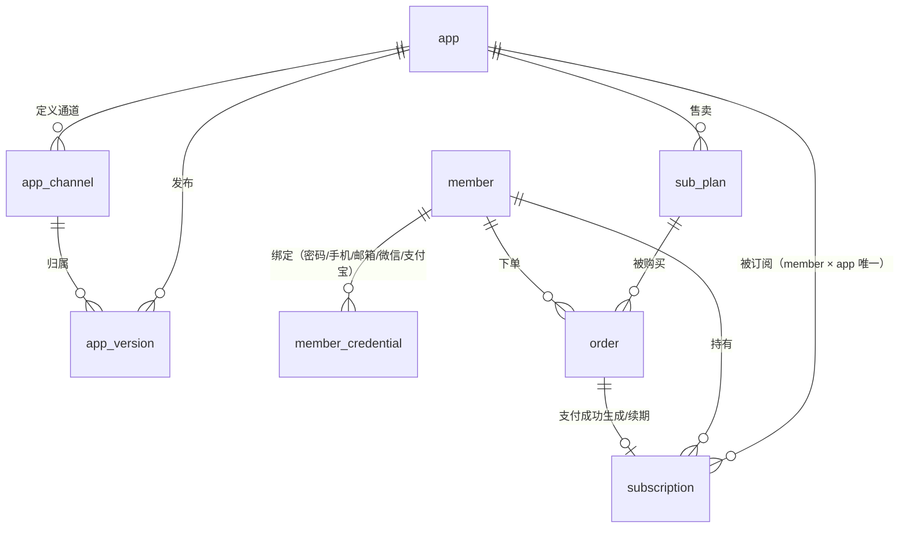
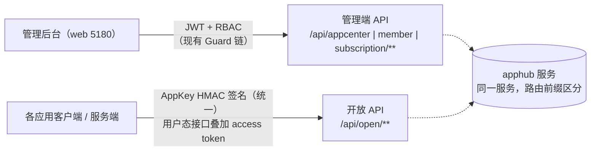

# 应用管理平台总体设计

> 本文是应用管理平台（apphub）业务层的总体设计：领域划分、核心模型概览、模块结构、接口分层与分期计划。
> 三份分域详细设计（应用与版本管理 / 统一认证 / 订阅与支付）在本文评审定稿后展开。
>
> 关联文档：[架构设计](../架构设计.md)（底座工程架构）、[权限设计](../指南/权限设计.md)（管理端 RBAC）、[请求签名验证设计](../指南/请求签名验证设计.md)（HMAC 签名算法）

## 1. 背景与目标

apphub 是面向自有应用群的**应用管理平台**，为多个应用（跨平台桌面端 / Web / 移动 App）提供三项核心能力：

1. **多应用更新检测**：应用版本登记、多通道发布、安装包分发与客户端更新检测协议
2. **用户统一认证授权**：终端用户账号中心，四种登录方式与账户绑定合并，应用经开放 API 完成用户认证与授权校验
3. **订阅管理**：单应用订阅售卖，在线支付（微信扫码 / 支付宝当面付）与线下备案双通道，订阅全生命周期管理

平台服务两类角色：**运营人员**（使用管理后台，走底座现有 system 域 RBAC）与**终端用户**（在各应用内交互，经开放 API 使用平台能力）。首期平台前端仅含管理后台。

## 2. 评审决策记录

以下决策已于 2026-10-16 经评审确定，后续设计文档与实现均以此为基准；如需变更，先更新本表再动代码（文档先行）。

| # | 决策项 | 结论 |
| --- | --- | --- |
| D1 | 应用形态 | 跨平台桌面端 + Web 应用 + 移动 App 三形态；iOS 受 App Store 政策限制首期仅做版本登记与检测提示，不分发安装包 |
| D2 | 认证对象 | 终端用户账号中心（各应用的用户统一到平台注册 / 登录） |
| D3 | 支付通道 | 在线支付 + 线下支付并行：微信扫码、支付宝当面付、线下收款后台备案 |
| D4 | 用户体系 | 终端用户与管理后台用户两套分域，独立建模互不干扰 |
| D5 | 登录方式 | 最终形态四种并存：账号密码、手机验证码、邮箱验证、微信 / 支付宝扫码；新用户支持与已有账户绑定合并（一个用户多凭证） |
| D6 | 应用接入形态 | 应用自建登录 UI，直连平台开放 API 获取令牌 |
| D7 | 令牌校验 | 平台在线校验接口（应用持终端用户 token 换取身份与订阅状态；禁用 / 退订即时生效） |
| D8 | 订阅粒度 | 单应用订阅（每应用自定义订阅计划，不支持套餐与功能档位） |
| D9 | 更新能力 | 多更新通道（稳定 / 测试 / 内测等，通道由应用自定义）+ 强制更新标记；不做灰度发布 |
| D10 | 安装包存储 | 阿里云 OSS 对象存储，下载走 OSS 直链 |
| D11 | 增量更新 | 首期仅全量包，差分更新待版本体量成为瓶颈后再评估 |
| D12 | 注册策略 | 终端用户开放注册（密码 / 手机 / 邮箱任一方式自助注册） |
| D13 | 到期语义 | 订阅到期即失效，无宽限期；到期后的产品表现（阻断 / 降级）由各应用自行决定，平台只给出权威状态 |
| D14 | 前端范围 | 首期仅管理后台；终端用户自助门户（查订阅 / 续费 / 下载）不在首期范围 |
| D15 | 开放 API 鉴权 | 应用持 AppKey / AppSecret 走 HMAC-SHA256 签名（复用底座签名算法与头契约，新增应用级密钥源） |
| D16 | 登录方式落地顺序 | 密码方式首期落地；手机验证码、邮箱验证、微信 / 支付宝扫码依赖第三方资质与通道，按依赖就绪情况分阶段接入（见 §6 分期） |
| D17 | 用户态接口调用通道 | 双通道均走 AppKey HMAC 签名，鉴权模型统一：**机密客户端**（应用后端代理，Secret 存服务端环境）与**公开客户端**（桌面 / 移动客户端直连，Secret 编译进二进制——Rust / Node 机器码分发提高逆向门槛）都做签名 + 时间戳 + nonce 防重放；公开客户端接受「防小白不防专家」的现实，Secret 泄露后靠后台轮换凭证 + 发布新版应用兜底（可与 D9 强制更新配合）。应用注册时仍登记调用方类型，作为风控差异化依据（公开客户端的 Secret 暴露风险高，优先监控与轮换提醒），不再影响鉴权分支 |
| D18 | 终端用户令牌策略 | 双令牌：短效 access token + 长效 refresh token 换发（标准 OAuth2 体验，支持轮换与吊销）；access token 校验时仍逐请求查库，禁用 / 改密 / 登出即时生效 |
| D19 | 终端令牌作用域 | 绑定应用：token 签发时绑定 appKey，只在签发应用内有效，各应用独立登录态（不做跨应用 SSO） |
| D20 | 续费模型 | 单实例顺延：订阅实例 = 会员 × 应用一条记录，续费在原实例上顺延到期时间；永久买断是实例的一种周期形态 |
| D21 | 退款支持 | 首期不支持退款 / 退订，订单支付即终态；后续需要时再扩展 |
| D22 | Secret 轮换失效 | 重置后旧 Secret 立即失效，老版本客户端鉴权失败，配合强制更新完成切换（不做新旧并行过渡） |
| D23 | 更新检测豁免签名 | `POST /api/open/app/version/check` 豁免 HMAC 签名（开放 API 唯一例外）：仅校验 AppKey 有效性（路由 / 统计用途）+ 限流，下载走短时效 OSS 签名 URL；保证 Secret 轮换后旧客户端「检查更新 → 自我更新」闭环不断，轮换可随时执行无需发版铺垫 |
| D24 | 框架内建更新器兼容 | **双协议适配端点**：平台动态渲染 electron-updater 的 `latest*.yml` 与 tauri-plugin-updater 的 JSON manifest（`GET /api/update/**`），桌面应用用框架内建更新器**零适配**接入（Electron 差分下载白拿）；同 D23 逻辑豁免签名（内建更新器无法携带 HMAC 头，AppKey 在 URL 路径）。自研 `POST version/check` 保留（Android / 自定义客户端）。强制更新标记单一事实源 `app_version.force_update`，两种渲染：自研协议 `forceUpdate` 字段 / 框架 manifest 的 notes 首行 `[force]` 约定标记（应用在更新回调解析并阻断，应用侧展示说明前剔除标记行） |

## 3. 领域模型总览

核心实体关系（详细字段与约束见各分域设计）：

要点：

- **应用（app）**：平台管理的基本单元，持有 AppKey / AppSecret（开放 API 调用凭证；公开客户端将 Secret 编译进二进制，泄露后轮换，D17），登记形态（桌面 / Web / 移动）、调用方类型（机密 / 公开，风控差异化依据）与图标、描述等元数据
- **应用版本（app_version）**：按「应用 × 通道 × 平台」组合发布；桌面端与 Android 挂安装包（OSS 地址），Web 版本仅登记与提示，iOS 仅登记
- **终端用户（member）**：与 system 域管理用户完全分域；自身只承载昵称 / 状态等身份信息，登录能力全部落在凭证表
- **用户凭证（member_credential）**：一条凭证一种登录方式（密码 / 手机 / 邮箱 / 微信 openid / 支付宝 user_id），绑定合并 = 向已有 member 追加凭证
- **订阅计划（sub_plan）**：应用定义的售卖单元（周期类型 + 价格；周期含月 / 季 / 年 / 永久买断，由计划自由组合）
- **订单（order）**：支付的凭据，三渠道统一状态机；线下备案是渠道之一（后台录入收款凭证后生成已支付订单）
- **订阅实例（subscription）**：用户在某应用的有效订阅区间（生效期 ~ 到期期），到期即失效（D13）；续费在原实例上顺延或生成新区间，细则见订阅分域设计

## 4. 模块划分

后端新增三个业务模块（照底座 `modules/demo` 八步接入清单落地，权限点 / 错误码分段各自登记）：

| 模块 | 职责 | 错误码分段 | 权限点首段 |
| --- | --- | --- | --- |
| `modules/appcenter` | 应用注册与凭证管理、版本发布与通道管理、安装包上传（OSS）、更新检测开放 API | 003 | `appcenter:*` |
| `modules/member` | 终端用户账号、多凭证登录、绑定合并、令牌签发与在线校验开放 API | 004 | `member:*` |
| `modules/subscription` | 订阅计划、订单（三渠道支付 + 线下备案）、订阅实例生命周期、订阅状态校验开放 API | 005 | `subscription:*` |

前端（管理后台）新增对应页面组：应用管理（应用 / 版本 / 通道）、终端用户管理（用户 / 凭证）、订阅管理（计划 / 订单 / 订阅实例），全部挂 RBAC 权限点。

### 与底座的复用关系

| 底座能力 | 复用方式 |
| --- | --- |
| RBAC（Guard 链 / 权限点注册表） | 管理后台新页面照常挂 `@RequirePermissions`；开放 API 不走 JWT，走 AppKey 签名 |
| HMAC 签名 Guard | 算法与头契约（`X-App-Key` / `X-Timestamp` / `X-Nonce` / `X-Signature` 等按分域设计细化）复用，密钥源从「全局单密钥」扩展为「按应用 AppSecret 查表」 |
| BaseEntity / 审计 / 软删 | 新域实体一律继承 |
| 迁移体系（唯一建表通道） | 全部新表走 migration |
| 九位错误码 | 003 / 004 / 005 分段登记 |
| 统一响应结构 | 管理端与开放 API 共用 `{ code, message, data }` 契约 |

## 5. 接口分层

平台对外两类 API 入口，物理上同一服务、路由前缀区分：

- **管理端 API**：运营人员使用，走现有 `签名 → JWT → 权限` Guard 链，无新机制
- **开放 API**：应用侧使用，**统一 AppKey HMAC 签名**（时间戳 + nonce 防重放，复用底座机制），双通道均适用（D17）；例外：更新检测类接口豁免签名（D23 救生通道 / D24 框架适配端点——内建更新器只能发普通 GET，无法携带 HMAC 头）：
  - **机密客户端**（应用后端代理）：Secret 存服务端环境，签名 + 用户态接口携 `Authorization: Bearer <access token>` 标识操作会员（双层身份：谁的应用 × 谁的用户）
  - **公开客户端**（桌面 / 移动客户端直连）：Secret 编译进二进制（Rust / Node 机器码），同样做签名；应用注册时登记调用方类型作为风控差异化依据（公开客户端优先监控、及时轮换）
  - 令牌体系（D18）：access token 短效（**8h**，与 system 域管理端令牌时效一致）+ refresh token 长效（建议 30d，支持轮换与吊销）；member 域令牌与管理端 JWT **同构不同域**（独立签发密钥与声明），两个信任域不可串用

开放 API 首期清单（详细契约见各分域设计）：

| 接口 | 域 | 说明 |
| --- | --- | --- |
| `POST /api/open/app/version/check` | appcenter | 更新检测：应用 + 通道 + 平台 + 当前版本号 → 是否有新版本 / 下载地址 / 强制标记 |
| `GET /api/update/{appKey}/{channel}/electron/{latest*.yml}` | appcenter | electron-updater 适配端点：动态渲染 latest.yml / latest-mac.yml / latest-linux.yml（D24，豁免签名） |
| `GET /api/update/{appKey}/{channel}/tauri/{target}/{currentVersion}` | appcenter | tauri-plugin-updater 适配端点：动态渲染 JSON manifest，无更新返回 204（D24，豁免签名） |
| `POST /api/open/member/auth/login` | member | 终端用户登录（应用自建 UI 提交凭证）→ access token + refresh token |
| `POST /api/open/member/auth/refresh` | member | 刷新令牌：refresh token → 新 access token（可轮换） |
| `POST /api/open/member/auth/register` | member | 终端用户注册 |
| `POST /api/open/member/auth/bind` | member | 已登录用户绑定新凭证（绑定合并） |
| `GET /api/open/member/token/introspect` | member | 令牌在线校验：token → 用户身份 + 各应用订阅状态（D7，认证与订阅校验合一） |
| `POST /api/open/subscription/order/create` | subscription | 应用侧发起下单（在线支付渠道返回支付二维码） |
| `POST /api/open/subscription/order/query` | subscription | 订单状态查询（支付回调异步，应用轮询） |

## 6. 分期计划

按「依赖就绪程度」与「价值优先级」排序，每期独立可交付：

| 期 | 内容 | 前置依赖 |
| --- | --- | --- |
| M1 应用与版本管理 | appcenter 模块全量：应用注册 / AppKey 凭证、版本发布 / 通道 / 强制更新、OSS 包管理（STS 直传）、更新检测开放 API、框架内建更新器适配端点（D24）、管理后台页面 | OSS 桶 + AccessKey + RAM 角色（STS 直传，需开通并配置桶 CORS） |
| M2 终端认证（密码先行） | member 模块核心：账号模型 / 凭证表、密码注册登录、令牌签发与在线校验、开放 API 签名扩展（应用级密钥源）、管理后台用户页 | 无外部依赖 |
| M3 订阅与支付（备案先行） | subscription 模块：计划 / 订单 / 订阅实例、线下备案流程、订阅校验并入 introspect、管理后台页面 | M2 |
| M4 认证方式扩展 | 手机验证码（短信服务商）、邮箱验证（SMTP）、微信 / 支付宝扫码登录（开放平台资质）——三种方式逐个接入，凭证表结构 M2 已就绪 | 短信 / 邮件 / 开放平台资质 |
| M5 在线支付 | 微信 Native 扫码、支付宝当面付、支付回调与订单自动完成 | 商户号与密钥配置 |

> M2 的开放 API 签名扩展（应用级密钥源）原为 M1 更新检测接口的前置；**M1 实际交付时按 D23 / D24 将更新检测类接口（自研 `version/check` 与 `update/**` 适配端点）全部豁免签名**（仅校验 AppKey 有效性 + 限流），应用级 HMAC 密钥源扩展（D17 双通道统一签名）整体留待 M2 随 member 模块落地，届时再评估是否收紧豁免范围。实现顺序上建议 M1、M2 同期启动，本文按域拆期仅为范围视图。
>
> **M1 已交付（2026-10-16）**：appcenter 模块全量（应用 / 通道 / 版本 / 包四域 + 更新检测开放 API + electron / tauri 适配端点）、OSS STS 直传、管理后台应用与版本页面、AppKey 限流（common 横切组件）。

## 7. 风险与约束

1. **第三方资质依赖链**：扫码登录（微信 / 支付宝开放平台）、在线支付（商户号）、短信通道的开通周期不可控，M4 / M5 的排期以资质就绪为前提，平台侧做到「结构就绪、渠道即插」
2. **iOS 分发限制**：仅登记与检测提示（D1），移动端 iOS 场景的完整分发不在规划内
3. **开放 API 安全**：统一 AppKey 签名 + 时间戳 + nonce 防重放（复用底座机制）；公开客户端的 Secret 终归可被专业逆向提取，**凭证轮换是兜底机制**——后台重置 Secret 后旧凭证立即失效，配合发布新版应用（可与强制更新联动）完成切换；轮换时是否支持新旧 Secret 并行的平滑过渡（老版本客户端在过渡期内不失效），作为待决策项留待 appcenter 分域设计评审；限流与异常调用监控按「公开客户端从严」配置
4. **两套用户分域的边界**：member 域不挂 RBAC 权限点（终端用户无后台角色概念），其管理端页面（查用户 / 封禁 / 解绑凭证）的权限挂 `member:*` 由运营人员使用
