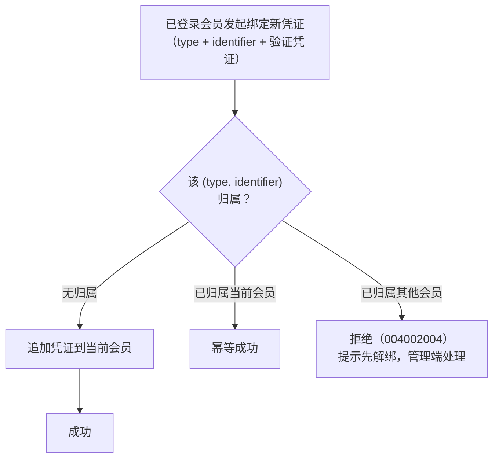

# 统一认证设计（member）

> 本文是 member 域的唯一设计依据：终端用户账号模型、多凭证登录、绑定合并、令牌体系与开放 API 认证协议。
> 遵循总体设计决策 D2 / D4 / D5 / D6 / D7 / D8 / D12 / D16 / D17 / D18 / D19（见 [总体设计](总体设计.md) §2）。

## 1. 需求背景

各应用的终端用户统一到平台注册 / 登录（账号中心）：应用自建登录 UI（D6），经开放 API 完成登录与用户身份校验。最终形态支持四种登录方式（D5）：账号密码、手机验证码、邮箱验证、微信 / 支付宝扫码，且一个会员可绑定多种凭证（绑定合并）。首期落地密码方式（D16），其余三种按第三方资质就绪分阶段接入——凭证表结构一次到位。

member 域与 system 域（管理后台 RBAC）**完全分域**（D4）：独立账号表、独立令牌签发密钥、独立 Guard；member 不参与角色与权限点体系。

## 2. 数据模型

### 2.1 member（终端用户）

| 字段 | 类型 | 说明 |
| --- | --- | --- |
| nickname | varchar(64)，必填 | 昵称（注册时自动生成兜底，如「用户a1b2c3」） |
| avatar_url | varchar(512)，可空 | 头像 |
| status | varchar(16) | `active` / `disabled`（禁用后全部令牌即时失效——逐请求查库） |
| registered_app_id | uuid，可空 | 首次注册来源应用（统计用） |
| last_login_at | timestamptz，可空 | 最近登录时间 |

member 自身**不承载任何登录能力**：登录标识与密钥全部在凭证表。无用户名 / 密码列。

### 2.2 member_credential（用户凭证）——绑定合并的载体

| 字段 | 类型 | 说明 |
| --- | --- | --- |
| member_id | uuid，FK | 所属会员 |
| credential_type | varchar(16) | `password` / `phone` / `email` / `wechat` / `alipay` |
| identifier | varchar(128) | 登录标识，按类型：password=登录账号（用户自设，字母数字下划线 4-32 位）；phone=手机号；email=邮箱；wechat=openid；alipay=支付宝 user_id |
| credential_secret | varchar(255)，可空 | 仅 password 类型使用（bcrypt 哈希） |
| verified | bool | phone / email 是否已验证（短信 / 邮件通道回执；首期密码 / 扫码类型恒 true） |
| last_used_at | timestamptz，可空 | 最近使用时间 |

**全局唯一约束 `(credential_type, identifier)`**：同一手机号 / 邮箱 / openid 在平台范围内只能归属一个会员——这是绑定合并与「同标识即同人」的根基。

### 2.3 member_refresh_token（刷新令牌）

| 字段 | 类型 | 说明 |
| --- | --- | --- |
| member_id | uuid，FK | 所属会员 |
| app_id | uuid，FK | 签发应用（令牌绑定应用 D19） |
| token_hash | char(64)，唯一 | refresh token 的 SHA-256（不存原文；原文为 32 字节随机数的 hex 形态 64 字符，签发时仅返回一次） |
| expires_at | timestamptz | 过期时间（签发起 30d） |
| status | varchar(16) | `active` / `revoked`（登出 / 轮换 / 改密时吊销） |
| created_ip | varchar(64)，可空 | 签发时来源 IP（风控留痕） |

### 2.4 member_login_log（会员登录日志）

member 域独立于 system 域登录日志（字段面向开放 API 场景：appKey / 凭证类型），异步写入不阻断主链路：

| 字段 | 类型 | 说明 |
| --- | --- | --- |
| member_id | uuid，可空 | 会员（登录失败且无法确定归属时为 null） |
| app_key | varchar(32) | 来源应用 AppKey |
| credential_type | varchar(16) | 凭证类型 |
| identifier | varchar(128) | 登录标识（失败也留痕，供风控回溯） |
| log_type | smallint | 10 登录 / 20 登出 |
| result_code | int | 业务码（0 成功） |
| result_msg | varchar(255)，可空 | 失败原因 |
| ip / user_agent | varchar | 客户端信息 |
| login_time | timestamptz | 时间 |

### 2.5 member_login_lock（登录失败锁定计数）

§3.3「库表计数，含锁定截止时间」的载体——重启不丢锁定状态（单实例内存实现做不到）；锁定维度 `(app_key, credential_type, identifier)` 唯一（实现主张 I4）：

| 字段 | 类型 | 说明 |
| --- | --- | --- |
| app_key | varchar(32) | 应用维度 |
| credential_type | varchar(16) | 凭证类型维度 |
| identifier | varchar(128) | 登录标识维度 |
| fail_count | int | 连续失败次数（成功登录即清零） |
| locked_until | timestamptz，可空 | 锁定截止时间（null 未锁定） |
| last_fail_at | timestamptz | 最近一次失败时间 |

**主张 M1（令牌体系落地）**：

- **access token = JWT**：声明 `{ sub: memberId, appKey, iat, exp }`，有效期 **8h**（与 system 域管理端令牌时效一致，吊销即时性由逐请求查库保证），签发密钥 `MEMBER_JWT_SECRET`（.env 注入，与 system 域 JWT_SECRET 相互独立）；校验时**逐请求查库**核对 member 状态（禁用即时失效，对齐 D18 与底座 ADR-003 同构思路）
- **refresh token = 随机 64 位不透明串**：原文仅返回客户端一次，库存 SHA-256；刷新时**轮换**（旧 refresh 吊销 + 签发新对）
- 令牌绑定 appKey（D19）：`introspect` 与用户态接口同时校验 token 的 appKey 声明与请求签名的 AppKey 一致（004003004），A 应用的令牌到 B 应用一律无效
- 改密 / 解绑凭证：吊销该会员全部 refresh token（access 靠 8h 时效自然过期，安全即时性可接受；禁用类操作另有查库即时兜底）

## 3. 方案设计

### 3.1 注册与登录（开放 API，AppKey 签名 + `@Public`）

| 接口 | 请求 | 响应 |
| --- | --- | --- |
| `POST /api/open/member/auth/register` | `{ type: 'password', identifier, credential, nickname? }` | `{ accessToken, refreshToken, expiresIn }`（注册即登录） |
| `POST /api/open/member/auth/login` | `{ type, identifier, credential }`（password：identifier+密码；phone / email：identifier+验证码；wechat / alipay：第三方临时授权码换 openid 后按标识登录，D16 分阶段开通） | `{ accessToken, refreshToken, expiresIn }` |
| `POST /api/open/member/auth/refresh` | `{ refreshToken }` | 新 `{ accessToken, refreshToken, expiresIn }`（旧 refresh 吊销） |
| `POST /api/open/member/auth/logout`（用户态） | `Authorization: Bearer <access>` + `{ refreshToken }`（定位吊销目标，主张 I5） | 吊销该 refresh（access 短效自然过期；多端各自持 refresh 互不影响） |
| `GET /api/open/member/token/introspect`（用户态，参与签名 I1） | `Authorization: Bearer <access>` | `{ member: { id, nickname, avatarUrl, status }, subscription: { subscribed, planName, expireAt } }`（P4：认证与订阅校验合一，订阅字段由 subscription 域注入；M2 固定占位 `subscribed: false`，主张 I6） |

第三方扫码登录首期接入形态（M4）：应用侧完成 OAuth 拿到平台可识别的标识（openid / user_id）后，仍走统一 `login` 接口（type=wechat/alipay），**查无凭证时自动注册新会员并挂凭证**（D12 开放注册的自然延伸），平台不维护第三方回调页。

### 3.2 绑定合并（用户态，`POST /api/open/member/auth/bind`）

**主张 M2**：首期不做「两账户高级合并」（把 B 账户整体并入 A 账户、迁移其订阅与订单）——涉及订阅 / 订单主体变更的级联，放到有真实诉求时再设计；当前合并语义 = **向已有账户追加登录凭证**。

### 3.3 安全基线（主张 M3）

| 项 | 规则 |
| --- | --- |
| 密码强度 | 8-64 位，至少含字母与数字（首期不强制特殊字符） |
| 密码存储 | bcrypt（对齐 system 域现有实现与 cost） |
| 登录失败锁定 | 同 `(appKey, credentialType, identifier)` 连续 5 次失败锁 15 分钟（库表 `member_login_lock` 计数，含锁定截止时间；防爆破统一文案 004003001） |
| 基础频控 | 开放 API 按 `AppKey + IP` 滑动窗口限流（内存计数，默认 60 次 / 分钟，超限 429）；公开客户端（client_type=public）阈值减半 |
| 异常告警留痕 | 登录日志记录 IP / appKey / 凭证类型 / 结果（复用底座登录日志思路，member 域独立表 `member_login_log`），风控规则首期不展开 |

### 3.4 管理端接口（RBAC，前缀 /api/member）

| 接口 | 权限点 | 说明 |
| --- | --- | --- |
| `GET /member` | `member:member:query` | 会员列表（分页 / 昵称 / 手机 / 邮箱关键字） |
| `GET /member/:id` | `member:member:query` | 详情（含凭证清单，敏感字段脱敏：手机 / 邮箱打码，Secret 不显示） |
| `PUT /member/:id/disable` | `member:member:disable` | 禁用（吊销其全部 refresh token） |
| `PUT /member/:id/enable` | `member:member:enable` | 启用（仅恢复状态，需重新登录） |
| `DELETE /member/:id` | `member:member:remove` | 软删（同时吊销全部令牌与软删全部凭证） |
| `DELETE /member/:id/credential/:cid` | `member:credential:unbind` | 解绑凭证（密码凭证是最后一条时拒绝 004002005） |
| `POST /member/:id/password/reset` | `member:credential:reset-password` | 管理员重置密码（生成随机新密码显示一次，吊销全部令牌） |

权限点 6 项，首段 `member`（原文「7 项」为计数笔误，2026-10-17 评审修正）。启停原文为单路由 `PUT :id/status`，落地时拆为 disable / enable 两路由——`@RequirePermissions` 是静态元数据无法按 body 分流，拆路由后权限点与路由一一对应（2026-10-17 实现修正）。

### 3.6 M2 落地实现主张（2026-10-17 评审通过）

| # | 主张 | 结论 |
| --- | --- | --- |
| I1 | introspect（GET）参与签名：扩展签名守卫规则——**`@UseSignature` 显式标注的接口全方法验签**（不再按写方法过滤）；开放 API 用户态接口全部显式挂 `@UseSignature('app')`，D19 域绑定（004003004）建立在签名之上而非明文头比对 |
| I2 | 应用级密钥源架构：common/signature 新增 `app` 签名方案（复用标准方案的签名串构造 / 时间窗 / nonce / 常量时间比对），密钥源经注入接口由业务模块注册解析器（appcenter `onModuleInit` 注册 `findByAppKey` → AppSecret，停用 / 查无返回 null 拒绝）——与限流策略注册（RateLimitPolicyRegistry）完全同构，零侵入全局守卫 |
| I3 | D23/D24 更新检测豁免：**维持不变**——救生通道逻辑（Secret 轮换后旧客户端自我更新闭环）独立于 member 签名能力成立，已发布旧版无法回头补签名 |
| I4 | 登录失败锁定维度收紧为 `(appKey, credentialType, identifier)`：密码标识为用户自设 4-32 位字母数字串，可与手机号字符串撞车导致跨类型误锁，加 type 后各凭证类型独立计数 |
| I5 | logout 契约：body 必填 `{ refreshToken }`，服务端哈希定位吊销那一条（access token 不含 refresh id，无法从 Bearer 推出；与「登出仅吊销当前 refresh」的多端语义对齐） |
| I6 | introspect 的 subscription 字段 M2 固定返回 `{ subscribed: false, planName: null, expireAt: null }`：结构就绪，M3 订阅域上线后注入真值，应用侧无需兼容字段缺失 |
| I7 | 管理后台页面形态：会员管理单页（列表 + 搜索卡）+ 详情抽屉（凭证清单脱敏 / 解绑 / 重置密码 / 启停 / 删除），对齐通道抽屉先例；凭证操作全部在抽屉内，无独立凭证页面 |
| I8 | AppKey 头契约：开放 API 统一 `X-App-Key` 请求头（签名密钥源定位 + 限流维度 + 令牌域校验三用，与限流 Guard 现有取头逻辑一致）；签名头三件套沿用底座 `sign` / `timestamp` / `noncestr` |
| I9 | 凭证唯一约束 `(credential_type, identifier)` 为**全表唯一**（不含 `WHERE deleted_at IS NULL` 部分索引）——本仓唯一一处刻意含软删行的唯一约束（§4.2 防抢注语义），迁移手写保障 |

### 3.5 错误码（模块段 004）

| 错误码 | 场景 |
| --- | --- |
| 004001001 | 会员不存在 |
| 004001002 | 会员已禁用 |
| 004002001 | 凭证类型不支持 |
| 004002002 | 凭证标识已存在（注册冲突 / 绑定冲突） |
| 004002003 | 凭证不存在 |
| 004002004 | 凭证已归属其他会员（绑定合并拒绝） |
| 004002005 | 最后一条密码凭证不允许解绑 |
| 004002006 | 验证码错误或过期（M4 激活） |
| 004003001 | 登录失败（账号或密码错误，统一文案） |
| 004003002 | 登录尝试已锁定 |
| 004003003 | refresh token 无效或已过期 |
| 004003004 | 令牌与应用不匹配（appKey 校验失败，D19） |
| 004003005 | access token 无效或已过期 |

子域分段：001 会员 / 002 凭证 / 003 认证与令牌。

## 4. 边界与异常

1. **两套信任域隔离**：member JWT 与 system JWT 使用不同密钥且声明结构不同（appKey 有无）；开放 API 的用户态 Guard 只认 member 令牌，管理端 Guard 只认 system 令牌，互不可用
2. **禁用 / 软删的即时性**：依赖逐请求查库（member 状态 + refresh 状态），不依赖 token 到期；软删会员的凭证不释放标识（唯一约束含软删数据，防恶意抢注）——若需释放标识走管理端「彻底删除」流程（首期不做，人工库层面处理并记录）
3. **验证码通道（M4）**：短信 / 邮箱验证码有效期 5 分钟、60 秒重发间隔、按手机号日限额——依赖服务商接入后生效，验证码存储内存（单实例部署前提下）
4. **多端登录**：不限制同一会员多设备 / 多应用同时持有令牌（refresh token 多行并存），登出仅吊销当前 refresh；「全端下线」走改密或管理端禁用

## 5. 验收标准

1. 密码注册 → 登录 → 刷新（轮换）→ introspect → 登出闭环，刷新后旧 refresh 复用返回 004003003
2. 绑定合并三分支：新凭证追加 / 幂等 / 归属他人拒绝
3. 令牌域隔离：member 令牌调管理端接口 401；A 应用令牌携 B 应用 AppKey 访问返回 004003004
4. 安全基线：5 次失败锁定、频控 429、禁用后 introspect 即时失效
5. 管理端：会员列表 / 详情（脱敏）/ 禁用 / 解绑 / 重置密码
6. `pnpm check` 全绿 + 浏览器 e2e 补充本域管理页用例
