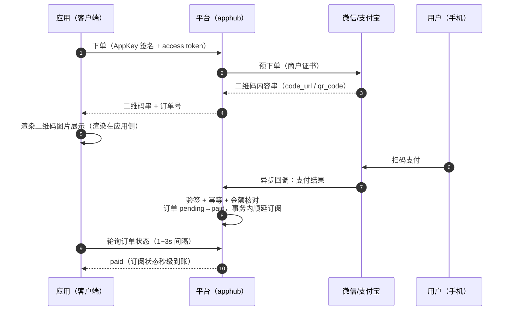
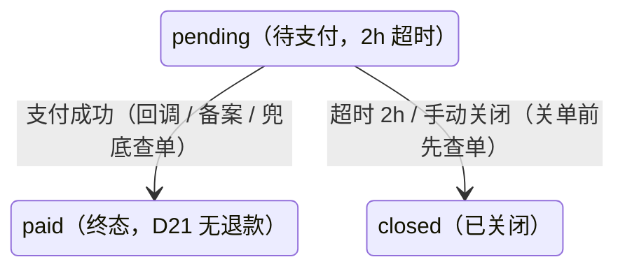

# 订阅与支付设计（subscription）

> 本文是 subscription 域的唯一设计依据：订阅计划、订单与三渠道支付、订阅实例生命周期、订阅状态校验。
> 遵循总体设计决策 D3 / D8 / D13 / D14 / D20 / D21（见 [总体设计](总体设计.md) §2）。

## 1. 需求背景

单应用订阅（D8）：每个应用自定义订阅计划（周期 × 价格），会员经应用内发起购买；支付走三通道（D3）：微信 Native 扫码、支付宝当面付（M5）、线下收款后台备案（M3 首期落地）。订阅到期即失效无宽限（D13）；首期不支持退款（D21）；续费单实例顺延（D20）。

依赖：member 域（会员身份与令牌）、appcenter 域（应用主体）。

## 2. 数据模型

### 2.1 sub_plan（订阅计划）

| 字段 | 类型 | 说明 |
| --- | --- | --- |
| app_id | uuid，FK | 所属应用 |
| name | varchar(64)，必填 | 计划名（如「专业版 · 年付」） |
| period_type | varchar(16) | `monthly` / `quarterly` / `yearly` / `permanent` |
| duration_months | int，可空 | monthly=1 / quarterly=3 / yearly=12（日历月数，permanent 为 null） |
| price | int，必填 | 现价，**单位分**（整数，杜绝浮点误差） |
| original_price | int，可空 | 划线原价（分，展示用） |
| status | varchar(16) | `on` / `off`（下架后不可新购，存量订阅不受影响） |
| sort / remark | | 排序与备注 |

**主张 S1（周期落地）**：周期四档，到期时间按**日历时间加法 + 最短周期保底**计算，起算时刻 T（下单生效或原到期时刻）、周期月数 N（duration_months）：

```text
expire_at = max( T + N 个日历月（同日同时分秒，目标月无同日时钳制到月末日）
               , T + N × 30 天保底 )
```

- 常规场景走日历月（2026-10-16 14:30 月付 → 2026-11-16 14:30；年付 → 2027-10-16 14:30）
- **保底规则**：短月场景日历加法可能不足额（1-31 月付钳制到 2-28 仅 28 天；2-28 月付到 3-28 同样只有 28 天且不触发钳制），凡周期不足 N×30 天的，顺延到 T + N×30 天——**保证每个周期至少 30 天 / 月**（1-31 月付 → 3-02；2-28 月付 → 3-30；2-29 闰年月付 → 3-30）
- `permanent` 表示永久买断，到期时间写哨兵值 **2999-12-31 23:59:59+00**（不用 null）。不支持自定义周期（有诉求时加 `custom` 档 + duration_months 必填）

### 2.2 subscription（订阅实例）——会员 × 应用唯一（D20）

| 字段 | 类型 | 说明 |
| --- | --- | --- |
| member_id + app_id | uuid，FK | **联合唯一**（单实例顺延的根基） |
| plan_id | uuid，FK | 当前生效计划（最近一次购买） |
| start_at | timestamptz | 首次开通时间 |
| expire_at | timestamptz，必填 | 到期时间；永久买断写哨兵值 **2999-12-31 23:59:59+00**（不使用 null，判定统一为 `expire_at > now`） |
| last_renew_at | timestamptz，可空 | 最近续费时间 |

**主张 S2（状态推导，不存状态字段）**：订阅是否有效 = `expire_at > now()`（永久档哨兵值天然恒真，无空值分支），查询时实时判定，不维护 `status` 列、不做定时任务刷状态——避免状态与时间的双源不一致；列表页的「已过期」由查询层按时间打标。过期实例保留（续费可复活顺延），不删除。实例是否为永久 = `expire_at` 年份 ≥ 2999。

**续费顺延规则（D20，起算时刻 + S1 周期计算，保底规则同样适用）**：

```text
续费时（订单支付成功驱动）：
  无实例                  → 创建：start_at=now，expire_at=按 S1 计算（T=now）
  实例未过期              → expire_at=按 S1 计算（T=原到期时刻，顺延不满不亏）
  实例已过期              → expire_at=按 S1 计算（T=now，从当下起算复活）
  permanent 购买          → expire_at = 2999-12-31 23:59:59+00（永久覆盖，此后再续周期类无意义，前端置灰）
  周期类续费到永久实例上    → 拒绝（005003003），永久即终态
```

### 2.3 order（订单）

| 字段 | 类型 | 说明 |
| --- | --- | --- |
| order_no | varchar(32)，唯一 | 订单号：`AH` + yyMMddHHmmss + 6 位随机（可读前缀 + 时间 + 随机防枚举） |
| member_id / app_id / plan_id | uuid，FK | 购买主体与标的（plan 快照见下） |
| plan_name | varchar(64) | 计划名快照（防计划改名 / 删除影响对账） |
| period_type | varchar(16) | 周期快照 |
| amount | int | 应付金额（分）= 下单时计划价格快照 |
| channel | varchar(16) | `wechat` / `alipay` / `offline` |
| status | varchar(16) | 状态机：`pending` → `paid` / `closed`（见 §3.2） |
| transaction_id | varchar(64)，可空 | 渠道交易号（微信 / 支付宝回调回填；线下为转账流水号选填） |
| paid_at | timestamptz，可空 | 支付完成时间 |
| expire_at | timestamptz | 待支付过期时间（下单 + 2h，超时关单） |
| offline_note | varchar(512)，可空 | 线下备案备注（收款凭证说明、经办留痕走审计列） |

### 2.4 支付渠道配置（M5）

微信 Native（扫码）与支付宝当面付的商户参数经 `.env` 注入（`WECHAT_PAY_MCH_ID` / `WECHAT_PAY_KEY` / `WECHAT_PAY_APP_ID`、`ALIPAY_APP_ID` / `ALIPAY_PRIVATE_KEY` 等），SDK 选型与回调验签细节在 M5 开工前补一份渠道接入附录（依赖商户资质落地后的实际参数形态）。

## 3. 方案设计

### 3.1 购买流程（在线渠道）

应用内（用户态：AppKey 签名 + access token）：

1. `GET /api/open/subscription/plans` → 该应用在售计划列表（含价格）
2. `POST /api/open/subscription/order/create`（`{ planId, channel: 'wechat'|'alipay' }`）→ `{ orderNo, amount, qrCodeUrl }`（服务端预下单拿渠道二维码链接）
3. `POST /api/open/subscription/order/query`（`{ orderNo }`）→ `{ status }`（应用侧轮询，1~3s 间隔）
4. 用户扫码支付 → 渠道回调 `POST /api/pay/callback/wechat|alipay` → 验签 + 幂等校验 → 订单 pending→paid → 事务内顺延订阅实例
5. 应用侧轮询到 paid → introspect 的 subscription 字段即时反映新状态

**四方时序（应用 / 平台 / 渠道 / 用户）**：



要点：二维码**内容串**由渠道预下单返回、**图片渲染在应用侧**；回执（⑦）是渠道服务器对平台回调 URL 的服务器间 POST，验签 / 幂等 / 金额核对（§3.2）通过后自动完成订单与订阅更新，全程无人工介入；资金直接进商户账户，平台只管理订单与订阅状态。

### 3.2 订单状态机



- 回调幂等：渠道可能重复通知，已 `paid` 订单重复回调直接返回成功（不重复顺延订阅）
- 金额核对：回调金额 ≠ 订单 amount 时告警并拒绝（005002004）
- **兜底查单**：回调可能因网络丢失，定时任务对超时未支付且未关单的 pending 订单主动调渠道查单接口补偿——查到已支付则补记 paid 并顺延订阅（与回调同一套幂等逻辑）
- 自动关单：惰性关单（查询 / 回调时发现超时即置 closed）+ 每小时定时兜底扫描（复用底座 AsyncTaskQueue 思路），关单前先查单防「已付被关」；不依赖渠道关单接口

### 3.3 线下备案（M3 首期通道）

管理后台（RBAC）：选会员 + 选应用计划 → 录入金额与收款凭证备注 → 创建 `channel=offline` 订单并**直接标记 paid**（备案即生效，无二次审核——收款事实由经办人负责，审计列留痕）→ 订阅即时顺延。同时在订单列表可按渠道筛选对账。

### 3.4 订阅状态校验（并入 introspect，P4）

`GET /api/open/member/token/introspect` 响应中的订阅段（member 域 §3.1）由本域提供查询实现：

```jsonc
{ "subscribed": true, "planName": "专业版 · 年付", "periodType": "yearly", "expireAt": "2027-10-16T00:00:00Z" }
// 未订阅：{ "subscribed": false, ... null }
// 永久：  { "subscribed": true, "periodType": "permanent", "expireAt": "2999-12-31T23:59:59Z" }
```

到期后的产品表现（阻断 / 降级）由各应用依 `subscribed` 自行决定（D13）。**主张 S3**：首期只提供 introspect 拉取，不做「订阅变更 webhook 推送」（应用侧轮询 + 登录即拉够用；推送留待应用数量多后评估）。

### 3.5 管理端接口（RBAC，前缀 /api/subscription）

| 接口 | 权限点 | 说明 |
| --- | --- | --- |
| `GET/POST /plan`、`PUT/DELETE /plan/:id` | `subscription:plan:query/create/update/remove` | 计划管理（按应用维度） |
| `GET /order` | `subscription:order:query` | 订单列表（渠道 / 状态 / 应用 / 会员筛选） |
| `POST /order/offline` | `subscription:order:offline-create` | 线下备案（直接 paid） |
| `POST /order/:id/close` | `subscription:order:close` | 手动关闭待支付订单 |
| `GET /sub` | `subscription:sub:query` | 订阅实例列表（含已过期打标） |

权限点 8 项，首段 `subscription`。

### 3.6 错误码（模块段 005）

| 错误码 | 场景 |
| --- | --- |
| 005001001 | 计划不存在 |
| 005001002 | 计划已下架 |
| 005001003 | 计划不属于该应用 |
| 005002001 | 订单不存在 |
| 005002002 | 订单状态冲突（重复支付 / 关闭已支付订单等） |
| 005002003 | 订单已过期（超时关单后支付回调到达，记录并返回成功避免渠道重试） |
| 005002004 | 支付金额与订单不符 |
| 005002005 | 支付渠道错误 / 预下单失败 |
| 005003001 | 订阅实例不存在 |
| 005003002 | 周期续费至永久实例 |
| 005003003 | 订阅顺延失败（事务异常兜底） |

子域分段：001 计划 / 002 订单 / 003 订阅实例。

## 4. 边界与异常

1. **回调接口安全**：`/api/pay/callback/**` 双豁免（`@Public` + `@SkipSignature`——渠道服务器无法做 AppKey 签名），安全依赖**渠道验签**（微信 / 支付宝证书与密钥校验）+ 金额核对 + 幂等；IP 白名单作为可选加固项
2. **跨域一致性**：下单校验 appKey（签名）= 令牌 appKey（D19）= plan 所属应用，三方一致才可下单（防止 A 应用的令牌买 B 应用的计划）
3. **价格快照**：订单冻结下单时的计划名 / 周期 / 金额，计划后续改价、改名、删除不影响历史订单与对账
4. **会员删除**：member 软删时其订阅与订单保留（历史数据完整性），仅令牌失效
5. **对账**：线下备案与在线渠道共用订单表，按 channel + 日期区间导出（首期页面筛选即可，不做独立报表）

## 5. 验收标准

1. 线下备案闭环：创建备案订单 → 订阅即时生效 → introspect 反映 → 计划下架后不可新购但存量有效
2. 订单状态机：待支付 → 支付（模拟回调）→ 重复回调幂等 → 超时关单 → 金额不符拒绝
3. 续费顺延四分支：新开 / 未过期顺延 / 过期复活 / 永久终态（含周期续永久拒绝）
4. 在线支付：微信 / 支付宝预下单与回调验签联调（依赖商户资质，M5 验收项）
5. 管理端：计划管理 / 订单列表与备案 / 订阅列表三组页面挂 RBAC
6. `pnpm check` 全绿 + 浏览器 e2e 补充本域用例
