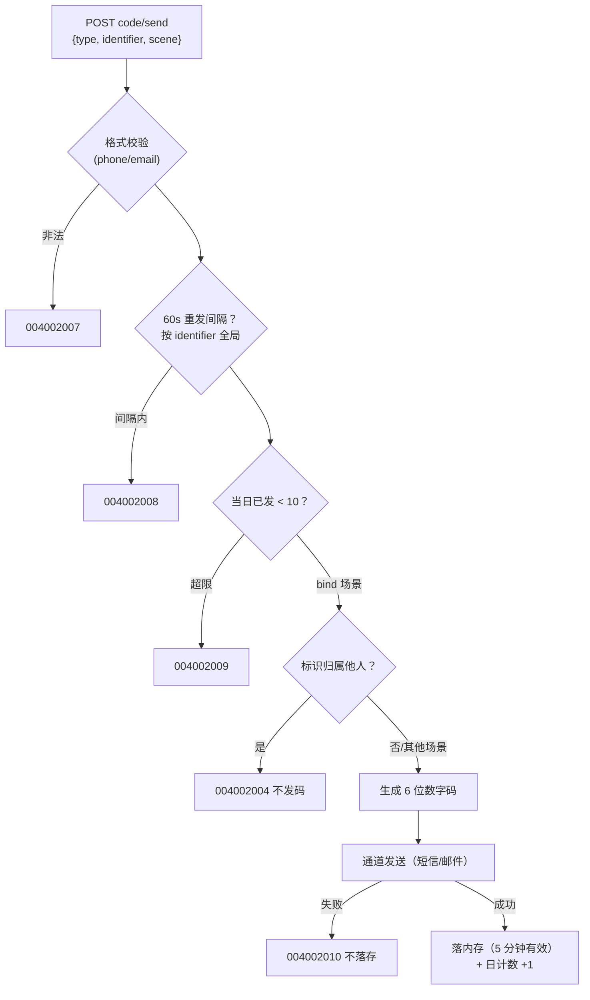
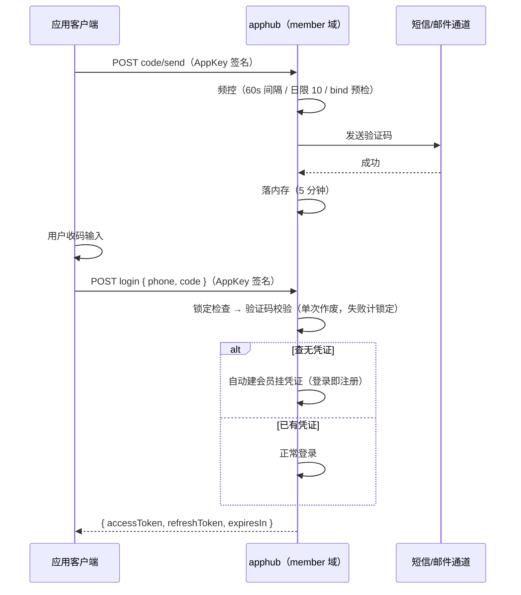

# 认证方式扩展设计（M4）

> 本文是 M4 期的设计依据：在 member 域（[统一认证设计](统一认证设计.md)）预留的 M4 接入点上，落地手机验证码 / 邮箱验证码 / 微信支付宝扫码四种新凭证形态。
> 决策依据：总体设计 D5 / D12 / D16 / D17 / D18；统一认证设计 §3.1 接口形态、§4.3 验证码基线为本文预留点。
> **数据模型零变更**：凭证表结构 M2 已一次到位，验证码域为内存态，无新表、无新列、无迁移。

## 1. 范围与通道

| 方式 | 通道 | 外部依赖 | 本期深度 |
| --- | --- | --- | --- |
| 手机验证码 | 阿里云短信（dysmsapi V2 SDK） | 签名 + 模板报备审核、独立 RAM 子账号 AK | 全量接入 |
| 邮箱验证码 | SMTP（nodemailer） | 企业邮箱账号 | 全量接入 |
| 微信扫码 | 协议约定（应用侧 OAuth，平台不维护回调页） | 各接入应用挂**同一微信开放平台主体**（unionid 前提，C3） | 全量接入 |
| 支付宝扫码 | 协议约定（应用侧 OAuth） | 支付宝开放平台应用（user_id 账号维度全局唯一，无微信的跨应用问题） | 全量接入 |

## 2. 评审决策记录（2026-10-17 评审通过）

| # | 决策项 | 结论 |
| --- | --- | --- |
| C1 | 交付范围 | 三种方式全量接入真实通道（资质已就绪 / 即将就绪），不做「只留结构」的半成品 |
| C2 | 短信服务商 | 阿里云短信：与 OSS 同云生态；AK 独立 RAM 子账号（最小权限仅授短信发送，不复用 OSS AK） |
| C3 | 微信扫码标识 | identifier = **unionid**：同一微信用户跨接入应用是同一会员；接入前提「各应用挂同一微信开放平台主体」写入接入约定。openid 是微信应用维度的，各应用独立主体会造成同人异号 |
| C4 | 扫码凭证校验 | **信任签名层**：平台只验 AppKey HMAC 签名，不回查微信 / 支付宝。残余风险：被攻破或恶意的接入应用可在自己 appKey 域内伪造他人标识冒登（openid / user_id 全局唯一约束下可抢注）；以凭证轮换 + 调用监控兜底，平台侧回查验真留待有真实风险事件再立项 |
| C5 | 验证码注册语义 | **登录即注册**：login(type=phone/email) 验证码通过且查无凭证 → 自动建会员挂凭证（与扫码同语义，D12 开放注册的自然延伸）；register 接口同步支持 phone/email（应用侧显式注册可携昵称），两接口「查无即建」逻辑合一 |
| C6 | 验证码作废策略 | **单次作废**：校验失败一次即作废须重发（配合 60s 重发间隔，6 位数字 100 万空间不可爆破）；验证码错误同时计入登录失败锁定（5 次锁 15 分钟）双保险 |
| C7 | 通道配置缺失行为 | **生产 fail-fast + 非生产 log 降级**：`NODE_ENV=production` 时短信 / SMTP 配置缺失即启动失败（MEMBER_JWT_SECRET 先例）；非生产未配置自动降级 log 通道（验证码写服务日志，开发零配置可跑）。**2026-10-20 修订（上线批次 DEP-5）**：生产可设 `ALLOW_CHANNEL_FALLBACK=true` 显式豁免——资质报备未齐的上线窗口期，未配置通道按非生产同款 log 降级运行（启动 WARN 提示），默认 false 维持 fail-fast |
| C8 | 短信模板形态 | **单通用模板**：登录 / 注册 / 绑定共用一条报备模板（`${code}` `${minutes}` 两个变量）；scene 参数仅作日志风控维度不进文案；邮箱模板自写不受限 |
| C9 | 验证码域实现 | 内存 Map：**发送成功才落存**（通道失败不占用重发间隔）、定时清理过期项（setInterval 5 分钟 + onApplicationShutdown 收口）；重启全丢由用户重发兜底（单实例部署前提，统一认证设计 §4.3 已定） |
| C10 | 频控维度 | 重发间隔与日限额均按 **identifier 全局**（不含 appKey）：防换应用绕过频控；验证码 key 同为全局维度——A 应用发的码可在 B 应用完成校验（手机号身份全局唯一，同人所码） |
| C11 | DTO 校验迁移 | 开放入参 DTO 统一宽松化（长度校验），**类型相关的格式与强度校验全部移入 service 层**抛分段业务码（DTO 装饰器无法按运行时 type 分支）；代价：password 注册的强度错误从框架 400 变为业务码 004002007，对外协议语义等价 |
| C12 | 绑定发码预检 | scene=bind 发码前预检 `(type, identifier)` 归属：已归属他人直接 004002004，不消耗通道成本；归属校验真正生效仍以 bind 接口事务内为准（发码与绑定之间存在时间窗） |

### 实现层细化主张（随 C1~C12 定稿，不单独评审）

- 验证码参数走常量：6 位数字（`randomInt`）、有效期 5 分钟、重发间隔 60 秒、日限额 10 条 / identifier（统一认证设计 §4.3 基线的落地值）
- 手机号格式：国内 11 位（`/^1[3-9]\d{9}$/`，平台面向国内生态）；邮箱格式：宽松 RFC 正则
- 扫码类型 credential 传占位 `'oauth'`（平台不校验、不落库 credentialSecret）
- login 增加可选 `nickname`：仅在自动注册新会员时生效（扫码 / 验证码登录带出第三方昵称），已存在会员忽略
- 锁定检查顺序不变（先锁检后凭证比对）；扫码类型无凭证错误概念，仅跑锁检防滥用
- `SELF_SERVICE_TYPES` 常量收敛语义撤销：register / login / bind 三接口对五种类型全开放，行为差异在服务层矩阵（§3.3）

## 3. 方案设计

### 3.1 验证码域（内存，`member/auth/captcha.service.ts`）



内存结构（key = `${type}:${identifier}`，全局维度 C10）：

| 存储 | 结构 | 生命周期 |
| --- | --- | --- |
| 验证码 | `{ code, expiresAt, sentAt }` | 5 分钟过期 / **校验失败或成功即删**（单次作废 C6） |
| 日计数 | `{ day: 'YYYY-MM-DD', count }` | 自然日翻转归零，定时清理兜底 |

`verify(type, identifier, code)`：查无 / 过期 / 比对失败一律返回 false 并**删除条目**（单次作废），调用方随即记锁定失败并抛 004002006；发送失败不落存（C9），故重发间隔以「最近一次成功发送」计时。

### 3.2 通知通道抽象（渠道即插）

```ts
/** 验证码发送通道：短信与邮件各一实现，装配期按配置择一 */
interface CodeSender {
  /** 发送失败抛异常（调用方转 004002010）；log 降级通道恒成功 */
  send(identifier: string, code: string): Promise<void>
}
```

| 实现 | 装配条件 | 说明 |
| --- | --- | --- |
| `AliyunSmsSender` | SMS_* 四项配置齐全 | dysmsapi V2 SDK，单通用模板（C8），模板变量 `{code, minutes}` |
| `SmtpMailSender` | MAIL_* 五项配置齐全 | nodemailer，HTML 模板自写（验证码 + 有效期 + 用途提示） |
| `LogCodeSender` | 对应通道配置缺失且**非生产** | `Logger.log` 输出 `[mock] 验证码 123456 → 138****8000`（手机号打码） |

生产启动校验（C7）：`NODE_ENV=production` 时 SMS_* 与 MAIL_* 任一缺失即 fail-fast（对齐 MEMBER_JWT_SECRET 校验位置与告警文案风格）。两通道独立装配互不影响（只配邮件不配短信，则发短信码报 004002010）。

**通道降级开关（2026-10-20 上线批次 DEP-5 修订）**：`ALLOW_CHANNEL_FALLBACK=true`（默认 false）时，生产环境未配置的通道不再 fail-fast，按非生产同款 log 降级运行（验证码写服务日志，启动时 WARN 显式提示）。用于短信 / 邮箱资质报备未下来的上线窗口期——密码登录（M2）与扫码登录不依赖通道，服务可先行上线；资质就绪后配置真实通道并移除开关（已配置通道不受开关影响，照常生效）。

### 3.3 开放 API 变更（member 域，AppKey 签名 + `@Public`）

新增一个接口，既有三接口扩展 type 分支：

| 接口 | 变更 | 说明 |
| --- | --- | --- |
| `POST /api/open/member/auth/code/send` | **新增** | body `{ type: 'phone'\|'email', identifier, scene: 'login'\|'register'\|'bind' }`；scene 进登录日志风控维度、bind 预检归属（C12）；响应 data 为 null（不回显任何验证码信息） |
| `POST /api/open/member/auth/register` | type 扩展 | 五类型全支持；查有凭证（含软删）→ 004002002 |
| `POST /api/open/member/auth/login` | type 扩展 + 可选 nickname | 矩阵见下；查无凭证时 phone/email/wechat/alipay 自动注册（C5） |
| `POST /api/open/member/auth/bind` | type 扩展 | 用户态；三分支语义不变，验证类凭证改为验证码校验 |

**凭证矩阵**（服务层按 type 分流，DTO 统一宽松 C11）：

| type | identifier 规则 | credential 语义 | 查无凭证（login） | credentialSecret 落库 |
| --- | --- | --- | --- | --- |
| password | 字母数字下划线 4-32 位 | 密码（8-64 位字母+数字，bcrypt 比对） | 004003001 统一失败文案 | bcrypt 哈希 |
| phone | 国内 11 位手机号 | 6 位验证码（内存域校验） | **自动注册** | null |
| email | 邮箱地址 | 6 位验证码（内存域校验） | **自动注册** | null |
| wechat | unionid（C3 接入前提） | 占位 `'oauth'`（不校验） | **自动注册** | null |
| alipay | 支付宝 user_id（2088 开头） | 占位 `'oauth'`（不校验） | **自动注册** | null |

verified 字段：验证码通过即视为已验证（「通道回执」语义首期简化），五类型注册 / 绑定落库恒 `true`。

**验证码登录闭环时序**：



**扫码登录接入约定**（对外协议，应用侧自建 OAuth）：

1. 应用侧引导用户完成微信扫码授权（网站应用 / 移动应用 OAuth），以 `access_token` 换取 **unionid**；支付宝侧 OAuth 换取 **user_id**
2. 调 `POST login { type: 'wechat'|'alipay', identifier: unionid|user_id, credential: 'oauth', nickname? }`——查无凭证自动注册（可携第三方昵称），查有凭证正常登录
3. 绑定：已登录用户在应用内完成 OAuth 后调 `bind`，同参数结构
4. 平台不维护第三方回调页、不持各应用开放平台凭证（C4 信任签名层）

### 3.4 安全基线扩展（统一认证设计 §3.3 增补）

| 项 | 规则 |
| --- | --- |
| 验证码频控 | 60s 重发间隔 + 日限 10 条，按 identifier 全局（C10）；发送失败不占间隔（C9） |
| 验证码爆破 | 单次作废 + 验证失败计入 `(appKey, type, identifier)` 锁定（C6）——60s 只能试 1 码，锁定计数另封顶 |
| 短信轰炸 | 发码接口走 AppKey HMAC 签名（恶意第三方无法直连）+ 上述频控 + 既有 `AppKey + IP` 滑窗限流三层叠加 |
| 图形验证码 | 首期不做（签名 + 频控 + 日限已覆盖成本攻击面），留待风控数据说话 |

### 3.5 错误码（模块段 004，子域 002 凭证）

| 错误码 | 场景 | 状态 |
| --- | --- | --- |
| 004002006 | 验证码错误或已过期 | M2 预留，**本期激活** |
| 004002007 | 凭证格式非法（标识 / 密文不符合类型规则，message 按类型给具体文案） | 新增 |
| 004002008 | 验证码发送过于频繁（60s 重发间隔内） | 新增 |
| 004002009 | 验证码超出当日发送限额 | 新增 |
| 004002010 | 验证码通道发送失败（通道异常 / 通道未装配） | 新增 |

### 3.6 管理端与前端影响

- **无新页面、无新管理接口**：会员管理页凭证清单的 credentialType 展示扩展五类型标签（password / phone / email / wechat / alipay 中文映射 + tag 配色），脱敏规则复用现有（手机号 / 邮箱打码，unionid / user_id 截断显示）
- 会员列表「手机 / 邮箱关键字」搜索 M2 已按凭证表实现，五类型凭证自然可查，无改动
- 管理端解绑 / 重置密码对五类型凭证同样适用（重置密码仅对 password 凭证有意义，其余类型解绑即可）

## 4. 边界与异常

1. **单实例前提**：验证码域与底座限流同为进程内存态，多实例部署需先外置（Redis 计数器位已在限流组件预留，验证码域同位收敛）
2. **重启丢码**：内存验证码随进程丢失，用户重发即可（发送侧频控以重启后首条重新计时）；锁定计数在库表不受影响
3. **跨应用验码**（C10 全局维度的另一面）：验证码 key 不含 appKey，A 应用所发之码可在 B 应用完成登录——手机号身份平台全局唯一，同人语义下无越权增益；攻击者仍须同时持有目标手机号的短信
4. **C4 残余风险**：被攻破的接入应用可在自身 appKey 域内伪造任意 unionid / user_id 冒登该标识既有会员（不能跨域——令牌绑定 appKey，D19）；唯一约束下亦可抢注未注册标识。缓解：AppSecret 轮换（D22）+ 开放 API 调用日志审计；平台侧回查验真为后续可加固项
5. **通道发送时延**：短信 / 邮件为同步调用（发送接口阻塞至通道回执），通道超时按 10s 兜底转 004002010；不做异步队列（量级未到，验证码接口天然低频）
6. **绑定时间窗**（C12）：发码预检与 bind 事务之间存在标识被他人注册的窗口，bind 事务内唯一约束为最终权威（预检仅为省通道成本的尽力检查）

## 5. 验收标准

1. 邮箱验证码闭环：code/send → 日志 / 邮箱取码 → login 自动注册 → 再 login 正常登录；60s 内重发 004002008、日限第 11 条 004002009、错码一次即作废（重发前旧码不可用）
2. 手机验证码闭环同上（通道 mock 走 LogCodeSender，单测 / e2e 以通道 stub 捕获验证码驱动断言，不为测试在 src 加后门端点）
3. 扫码登录：login(type=wechat, identifier=unionid) 首次自动注册（携 nickname）→ 二次登录同会员；bind(type=alipay) 追加凭证与解绑闭环
4. 安全基线：验证码错误计入锁定（5 次锁 15 分钟）；password 强度错误返回业务码 004002007；发码接口无签名 401
5. 生产 fail-fast：NODE_ENV=production 且 SMS / MAIL 配置缺失启动失败；ALLOW_CHANNEL_FALLBACK=true 时降级 log 通道（WARN 提示）；非生产缺配置走 log 通道
6. 管理端：会员详情凭证清单五类型标签与脱敏展示
7. `pnpm check` 全绿 + 浏览器 e2e 补充凭证类型展示用例
