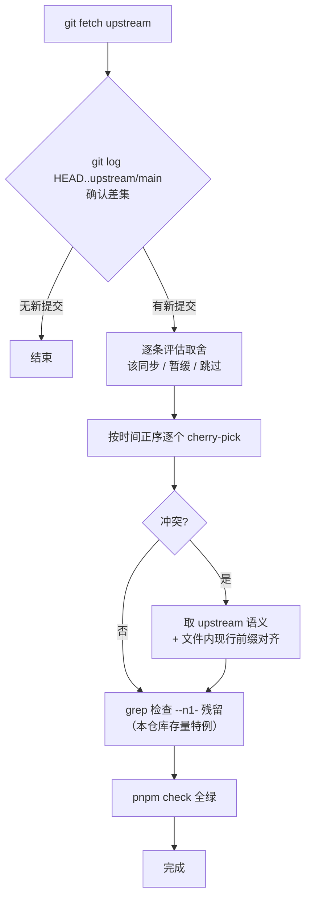

# upstream 同步指南

> 本仓库 fork 自 n-1 底座框架，业务开发期间上游可能持续产出修复与优化。本文约定**从 upstream 拉取变更合并到本仓库**的标准流程与取舍判断。品牌化范围与冲突处理规则见 [rules/branding.md](../../rules/branding.md)，决策背景见 [ADR-006](../决策/ADR-006-品牌化迁移范围.md)。

## 1. remote 约定

| remote | 地址 | 用途 |
| --- | --- | --- |
| `upstream` | `git@github.com:Harley-xk/n-1.git`（main） | 底座框架上游，只拉取、按需回推通用规则 |
| `origin` | 本项目业务远端 | 业务提交推送 |

首次配置：`git remote add upstream git@github.com:Harley-xk/n-1.git`。

## 2. 同步流程



### 2.1 确认差集

```bash
git fetch upstream
git log --oneline HEAD..upstream/main
```

`HEAD..upstream/main` 列出本仓库尚未包含的上游提交；逐条 `git show <hash> --stat` 了解涉及文件，预判与本地业务改动的重叠。

### 2.2 取舍判断

| 上游变更类型 | 处理 |
| --- | --- |
| 框架缺陷修复（暗色样式、守卫行为、构建问题等） | **应同步**——cherry-pick 保留修复语义 |
| 横切设施优化（common 组件、表格封装、工具） | **应同步**，注意与业务用法的兼容 |
| 新特性 / 新依赖引入 | 评估业务是否需要，需要时走「文档先行」单独接入，不随同步夹带 |
| 与本仓库业务模块同名的文件改动 | 逐 hunk 人工评估，冲突以本仓库业务为准取舍 |

### 2.3 逐个 cherry-pick

**必须按时间正序**（`git log` 逆序列出的最后一项先摘），后续提交可能依赖前序修复的上下文。冲突解决遵循「**取 upstream 语义 + 保持文件内现行前缀一致**」（[rules/branding.md](../../rules/branding.md) §3）：

- upstream 的修复逻辑（选择器、变量映射、规则体）**完整落入**，不因前缀不同而丢弃
- 冲突行中的 token / 组件名**对齐到该文件当前使用的前缀**——同一文件混用两套前缀会导致 CSS 变量解析失败等静默缺陷
- upstream 新增注释中的前缀称谓随冲突行一并对齐；自动合并落入的新增行同样检查

### 2.4 残留检查（本仓库存量特例）

本仓库历史迁移已将框架前缀全量替换为自有品牌前缀（见附录 A），**正常状态不应出现 `--n1-`**：

```bash
grep -rn 'n1-' web/src --include='*.css' --include='*.ts' --include='*.vue'
```

命中即同步漏改，对齐为文件内现行前缀。**此检查仅适用于本仓库存量**——按现行规则（ADR-006）新 fork 的项目全文复用 `--n1-` 前缀，无需此检查。

### 2.5 验证与提交

- 每批同步完成后根目录 `pnpm check` 全绿（完成定义，见 [rules/base.md](../../rules/base.md) 第 5 节）
- cherry-pick 保留原提交信息（含 upstream 的中文规范格式与共同作者署名），钩子自动校验通过
- 前端样式类修复建议补充暗色模式人工核验（upstream 两个暗色修复均源于暗色路径的静默回归）

## 3. 通用规则回推

本仓库沉淀的**与品牌无关的通用规则**（如 [rules/branding.md](../../rules/branding.md) 本身）可回推 upstream，让后续 fork 直接受益：

1. 基于 `upstream/main` 建临时分支，落**适配上游视角**的规则内容（下游项目名以「某项目实践」代称，不出现具体业务项目名）
2. 提交后 `git push upstream <分支>:main`
3. 切回业务分支，删临时分支

## 附录 A：本仓库品牌化存量映射

历史全量替换（规则确立前的存量，ADR-006 决策「不回改」）涉及的层面与标识：

| 层面 | n-1 原名 | 本仓库现名 | 主要分布 |
| --- | --- | --- | --- |
| 设计 token 前缀 | `--n1-*` | 自有品牌前缀 | `web/src/styles/`（tokens.css 定义 + 全部覆写与消费） |
| 表格封装组件 | `N1Table` | 自有品牌组件名 | `web/src/components/` 组件目录与全部列表页引用 |
| 令牌存储键 | `N1_TOKEN` | `APPHUB_TOKEN` | `web/src/api/http.ts` |
| 表格列持久化键 | `N1_TABLE_COLS` | `APPHUB_TABLE_COLS` | 表格组件 column-persist 模块（localStorage） |
| 文档称谓 | N1Table / n1 token | 自有品牌称谓 | `docs/前端/` 设计文档 |
| UI 品牌信息 | 框架名 | 本项目产品名 | 页面标题、登录页、布局 logo 槽位（UI 层面，属品牌化正当范围） |

**同步重灾区**（替换密度高、冲突概率大）：`web/src/styles/*.css`（4 个覆写 / token 文件）与 `docs/前端/` 设计文档——同步涉及时优先按 §2.3 对齐前缀。

## 变更记录

| 日期 | 内容 |
| --- | --- |
| 2026-10-19 | 初版：首次 upstream 同步（3 个 web 修复）实操路径固化；残留检查与存量映射归档 |
