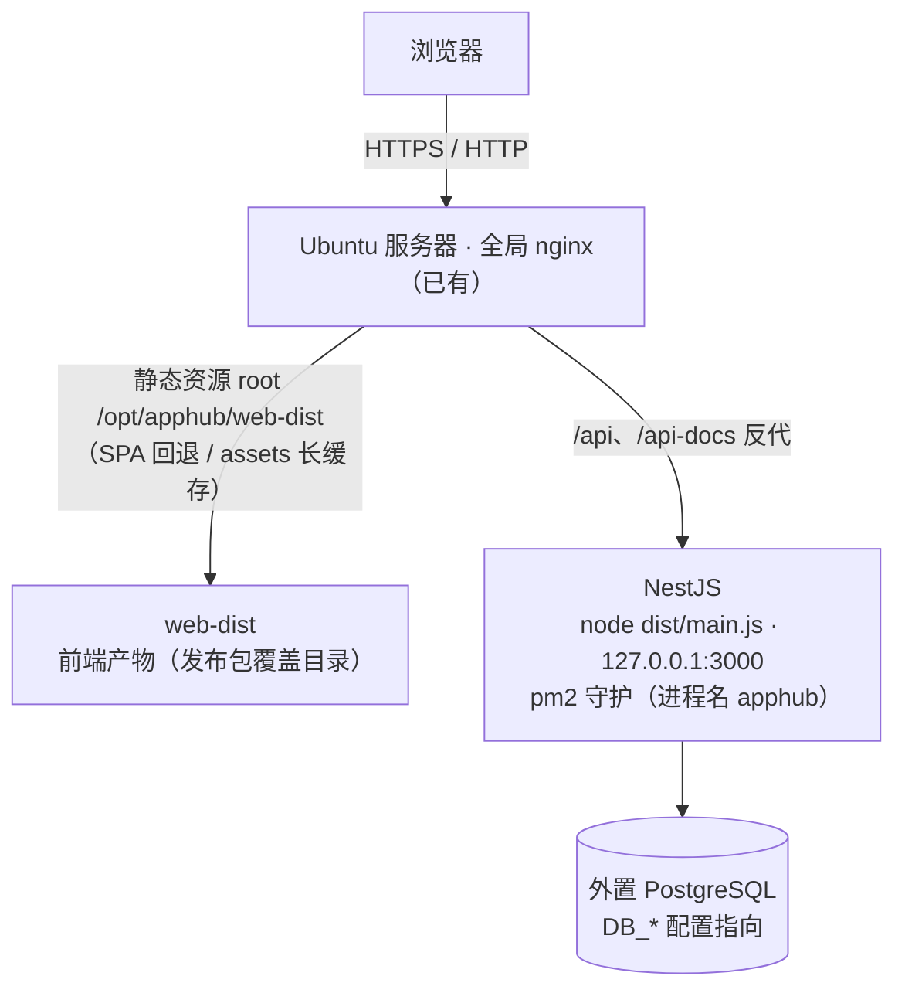
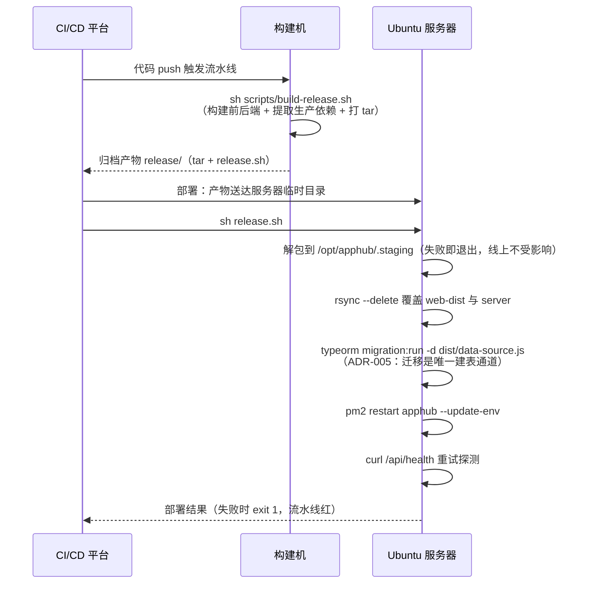
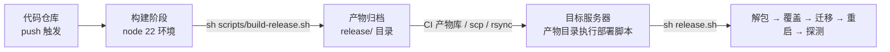

# 发布包打包与部署指南

apphub 提供两种可选部署方案：**发布包直部署**（本指南，**主方案**）与 [Docker 镜像部署](Docker打包与部署指南.md)（备选），选型对比见 [§1 方案选型](#1-方案选型)。本指南是发布包直部署的唯一设计依据：发布包结构、构建脚本、流水线接入、服务器初始化与日常发布 / 回滚操作均以本文为准。

## 1. 方案选型

| 维度 | 发布包直部署（本指南，**当前选定**） | [Docker 镜像部署](Docker打包与部署指南.md)（备选） |
| --- | --- | --- |
| 交付物 | tar.gz（后端 dist + 自包含生产依赖 + 前端产物） | 单镜像（node + nginx，tar 导出分发） |
| 服务器运行时 | node 22 + pm2 + 全局 nginx 分流 | docker + compose，全局 nginx 仅转发 |
| 环境一致性 | 依赖构建机与服务器同构（linux x64 + node 大版本锁定；生产依赖为纯 JS 无原生模块） | 镜像自包含，跨环境一致 |
| 适用场景 | 单机常驻、服务器组件最简、无容器设施 | 已有容器设施、多机分发、向容器平台演进 |

**选型结论（本仓库）**：生产上线采用发布包直部署——目标服务器单机常驻、组件最简（node + pm2 + 全局 nginx），不引入容器设施；Docker 方案保留为备选，向容器平台演进或多机分发时启用。

两方案遵循相同约定：前后端一体交付、数据库外置、运行配置外置（`server.env`）、前端签名密钥构建期注入（`VITE_SIGN_SECRET`）。

## 2. 部署形态与网络拓扑



要点：

- **单级 nginx**：全局 nginx 直接承担流量分流——静态资源 `root /opt/apphub/web-dist`（SPA `try_files` 回退、`/assets/` 长缓存、`index.html` 不缓存），`/api`、`/api-docs` 反代到本机 NestJS（对比 docker 方案少一层镜像内 nginx）。站点配置见 `deploy/nginx-site.conf.example`。
- **pm2 守护**：后端以 pm2 进程 `apphub` 常驻（`node dist/main.js`，工作目录 `/opt/apphub/server`），崩溃自动重启（pm2 默认 restart 策略）；运行配置在启动 / 重启时经 shell `source /opt/apphub/server.env` 注入并 `--update-env` 生效——发布包内不含任何环境差异配置。开机自启由 `pm2 startup` + `pm2 save` 承载。
- **端口安全**：NestJS 监听 3000，仅本机回环访问（nginx 反代）；服务器安全组 / 防火墙不应对公网放开 3000。
- **数据库外置**：经 `DB_*` 环境变量连接外部 PostgreSQL，不随发布包交付。

## 3. 工具链文件清单

| 文件 | 职责 |
| --- | --- |
| `scripts/build-release.sh` | 构建发布包（不依赖 docker，任意 node 22 环境可执行）：构建前后端 → 提取生产依赖 → 打版本化 tar.gz |
| `deploy/release.sh` | 部署阶段执行脚本：解包 → 覆盖 → 迁移 → 重启（pm2）→ 健康探测（随构建产物一起分发） |
| `deploy/server.env.example` | 外置运行配置模板（复制为 `/opt/apphub/server.env` 后修改） |
| `deploy/nginx-site.conf.example` | 全局 nginx 站点配置示例（静态托管 + API 反代） |

## 4. 发布包设计

### 4.1 构建流程（build-release.sh）

脚本在仓库根执行 `sh scripts/build-release.sh`，五步流水：

1. `pnpm install --frozen-lockfile` 安装全量依赖（环境无 pnpm 时自动安装同代版本）
2. 构建前端：进程环境变量 `VITE_SIGN_SECRET` 存在时自动覆盖 `web/.env.production` 占位值（Vite 规则：环境变量优先于 `.env` 文件）
3. 构建后端：`nest build` 产出 `server/dist`
4. **提取生产依赖**：`pnpm --filter server deploy --prod --legacy` 在 `release/staging/server` 产出自包含目录（symlink 相对闭环，不依赖 workspace 根；不影响仓库开发环境的依赖），随后清理开发态文件——源目录中的 `server/.env`（含数据库口令）不得进入发布包，清理为幂等保护
5. 打包：`web/dist` 一并拷入，附 `release-info`（版本时间戳 / commit / 构建时间），压成版本化 tar.gz；`deploy/release.sh` 拷到 `release/` 随产物分发（产物自包含，服务器无需再取仓库文件）

### 4.2 发布包结构

```text
apphub-release-<时间戳>.tar.gz
├── server/            # 后端：dist + package.json + node_modules（自包含生产依赖，纯 JS 无原生模块）
├── web-dist/          # 前端产物（Vite 构建，含 assets 指纹文件）
└── release-info       # version / commit / time（部署时打印，供核对）
```

### 4.3 部署流程（release.sh）



前置校验：`server.env` 未就位或 pm2 未安装时脚本直接失败并提示初始化步骤，不产生半成品状态；pm2 进程未注册时（首次部署）自动 `pm2 start` 拉起。

## 5. 服务器初始化（一次性）

以下命令在 Ubuntu 服务器上以 root / sudo 执行，文件内容取自仓库 `deploy/` 目录：

```bash
# 1. 安装 node 22（与构建环境大版本对齐；生产依赖为纯 JS，锁大版本即可）
curl -fsSL https://deb.nodesource.com/setup_22.x | sudo -E bash -
sudo apt-get install -y nodejs

# 2. rsync（release.sh 覆盖发布依赖；多数发行版自带，缺了补装）与 pm2（进程管理器）
sudo apt-get install -y rsync
sudo npm install -g pm2

# 3. 创建部署目录，放入运行配置
sudo mkdir -p /opt/apphub/pay-certs
#   deploy/server.env.example → /opt/apphub/server.env（务必修改占位值，见 §8）
sudo vim /opt/apphub/server.env

# 4. pm2 开机自启注册（此时服务器尚无 dist，应用进程由首次部署的 release.sh 自动 pm2 start 拉起；
#    首次部署成功后补执行一次「pm2 save && pm2 startup」，把 apphub 进程表固化进开机自启）
pm2 startup
#   ↑ 按输出提示执行其中的 sudo 命令完成注册

# 5. 全局 nginx 站点（server_name 改为实际域名——本仓库为 appcenter.witice.top；HTTPS 按需补证书）
#   deploy/nginx-site.conf.example → /etc/nginx/conf.d/apphub.conf
sudo nginx -t && sudo nginx -s reload
```

`server.env` 必改项见 [§8 配置参考](#8-配置参考serverenv)；占位密钥未改时应用启动失败（fail-fast 校验），属预期防护。

## 6. CI/CD 流水线接入

工具链不绑定具体平台（主流 CI/CD 均可接入），流水线按通用三段形态组织：



接入要点：

1. **触发**：代码 push 到 `main` 分支（或各平台等价机制）。
2. **加密变量**：`VITE_SIGN_SECRET`——值为前端签名密钥，**必须与 `server.env` 中 `SIGNATURE_SECRET` 完全一致**，不一致表现为登录后所有写请求被签名校验拒绝。
3. **构建**：构建环境仅需 node 22（pnpm 缺失时脚本自举安装同代版本），执行 `sh scripts/build-release.sh`。
4. **产物**：归档 `release/` 目录（tar 包与 `release.sh`，自包含，服务器无需访问代码仓库）。
5. **部署**：将产物送达服务器任意临时目录，以具备 `/opt/apphub` 写权限与 `pm2` / `npm -g` 使用权限的账号执行 `sh release.sh`。

**云效（Flow）接入映射**（本仓库 CI 实际使用）：

| 通用三段 | 云效配置 |
| --- | --- |
| 触发 | 流水线源选择 Codeup 仓库，触发器开启代码提交自动触发（push 到 `release/*` 发布分支；git flow，`main` 为生产基线建议设保护分支） |
| 加密变量 | 流水线设置 → 变量和缓存：`VITE_SIGN_SECRET`（服务变量，加密存储） |
| 构建 | 「执行命令」步骤（node 22 环境）：`sh scripts/build-release.sh`，产物勾选上报 `release/` 目录 |
| 部署 | 「主机部署」阶段：主机组添加 Ubuntu 服务器（ECS 自动装 Agent），制品选构建产物 `release/`，下载路径 `/tmp/apphub-deploy/package.tgz`，执行下方解包脚本 |

「下载路径」的云效语义是**制品落盘的完整文件路径**（非目录）：云效把勾选的 `release/` 目录整体打成单个 tgz 落到该路径，执行脚本需先解包归位再交 `release.sh`：

```sh
set -e
DL=/tmp/apphub-deploy/package.tgz
WORK=/tmp/apphub-run

rm -rf "$WORK" && mkdir -p "$WORK"

if [ -f "$DL" ]; then
  # 云效制品：release/ 目录整体打包的 tgz，解开后顶层即发布包与部署脚本
  tar -xzf "$DL" -C "$WORK"
elif [ -d "$DL" ]; then
  cp -a "$DL"/. "$WORK"/
else
  echo "制品不存在: $DL"; exit 1
fi

ls -la "$WORK"
cd "$WORK"
sh release.sh
```

## 7. 日常发布与回滚

- **发布**：push 到 `release/*` 发布分支即全链路自动执行；进度与日志在 CI 平台查看。
- **验证**：部署后访问全局 nginx 域名的 `/api/health` 应返回健康信息；服务器上 `pm2 status apphub` 应为 `online`。**首次部署后**补执行一次 `pm2 save`（把 apphub 进程表固化进开机自启，配合初始化时的 `pm2 startup`）。
- **回滚**：重发历史构建产物（CI 产物库保留历史版本时，取历史制品重新执行部署阶段；约几分钟完成），或 revert 提交后重新触发流水线。服务器**不维护历史版本目录**——版本历史由 CI 产物库承载。
- **日志**：`pm2 logs apphub` 查看后端运行日志（`--lines 200` 回看更多），`pm2 monit` 看实时资源与进程状态。

## 8. 配置参考（server.env）

发布包与 Docker 两方案共用同一份 `server.env`，仅注入方式不同（pm2 启动 / 重启时 shell source 注入 / compose `env_file`）。「必改」：✅ 无条件必配；△ 条件必配（按业务就绪情况）；— 可选。

| 变量 | 必改 | 说明 |
| --- | --- | --- |
| `NODE_ENV` | — | 固定 `production` |
| `PORT` | — | NestJS 端口，固定 `3000`（nginx 站点按此反代） |
| `DB_HOST` / `DB_PORT` / `DB_USERNAME` / `DB_PASSWORD` / `DB_DATABASE` | ✅ | 外置 PostgreSQL（本仓库为阿里云 RDS）连接信息：`DB_HOST` 填 RDS 内网连接地址（形如 `pgm-xxx.pg.rds.aliyuncs.com`）；同机自建数据库填 `127.0.0.1`（Docker 备选方案同机数据库填 `host.docker.internal`） |
| `DB_SYNC` | — | 保持 `false`：生产强制关闭，建表与升级由部署脚本迁移执行（ADR-005） |
| `JWT_SECRET` | ✅ | 长随机串；沿用开发默认值会启动失败（fail-fast） |
| `MEMBER_JWT_SECRET` | ✅ | member 域（终端用户令牌）独立密钥；沿用开发默认值同样启动失败 |
| `MEMBER_ACCESS_EXPIRES_HOURS` / `MEMBER_REFRESH_EXPIRES_DAYS` | — | 终端令牌时效，默认 8 小时 / 30 天 |
| `USER_INIT_PASSWORD` | ✅ | 种子账号 admin 的初始口令 |
| `SIGNATURE_ENABLED` / `SIGNATURE_SECRET` | ✅ | 签名开关与密钥；开启时密钥须与前端构建注入的 `VITE_SIGN_SECRET` 一致（云效流水线加密变量） |
| `SIGNATURE_EXPIRE_MS` | — | 签名时间窗，默认 300000（5 分钟） |
| `RATE_LIMIT_LIMIT` / `RATE_LIMIT_WINDOW_MS` | — | 开放 API 限流（AppKey + IP 滑动窗口），默认 60 次 / 60 秒 |
| `ALI_ACCESS_KEY_ID` / `ALI_ACCESS_KEY_SECRET` | △ | 全局阿里云 AK（整个应用唯一一组）：OSS 与短信通道共用同一 RAM 子账号（同时授 OSS 与 `dysmsapi:SendSms` 权限） |
| `OSS_REGION` / `OSS_BUCKET` | △ | 安装包分发（appcenter），AK 经上方 `ALI_ACCESS_KEY_*`；不配不影响启动，上传相关接口返回「存储未配置」；桶 CORS 须放行管理后台 Origin（PUT/POST/GET + ETag 暴露头） |
| `STS_ROLE_ARN` | △ | STS 直传凭证签发的 RAM 角色（策略仅授 `packages/*` PutObject）；缺失时仅上传凭证接口拒绝 |
| `SMS_SIGN_NAME` / `SMS_TEMPLATE_CODE` | △ | 阿里云短信验证码通道（AK 经 `ALI_ACCESS_KEY_*`）；生产缺配启动失败（`ALLOW_CHANNEL_FALLBACK=true` 时降级 log 通道）；当前模板 `SMS_512656603`（签名「张家港智汇冰芯」） |
| `MAIL_HOST` / `MAIL_PORT` / `MAIL_USER` / `MAIL_PASS` / `MAIL_FROM` | △ | SMTP 邮件验证码通道；fail-fast 与降级规则同短信 |
| `WECHAT_PAY_APP_ID` / `WECHAT_PAY_MCH_ID` / `WECHAT_PAY_CERT_SERIAL` / `WECHAT_PAY_PRIVATE_KEY_PATH` / `WECHAT_PAY_APIV3_KEY` | △ | 微信 Native 渠道（五项齐备启用该渠道）；PEM 放 `/opt/apphub/pay-certs/`，路径直接填服务器路径 |
| `WECHAT_PAY_PUBLIC_KEY_SERIAL` / `WECHAT_PAY_PUBLIC_KEY_PATH` | — | 微信公钥模式（2024 后新商户）；不配则平台证书模式自动拉取 |
| `ALIPAY_APP_ID` / `ALIPAY_PRIVATE_KEY_PATH` / `ALIPAY_PUBLIC_KEY_PATH` | △ | 支付宝当面付渠道（三项齐备启用）；PEM 路径规则同上 |
| `ALIPAY_GATEWAY` | — | 默认正式网关，沙箱联调改沙箱网关 |
| `PAY_PUBLIC_BASE_URL` | △ | 回调公网地址：填站点完整域名（`https://…`，本仓库为 `https://appcenter.witice.top`）；配置后预下单显式传 notify_url |
| `ALLOW_CHANNEL_FALLBACK` | △ | **通道降级开关（上线批次 DEP-5）**：默认 `false` 维持生产 fail-fast；资质报备未齐的窗口期置 `true`——短信 / 邮件降级 log 通道、支付渠道不注册（在线下单报 005200005，线下收款备案不受影响）。仅豁免「全部未配置」，部分填写仍启动失败；Mock 支付永不进生产。资质就绪后配真实通道并改回 `false` |
| `SWAGGER_ENABLED` | — | 生产建议 `false`（关闭 `/api-docs`） |

修改 `/opt/apphub/server.env` 后重启生效（pm2 默认保留旧环境，须显式 source 后更新）：

```bash
set -a && . /opt/apphub/server.env && set +a
pm2 restart apphub --update-env
```

（`release.sh` 已内置上述逻辑，走发布流程改配置无需手工执行；Docker 备选方案为 `docker compose up -d` 重建容器。）

## 9. 常见问题

| 现象 | 排查 |
| --- | --- |
| 服务起不来，`pm2 logs apphub` 含数据库连接错误 | `server.env` 的 `DB_*` 配置有误或数据库未放行访问；同机数据库确认 PostgreSQL `listen_addresses` 与 `pg_hba.conf` 覆盖本机连接 |
| 登录成功但所有写请求失败 | 前端 `VITE_SIGN_SECRET`（构建期注入）与后端 `SIGNATURE_SECRET`（运行期注入）不一致，两边对齐后重新构建 / 重启 |
| 页面白屏 / 静态资源 404 | nginx 站点约定部署在域名根路径（`/`），子路径部署需调整 Vite `base` 与 nginx 站点配置 |
| 上传文件 413 | 站点已设 `client_max_body_size 20m`，超限自行上调（`deploy/nginx-site.conf.example`） |
| 发版后页面未更新 | 浏览器缓存了旧 `index.html`；站点已对该文件设 `no-cache`，强制刷新一次即可 |
| 部署脚本健康探测失败 | 看 `pm2 logs apphub`；常见为迁移失败（数据库不可达 / 迁移冲突）导致服务未就绪 |
| 改了 `server.env` 但配置未生效 | pm2 保留进程旧环境——须 source 后 `pm2 restart apphub --update-env`（见 §8 尾注），或直接走 `release.sh` 发布 |
