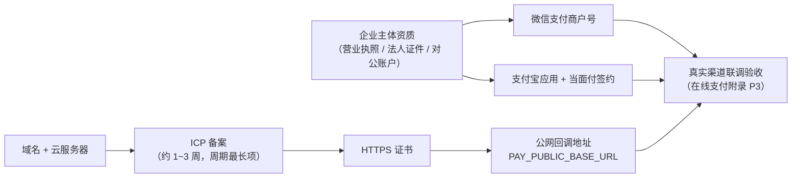

# 平台账号与配置申请指南

> 面向上线准备的交付清单：盘点 apphub 依赖的全部外部平台账号，给出申请条件、申请流程、对应 `server/.env` 配置项与验证方式。
> 配置键均与 [server/.env.example](../../server/.env.example) 一一对应；各能力的设计依据见所引文档。

## 1. 就绪状态总览

| 能力 | 所属模块 | 依赖平台 | 状态 | 配置键组 |
| --- | --- | --- | --- | --- |
| 安装包 OSS 分发 | M1 appcenter | 阿里云 OSS + STS | ✅ 已就绪（2026-10-16 真实浏览器验收） | `OSS_*` / `STS_*` |
| 手机验证码 | M4 认证扩展 | 阿里云短信 | ⬜ 待申请（签名 + 模板报备） | `SMS_*` 四项 |
| 邮箱验证码 | M4 认证扩展 | SMTP 邮件服务 | ⬜ 待申请 | `MAIL_*` 五项 |
| 微信 Native 支付 | M5 在线支付 | 微信支付商户平台 | ⬜ 待申请（商户号资质） | `WECHAT_PAY_*` 五项 + 可选公钥两项 |
| 支付宝当面付 | M5 在线支付 | 支付宝开放平台 | ⬜ 待申请（应用 + 签约） | `ALIPAY_*` 三项 |
| 公网回调地址 | M5 在线支付 | 域名 / 备案 / HTTPS | ⬜ 待准备 | `PAY_PUBLIC_BASE_URL` |
| 代码托管 | 工程 | 阿里云 Codeup | ✅ 已就绪 | — |
| 数据库 | 底座 | PostgreSQL | ✅ 本机已就绪；生产需独立实例 | `DB_*` |

本地开发**无需任何账号**：短信 / 邮件 / 支付在非生产环境未配置时自动降级（log 通道 / Mock 渠道），全部业务链路可用 Mock 验收。

## 2. 上线关键路径



**尽早启动的两条长周期线**：ICP 备案（约 1~3 周）与支付商户资质审核（微信约 1~5 个工作日、支付宝当面付签约数个工作日，但若企业尚无微信认证主体 / 支付宝企业账号，前置注册另需时间）。

## 3. 阿里云短信（M4 手机验证码）

设计依据：[认证方式扩展设计](../应用管理平台/认证方式扩展设计.md) §3.2。生产四项缺一即启动失败；非生产未配置降级 log 通道（验证码写服务日志）。

### 申请条件

- 已完成企业实名认证的阿里云账号（个人认证可申请但签名 / 模板审核受限）
- 待验证的手机号收信侧无特殊限制（个人号码即可）

### 申请步骤

1. 开通服务：阿里云控制台 → **短信服务**（dysmsapi.aliyuncs.com），首次进入按提示开通
2. 申请签名：**国内消息 → 签名管理 → 添加签名**——签名内容（2~12 字符，如产品简称）、场景选「验证码」、按提示上传企业资质；审核通常数小时内
3. 申请模板：**国内消息 → 模板管理 → 添加模板**——模板类型「验证码」，内容含 `${code}`（仅数字）与 `${time}`（仅数字，1-2 位）两个变量，与代码发码文案对齐；实际报备模板：`您的验证码为：${code}，验证码${time}分钟内有效，请勿泄露！`（CODE `SMS_512656603`，签名「张家港智汇冰芯」，2026-10-20 审核通过）
4. 授权发短信权限：短信通道**复用全局阿里云 AK**（`ALI_ACCESS_KEY_*`，与 OSS 共用同一 RAM 子账号）——为该 RAM 子用户追加授权 `AliyunDysmsFullAccess`（或最小化自定义策略仅授 `dysmsapi:SendSms`）

### 配置项映射

| 配置键 | 值来源 |
| --- | --- |
| `ALI_ACCESS_KEY_ID` / `ALI_ACCESS_KEY_SECRET` | 全局阿里云 AK（与 OSS 共用同一 RAM 子账号，子账号同时具备 OSS 与短信发送权限） |
| `SMS_SIGN_NAME` | 签名管理中已通过审核的签名内容（当前为「张家港智汇冰芯」） |
| `SMS_TEMPLATE_CODE` | 模板管理中已通过审核的模板 CODE（`SMS_` 开头，当前为 `SMS_512656603`） |

### 验证方式

配置后重启服务，调开放接口 `POST /api/open/member/code/send`（scene=login，type=phone）向真实手机号发一条，收到短信即通；未配置时启动日志出现「SmsCodeSender 降级 log」warn，验证码直接打在服务日志中。

## 4. SMTP 邮件（M4 邮箱验证码）

设计依据同上。生产五项缺一即启动失败；非生产降级 log 通道。

### 方案选择（二选一）

- **方案 A（推荐）：阿里云邮件推送 DirectMail**——到达率好、按量计费便宜；控制台开通后 **发信地址 → 创建发信地址**（如 `noreply@mail.你的域名`，需域名归属验证 + 回信地址验证），并为该地址**设置 SMTP 密码**；发信域名在 DNS 中加 SPF / MX 解析记录（控制台有具体值）
- **方案 B：企业邮箱 SMTP**——腾讯 / 阿里企业邮箱任一账号，开启 SMTP 服务后使用**授权码**（非登录密码）

### 配置项映射

| 配置键 | 方案 A（DirectMail） | 方案 B（企业邮箱） |
| --- | --- | --- |
| `MAIL_HOST` | `smtpdm.aliyun.com` | 如 `smtp.exmail.qq.com` |
| `MAIL_PORT` | `465`（SSL） | `465` |
| `MAIL_USER` | 发信地址 | 邮箱账号 |
| `MAIL_PASS` | SMTP 密码 | SMTP 授权码 |
| `MAIL_FROM` | 同发信地址 | 同邮箱账号 |

### 验证方式

同短信：`code/send`（type=email）向真实邮箱发一条；未配置时降级 log。

## 5. 微信支付商户号（M5 微信 Native）

设计依据：[在线支付渠道接入附录](../应用管理平台/在线支付渠道接入附录.md) §7。五项齐备即装配真实渠道；生产两渠道全未配或部分填写启动失败。

### 申请条件

- 企业 / 个体工商户主体：营业执照、法人身份证、结算银行账户（对公户或法人银行卡）
- **一个已微信认证的 AppID**：已认证的服务号 / 小程序 / 开放平台网站应用——若公司尚无，需先注册并认证（服务号认证需企业资质，审核费 300 元/年）；桌面应用本身不在微信生态内，AppID 由该认证主体提供

### 申请步骤

1. 提交入驻：[pay.weixin.qq.com](https://pay.weixin.qq.com) → **接入微信支付** → 在线提交主体与结算资料（审核约 1~5 个工作日），获得**商户号 mchid**
2. 开通产品：商户平台 → **产品中心 → 我的产品** → 开通 **Native 支付**
3. 绑定 AppID：**产品中心 → AppID 账号管理** → 关联上述已认证 AppID（AppID 侧确认授权）
4. API 安全三项（商户平台 → **账户中心 → API 安全**）：
   - **申请 API 证书**：下载证书文件 `apiclient_cert.pem` 与私钥 `apiclient_key.pem`，记录**证书序列号**（40 位十六进制）
   - **设置 APIv3 密钥**：自定义 32 位字母数字串（回调解密与平台证书下载共用）
   - 查看本商户是「平台证书」还是「微信支付公钥」模式（2024-08 后新商户默认后者）：若为公钥模式，页面可下载 `wechatpayPublicKey.pem` 与 `PUB_KEY_ID_` 开头的公钥序列号
5. 文件部署：`apiclient_key.pem`（及公钥模式的 `wechatpayPublicKey.pem`）拷贝到服务器固定路径（建议 `/etc/apphub/pay/`，权限 600，不入库不入日志）

### 配置项映射

| 配置键 | 值来源 |
| --- | --- |
| `WECHAT_PAY_APP_ID` | 关联的已认证 AppID |
| `WECHAT_PAY_MCH_ID` | 商户号 |
| `WECHAT_PAY_CERT_SERIAL` | API 证书序列号 |
| `WECHAT_PAY_PRIVATE_KEY_PATH` | 服务器上 `apiclient_key.pem` 绝对路径 |
| `WECHAT_PAY_APIV3_KEY` | 自设的 APIv3 密钥 |
| `WECHAT_PAY_PUBLIC_KEY_SERIAL`（可选） | 公钥模式：`PUB_KEY_ID_` 开头序列号 |
| `WECHAT_PAY_PUBLIC_KEY_PATH`（可选） | 公钥模式：`wechatpayPublicKey.pem` 路径 |

公钥两项**要么都配要么都不配**（两项配齐才启用公钥验签，老商户不配走平台证书自动拉取）。

### 验证方式

- 装配验证：配置后重启，`order/create`（channel=wechat）返回的二维码串为 `weixin://wxpay/...`（Mock 为 `mock://pay/...`）
- 回调验证：`PAY_PUBLIC_BASE_URL` 就绪后，真实 1 分钱单扫码支付，服务日志出现微信回调受理 `SUCCESS` 应答与 markPaid `applied`（附录 P3 验收项）

## 6. 支付宝当面付（M5 支付宝当面付）

设计依据同上。三项齐备即装配真实渠道。

### 申请条件

- 支付宝**企业账号**（或个体户）：营业执照、法人身份证
- 正式签约「当面付」需真实经营资质；**联调可先用沙箱**（个人开发者即可申请沙箱）

### 申请步骤

1. 创建应用：[open.alipay.com](https://open.alipay.com) → **控制台 → 创建应用**（网页/移动应用），获得 **APPID**
2. 配置加签（**公钥模式**，非公钥证书模式——与本项目 SDK 验签方式对应）：
   - 下载「支付宝开放平台密钥工具」，生成 **RSA2（2048 位，PKCS8）** 密钥对，妥善保存**应用私钥**
   - 应用详情 → **开发设置 → 接口加签方式 → 公钥** → 粘贴**应用公钥** → 平台生成**支付宝公钥**（注意：验签用的是这份支付宝公钥，不是应用公钥），将其内容保存为 PEM 文件
3. 签约产品：应用详情 → **产品绑定 → 当面付 → 签约**（按提示上传经营资质，审核数个工作日）
4. 文件部署：应用私钥与支付宝公钥两个 PEM 拷贝服务器（同微信建议）
5. （可选）沙箱联调：控制台 → **沙箱环境**——使用沙箱 APPID、沙箱支付宝公钥与沙箱网关，配合作弊买家账号扫码，全程不产生真实资金

### 配置项映射

| 配置键 | 值来源 |
| --- | --- |
| `ALIPAY_APP_ID` | 应用 APPID（沙箱联调填沙箱 APPID） |
| `ALIPAY_PRIVATE_KEY_PATH` | 服务器上应用私钥 PEM 绝对路径 |
| `ALIPAY_PUBLIC_KEY_PATH` | 服务器上**支付宝公钥** PEM 绝对路径（沙箱联调填沙箱支付宝公钥文件） |
| `ALIPAY_GATEWAY` | 留空默认正式网关；沙箱填 `https://openapi-sandbox.dl.alipay.com/gateway.do` |

### 验证方式

- 装配验证：`order/create`（channel=alipay）返回 `https://qr.alipay.com/...` 或当面付 `qr` 串
- 回调验证：真实小额单支付后，日志出现支付宝回调受理 `success` 应答与 markPaid `applied`

## 7. 公网部署与生产环境核对清单

### 7.1 部署前置

| 事项 | 说明 |
| --- | --- |
| 云服务器 / 容器 | 国内节点（备案前提）；2C4G 起 |
| 域名 | 如 `api.你的域名.com`；国内节点必须 **ICP 备案**（云厂商代提交，约 1~3 周，**周期最长项，最先启动**） |
| HTTPS 证书 | 云厂商免费 DV 证书或 Let's Encrypt；微信 / 支付宝回调强制 HTTPS |
| `PAY_PUBLIC_BASE_URL` | `https://api.你的域名.com`——配置后预下单显式传 `notify_url`（`{base}/api/pay/callback/wechat|alipay`）；未配置时回落渠道侧默认配置，仅靠兜底查单 |
| 生产 PostgreSQL | 云 RDS（推荐，自动备份）或自建；与应用同可用区内网互通 |

### 7.2 生产 `.env` 核对清单

```text
NODE_ENV=production                 # 生产标记（DB_SYNC 强制关闭、各通道 fail-fast 生效）
DB_*                                # 生产数据库连接
JWT_SECRET / MEMBER_JWT_SECRET      # 各自独立的随机长串（默认值启动即失败）
SIGNATURE_SECRET                    # 与前端 VITE_SIGN_SECRET 一致的随机长串
SWAGGER_ENABLED=false               # 生产建议关闭接口文档
OSS_* / STS_*                       # 已就绪，按生产桶核对
SMS_* 四项 / MAIL_* 五项            # 生产缺配即启动失败（见 §3 / §4）
WECHAT_PAY_* / ALIPAY_*             # 至少一个渠道齐备（见 §5 / §6），两渠道全空启动失败
PAY_PUBLIC_BASE_URL                 # 公网 HTTPS 回调基址
```

### 7.3 上线验收

1. `pnpm check` 全绿 + 迁移执行：`pnpm --filter server migration:run`
2. 管理后台登录 / 应用 / 会员 / 订阅四模块冒烟
3. 真实渠道联调验收（附录 P3）：1 分钱真实单 → 扫码支付 → 回调日志受理成功 → introspect 订阅生效 → 后台订单已支付
