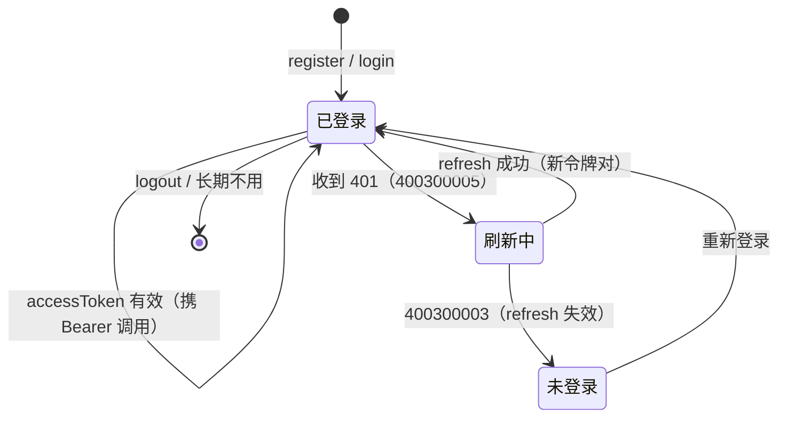
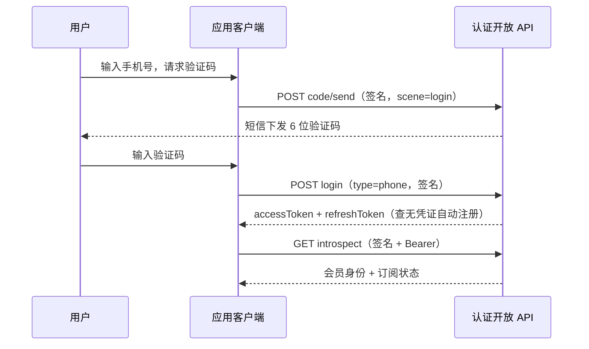

# 会员认证接入手册

> 面向为应用接入「用户注册 / 登录 / 身份校验」能力的开发者。
> 订阅支付的前置手册——[订阅支付接入手册](订阅支付接入手册.md) 的下单等用户态接口依赖本册的会员令牌。

## 1. 能力概述

- 会员账号托管在平台侧（统一认证）：应用不自建用户体系，经开放 API 完成注册、登录、凭证管理与身份校验
- **五种凭证类型**自由组合接入（可只接其一）：密码、手机验证码、邮箱验证码、微信扫码标识、支付宝扫码标识
- **双令牌机制**：短期 `accessToken`（默认 8 小时）随请求携带 + 长期 `refreshToken`（默认 30 天）用于无感续期
- 会员按 appKey 隔离：同一标识在不同应用中是不同会员；令牌与 appKey 绑定，不可跨应用使用

## 2. 接入前提

| 事项 | 说明 |
| --- | --- |
| 平台方准备 | 在管理后台注册应用，开通所需凭证类型对应的通道（短信 / 邮箱由平台侧配置） |
| 接入方获得 | **appKey**（随客户端分发）+ **appSecret**（签名密钥，保密） |
| 保密要求 | appSecret 泄漏将导致接口可被伪造调用。**有服务端的应用务必由服务端代理调用与签名**；纯客户端分发形态 appSecret 须编入二进制并接受残余风险（平台对此类公开客户端限流阈值减半） |
| 服务基址 | 线上环境 **`https://appcenter.witice.top`**（不含 `/api`），开放接口路径均以 `/api/open/member/**` 开头 |

## 3. 请求签名（app 方案）

会员认证全部接口（含 GET）要求 HMAC 请求签名，防伪造与重放。

### 3.1 请求头四件套

| 请求头 | 说明 |
| --- | --- |
| `X-App-Key` | 应用标识 |
| `sign` | 签名值（小写十六进制） |
| `timestamp` | 毫秒时间戳（与服务端时差须在 ±5 分钟内） |
| `noncestr` | 随机串，**一次性**（同一值重发会被拒） |

### 3.2 签名算法

```text
签名串 = METHOD + "\n" + path + "\n" + body + "\n" + timestamp + "\n" + noncestr
sign   = HMAC-SHA256(签名串, appSecret) 的小写 hex
```

| 段 | 规则 |
| --- | --- |
| `METHOD` | HTTP 方法大写（`POST` / `GET`） |
| `path` | URL 中主机名之后、`?` 之前的部分，**含 `/api` 前缀**，如 `/api/open/member/auth/login`；query 参数不参与签名 |
| `body` | 请求体**原文**（发送的确切 JSON 字符串）；无请求体（GET、无 body 的 POST）用空串 |
| `timestamp` / `noncestr` | 与请求头携带值一致 |

要点：

- **签的 = 发的**：先 `JSON.stringify` 得到字符串，签名与发送复用同一字符串，禁止两处独立序列化（键序 / 空格差异都会导致签名不匹配）
- 带请求体时 `Content-Type` 必须为 `application/json`
- 签名失败统一返回 HTTP 401，不提示具体环节（排查方向见 3.4）

### 3.3 TypeScript 实现（跨 Node / 浏览器 / Electron / Tauri）

```ts
const BASE = 'https://appcenter.witice.top'
const APP_KEY = '你的appKey'
const APP_SECRET = '你的appSecret'

function randomNonce(): string {
  return crypto.randomUUID().replaceAll('-', '')
}

async function hmacSha256Hex(text: string, secret: string): Promise<string> {
  const enc = new TextEncoder()
  const key = await crypto.subtle.importKey(
    'raw', enc.encode(secret), { name: 'HMAC', hash: 'SHA-256' }, false, ['sign'],
  )
  const sig = await crypto.subtle.sign('HMAC', key, enc.encode(text))
  return Array.from(new Uint8Array(sig)).map(b => b.toString(16).padStart(2, '0')).join('')
}

/** 发起带签名的开放 API 请求（path 形如 /api/open/member/auth/login，不含基址） */
async function callApi(path: string, method: 'GET' | 'POST', bodyObj?: unknown, accessToken?: string) {
  const body = bodyObj === undefined ? '' : JSON.stringify(bodyObj)
  const timestamp = String(Date.now())
  const noncestr = randomNonce()
  const sign = await hmacSha256Hex(
    [method.toUpperCase(), path, body, timestamp, noncestr].join('\n'),
    APP_SECRET,
  )
  const headers: Record<string, string> = {
    'X-App-Key': APP_KEY,
    sign,
    timestamp,
    noncestr,
  }
  if (body)
    headers['Content-Type'] = 'application/json'
  if (accessToken)
    headers.Authorization = `Bearer ${accessToken}`
  const res = await fetch(`${BASE}${path}`, { method, headers, body: body || undefined })
  const json = await res.json()
  if (json.code !== 0)
    throw new ApiError(json.code, json.message)
  return json.data
}

class ApiError extends Error {
  constructor(readonly code: number, message: string) {
    super(message)
  }
}
```

> Node 18+、现代浏览器、Electron、Tauri WebView 均内置 `crypto.subtle`，上述实现可直接使用。

### 3.4 签名 401 排查表

| 常见原因 | 检查点 |
| --- | --- |
| 时钟漂移超 5 分钟 | 设备 NTP 同步；timestamp 是否毫秒（非秒） |
| nonce 重放 | 同一 noncestr 是否被复用（每次请求重新生成） |
| body 两处序列化不一致 | 是否签名用一个字符串、发送用另一个 |
| path 段取错 | 是否漏了 `/api` 前缀 / 误把完整 URL 或 query 串拼进签名串 |
| appKey / appSecret 不匹配 | appKey 是否传对；appSecret 是否为该应用的 |

## 4. 凭证类型矩阵

| type | identifier | credential | 前置动作 |
| --- | --- | --- | --- |
| `password` | 自设账号（用户名） | 密码明文（HTTPS 通道传输） | 无 |
| `phone` | 手机号 | 6 位验证码 | 先调 `code/send`（scene 按用途） |
| `email` | 邮箱 | 6 位验证码 | 同上 |
| `wechat` | 微信 unionid | 固定传 `oauth` 占位 | 应用侧自行完成微信 OAuth 拿到 unionid |
| `alipay` | 支付宝 user_id | 固定传 `oauth` 占位 | 应用侧自行完成支付宝授权拿到 user_id |

- 扫码类型（`wechat` / `alipay`）的 identifier 由应用侧 OAuth 流程获得，平台**占位信任签名层**不校验第三方身份——接入方须确保 OAuth 流程真实可靠
- 验证码规则：6 位、5 分钟有效、**60 秒重发间隔**、单标识每日限 10 条、**单次作废**（校验失败一次即作废，须重新发送）
- 密码强度与标识格式由服务层校验，不合法返回 `400200007`（凭证格式非法）

## 5. 接口详解

以下端点均需 §3 请求签名；标注 🔑 的还需携带会员令牌（`Authorization: Bearer {accessToken}`）。

### 5.1 注册与登录

`POST /api/open/member/auth/register` 与 `POST /api/open/member/auth/login`，入参结构相同：

```json
{ "type": "password", "identifier": "zhangsan", "credential": "p@ssw0rd!", "nickname": "张三" }
```

| 字段 | 必填 | 说明 |
| --- | --- | --- |
| `type` | 是 | 凭证类型（见 §4 矩阵） |
| `identifier` | 是 | 登录标识，1~128 位 |
| `credential` | 是 | 凭证密文，1~128 位 |
| `nickname` | 否 | 昵称；未填自动生成。login 中仅「自动注册新会员」时生效，已存在会员忽略 |

响应（注册 / 登录均直接返回令牌对，**注册即登录**）：

```json
{
  "accessToken": "eyJhbGciOi…",
  "refreshToken": "6dcd4d…（64 位十六进制原文，请完整保存）",
  "expiresIn": 28800
}
```

`expiresIn` 为 accessToken 有效秒数（默认 28800 = 8 小时）。

行为要点：

- **登录即注册**：`phone` / `email` / `wechat` / `alipay` 类型登录时查无凭证将**自动注册**并返回令牌（携带 nickname 生效）；`password` 类型查无账号返回 `400300001`
- 密码错误统一返回 `400300001`（账号或密码错误），**不区分**账号不存在与密码错误，防枚举
- 密码连续错误 **5 次锁定 15 分钟**（按 appKey + 标识维度），锁定期返回 `400300002`
- 注册时标识已被占用返回 `400200002`（凭证标识已存在）

### 5.2 发送验证码

`POST /api/open/member/auth/code/send`

```json
{ "type": "phone", "identifier": "13800000000", "scene": "login" }
```

| 字段 | 说明 |
| --- | --- |
| `type` | `phone` / `email` |
| `identifier` | 手机号 / 邮箱 |
| `scene` | `login` / `register` / `bind`（bind 场景服务端会先预检标识归属） |

成功返回 `data: null`。频率类错误码：`400200008`（60 秒内重发）、`400200009`（当日已达 10 条上限）、`400200010`（通道发送失败，稍后重试）。

### 5.3 刷新令牌

`POST /api/open/member/auth/refresh`

```json
{ "refreshToken": "64位十六进制原文" }
```

返回新令牌对（结构同 5.1）。**轮换机制**：旧 refreshToken 在刷新成功后即刻吊销，新 refreshToken 生效。并发使用同一 refreshToken 刷新时**后发者胜、先发者所得令牌即刻失效**——接入方应：

- 串行刷新（全局同一时刻只允许一个刷新请求在途）
- 刷新返回 `400300003`（登录状态已失效）时直接走重新登录，不要重试

### 5.4 登出 🔑

`POST /api/open/member/auth/logout`，body 携带待吊销的 `{ "refreshToken": "…" }`。幂等：令牌已吊销也返回成功。登出后本地清空两个令牌。

### 5.5 绑定新凭证 🔑

`POST /api/open/member/auth/bind`，body `{ type, identifier, credential }`（矩阵同 §4；验证码类型须先 `code/send` scene=bind）。响应：

```json
{ "result": "added" }
```

`added` = 新增凭证；`existed` = 幂等成功（该凭证已归属当前会员）。凭证已归属**其他**会员时返回 `400200004`，须对方先解绑。

### 5.6 令牌在线校验（introspect）🔑

`GET /api/open/member/token/introspect`

```json
{
  "member": { "id": "…", "nickname": "张三", "avatarUrl": null, "status": "enabled" },
  "subscription": { "subscribed": false, "planName": null, "periodType": null, "expireAt": null }
}
```

- 会员身份与订阅状态**一次调用同时取得**（订阅段字段见[订阅支付接入手册](订阅支付接入手册.md)）
- GET 同样参与请求签名（body 段为空串）
- 服务端逐请求查库：会员被禁用 / 删除后令牌即时失效（401 + `400300005`）

## 6. 令牌管理建议



- accessToken 随业务请求携带 `Authorization: Bearer {accessToken}`；收到 401（`400300005` / `400300004`）时先尝试刷新，刷新失败再引导重新登录
- 令牌与 appKey 绑定（D19）：换 appKey 使用令牌返回 `400300004`（令牌与应用不匹配），属预期防护
- 本地存储建议：桌面端使用系统凭据管理器（Windows Credential Manager / macOS Keychain）；避免明文落普通文件

## 7. 认证流程示例



## 8. 错误码表

| code | 含义 | 客户端处理建议 |
| --- | --- | --- |
| `400100002` | 会员已禁用 | 提示联系平台方，停止重试 |
| `400200001` | 凭证类型不支持 | 检查 type 取值 |
| `400200002` | 凭证标识已存在（注册冲突 / 绑定冲突） | 引导改用登录或换标识 |
| `400200004` | 凭证已归属其他会员 | 引导换标识或对方解绑 |
| `400200006` | 验证码错误或已过期（**单次作废**） | 引导重新发送，不要重试旧码 |
| `400200007` | 凭证格式非法 | 按提示修正格式 |
| `400200008` / `400200009` / `400200010` | 验证码过频 / 日限 / 发送失败 | 倒计时禁发 / 提示次日再试 / 稍后重试 |
| `400300001` | 账号或密码错误 | 提示重输；连续 5 次将锁定 15 分钟 |
| `400300002` | 登录尝试被锁定 | 提示等待 15 分钟 |
| `400300003` | refreshToken 无效或已过期 | 清空本地态，走重新登录 |
| `400300004` | 令牌与应用不匹配 | 检查是否串用了其他应用的令牌 |
| `400300005` | accessToken 无效或已过期 | 先刷新，失败再重新登录 |
| HTTP 401 | 签名校验失败 | 见 §3.4 排查表 |
| HTTP 429 | 触发限流 | 退避重试 |
