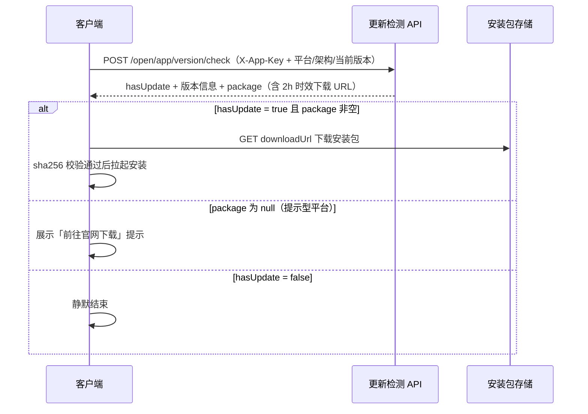

# 更新检测接入手册

> 面向为应用接入「发版 + 客户端检查更新」能力的开发者。
> 更新检测是零密钥救生通道：**不需要 appSecret、不需要签名、不需要用户登录**，客户端仅需持有 appKey 即可接入。

## 1. 能力概述

- 平台托管应用的版本与安装包：管理后台登记版本 / 上传安装包 / 发布，客户端按需检测
- 一套数据同时服务三种客户端形态，接入方按技术栈**三选一**：
  - **自研协议**：任何技术栈通用的 JSON 检测接口（推荐非 electron / tauri 应用使用）
  - **electron-updater 适配**：直出 `latest*.yml` 清单，electron 应用零改造接入
  - **tauri-plugin-updater 适配**：直出 tauri v2 updater 清单
- 通道（stable / beta 等）与灰度、强制更新标记（force_update）由版本数据驱动，客户端只需透传展示

## 2. 接入前提

| 事项 | 说明 |
| --- | --- |
| 平台方准备 | 在管理后台注册应用、开通通道、发布至少一个版本并登记安装包 |
| 接入方获得 | **appKey**（32 位标识，检测请求唯一凭证）、通道 code（默认 `stable`） |
| 保密要求 | appKey 可公开分发（随客户端发布无风险）；appSecret 在本能力中**完全不需要** |

> 未发布任何版本时：自研协议返回 `hasUpdate: false`；electron 端点返回 404；tauri 端点返回 204——均为「无更新」语义，客户端容错即可。

## 3. 形态一：自研协议（通用）

### 3.1 请求

`POST {基址}/api/open/app/version/check`

请求头：`X-App-Key: {appKey}`、`Content-Type: application/json`

请求体：

| 字段 | 类型 | 必填 | 说明 |
| --- | --- | --- | --- |
| `platform` | string | 是 | `windows` / `macos` / `linux` / `android` / `ios` / `web` |
| `channel` | string | 否 | 通道 code，缺省 `stable` |
| `arch` | string | 否 | `x64` / `arm64` / `universal`，**桌面端必填**，其余平台可空 |
| `currentVersion` | string | 否 | 客户端当前版本（semver）；首次安装可空，非 semver 值按「必有更新」处理 |

### 3.2 响应

```json
{
  "code": 0,
  "message": "ok",
  "data": {
    "hasUpdate": true,
    "latestVersion": "1.3.0",
    "title": "v1.3.0 正式版",
    "notes": "修复若干问题\n新增深色模式",
    "forceUpdate": false,
    "package": {
      "fileName": "myapp-1.3.0-x64.exe",
      "fileSize": 83886080,
      "sha256": "e3b0c44298fc1c14…",
      "downloadUrl": "https://…/myapp-1.3.0-x64.exe?Expires=…&Signature=…"
    }
  }
}
```

| 字段 | 说明 |
| --- | --- |
| `hasUpdate` | 是否有更新；`false` 时**其余字段全部省略**（无更新 / 通道停用 / 应用停用统一语义，不暴露原因） |
| `latestVersion` / `title` / `notes` | 最新版本号（semver）、版本标题、更新说明 |
| `forceUpdate` | 强制更新标记；为 `true` 时建议客户端禁用「稍后」入口 |
| `package` | 下载包信息；**提示型平台（web / ios）无安装包，为 `null`**——此时仅展示「请前往官网下载」类提示 |
| `package.downloadUrl` | 带签名的临时下载 URL，**2 小时时效**，过期后须重新检测获取新 URL，不要长期缓存 |
| `package.sha256` | 安装包 SHA-256，下载完成后校验再执行安装 |

### 3.3 接入示例（TypeScript）

```ts
const BASE = 'https://api.example.com'
const APP_KEY = '你的appKey'

interface CheckResult {
  hasUpdate: boolean
  latestVersion?: string
  title?: string
  notes?: string | null
  forceUpdate?: boolean
  package?: { fileName: string, fileSize: number, sha256: string, downloadUrl: string } | null
}

async function checkUpdate(platform: string, arch: string | undefined, currentVersion: string) {
  const res = await fetch(`${BASE}/api/open/app/version/check`, {
    method: 'POST',
    headers: { 'X-App-Key': APP_KEY, 'Content-Type': 'application/json' },
    body: JSON.stringify({ platform, arch, currentVersion, channel: 'stable' }),
  })
  const body = await res.json()
  if (body.code !== 0)
    throw new Error(`检测失败：${body.code} ${body.message}`)
  return body.data as CheckResult
}
```

下载后校验（Node 环境）：

```ts
import { createHash } from 'node:crypto'
import { readFile } from 'node:fs/promises'

async function verifySha256(filePath: string, expected: string): Promise<boolean> {
  const hash = createHash('sha256').update(await readFile(filePath)).digest('hex')
  return hash === expected.toLowerCase()
}
```

### 3.4 检测流程



## 4. 形态二：electron-updater 适配

平台按 electron-updater 的 generic provider 协议直出 `latest*.yml` 清单（裸 YAML，非统一响应包裹），安装包 URL 已内嵌签名直链。

### 4.1 端点与架构映射

| 端点（GET） | 对应清单 | 固定架构 |
| --- | --- | --- |
| `/api/update/{appKey}/{channel}/electron/latest.yml` | Windows | x64 |
| `/api/update/{appKey}/{channel}/electron/latest-mac.yml` | macOS | universal |
| `/api/update/{appKey}/{channel}/electron/latest-linux.yml` | Linux | x64 |

无已发布版本时返回 **404**，客户端按「无更新」容错（electron-updater 会记录报错日志，不影响应用运行；建议发布首个版本后再启用自动更新）。

### 4.2 集成配置

```ts
// main.ts（electron-updater）
import { autoUpdater } from 'electron-updater'

autoUpdater.setFeedURL({
  provider: 'generic',
  url: 'https://api.example.com/api/update/{appKey}/stable/electron',
})
autoUpdater.autoDownload = true
autoUpdater.checkForUpdates()
```

### 4.3 清单行为说明

- `files[].url` 为带签名的临时直链（含 blockmap 差量文件，若平台侧已登记），`sha512` / `size` 用于差量与完整性校验
- `releaseNotes` 为版本更新说明；**若版本标记了强制更新，首行会前置 `[force]` 标记**，展示前应剔除：

```ts
const FORCE_MARK = '[force]'
let forceUpdate = false
let notes = info.releaseNotes ?? ''
if (notes.startsWith(FORCE_MARK)) {
  forceUpdate = true
  notes = notes.slice(FORCE_MARK.length).replace(/^\n/, '')
}
```

- 版本比较在 electron-updater 客户端侧完成，平台只负责给出最新已发布版本清单

## 5. 形态三：tauri-plugin-updater 适配

按 tauri v2 `tauri-plugin-updater` 的 endpoint 协议直出 JSON manifest（裸载荷，非统一响应包裹）。

### 5.1 端点

`GET /api/update/{appKey}/{channel}/tauri/{target}/{currentVersion}`

`target` 取值（不在下表的未识别 target 一律返回 204）：

| target | 平台 / 架构 |
| --- | --- |
| `windows-x86_64` | Windows x64 |
| `windows-aarch64` | Windows arm64 |
| `darwin-x86_64` | macOS x64 |
| `darwin-aarch64` | macOS arm64 |
| `linux-x86_64` | Linux x64 |

响应语义：**200 = 有更新**（manifest JSON）；**204 = 无更新**（服务端完成版本比较，候选不新于 `currentVersion` 也返回 204）。

manifest 结构：

```json
{
  "version": "1.3.0",
  "pub_date": "2026-10-19T08:00:00.000Z",
  "notes": "[force]\n修复若干问题",
  "platforms": {
    "windows-x86_64": {
      "signature": "minisign 签名串（平台登记包时录入）",
      "url": "https://…/myapp-1.3.0-x64-setup.exe?Signature=…"
    }
  }
}
```

### 5.2 集成配置

`tauri.conf.json`（endpoint 模板占位符由插件运行时替换）：

```json
{
  "plugins": {
    "updater": {
      "endpoints": [
        "https://api.example.com/api/update/{appKey}/stable/tauri/{{target}}/{{current_version}}"
      ],
      "pubkey": "你的 minisign 公钥（与平台登记的包签名同密钥对）"
    }
  }
}
```

> `signature` 由平台侧登记安装包时录入（与 `pubkey` 同一密钥对），插件自动完成验签；`notes` 首行 `[force]` 标记的剔除逻辑同 4.3。

## 6. 通用行为与错误处理

| HTTP | code | 含义 | 客户端处理建议 |
| --- | --- | --- | --- |
| 200 | `0` | 正常返回（含 `hasUpdate: false`） | — |
| 400 | `300100002` | AppKey 无效 | 检查 appKey 拼写；持续出现联系平台方 |
| 404 / 204 | — | electron / tauri 端点「无更新」 | 容错忽略（见各节说明） |
| 429 | `429` | 触发限流 | 退避重试；检测频率建议 ≥ 启动时一次 + 手动刷新，勿高频轮询 |

自研协议的入参错误（平台 / 架构取值非法等）返回 HTTP 400 + 通用校验错误码，按响应 `message` 提示修正即可。
