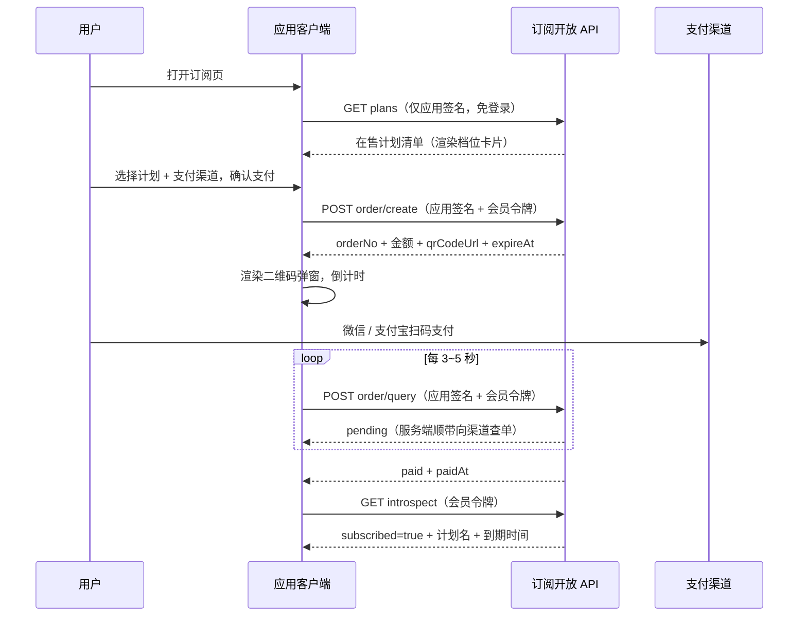

# 订阅支付接入手册

> 面向为应用接入「付费订阅 + 在线支付」能力的开发者。
> **前置手册**：下单等用户态接口依赖会员令牌，请先完成 [会员认证接入手册](会员认证接入手册.md) 的接入（含请求签名实现）。

## 1. 能力概述

- 平台托管订阅计划（档位 / 价格 / 上下架）与订单，应用侧展示计划、发起支付、轮询结果
- 在线支付渠道：**微信 Native**（扫码）与 **支付宝当面付**（扫码），二选一或并存由用户在下单时指定
- 二维码由**应用侧渲染**（平台返回二维码内容串）；支付结果由应用侧**轮询**获取——渠道异步回调由平台与渠道直接交互，接入方无需关心回调地址、验签、对账
- 订阅状态经 introspect 一次取回（会员身份 + 订阅段），无独立订阅查询端点

## 2. 接入前提

| 事项 | 说明 |
| --- | --- |
| 平台方准备 | 管理后台注册应用、创建并上架订阅计划、开通在线支付渠道（微信 / 支付宝） |
| 接入方准备 | 已完成会员认证接入（appKey + appSecret + 签名 + 令牌管理） |
| 联调环境 | 非生产环境平台自动降级 Mock 渠道：下单返回 `mock://pay/{订单号}` 二维码串，配合平台提供的触发支付端点完成全链路联调 |
| 服务基址 | 线上环境 **`https://appcenter.witice.top`**（不含 `/api`），下文端点路径均按该基址拼接 |

## 3. 业务总览



## 4. 接口详解

以下端点均需请求签名（[会员认证接入手册 §3](会员认证接入手册.md)）；标注 🔑 的还需 `Authorization: Bearer {accessToken}`。

### 4.1 在售计划清单

`GET /api/open/subscription/plans`

**免登录**（未登录可先浏览橱窗，登录后才可下单）。响应：

```json
[
  {
    "id": "0b1c2d3e-…（计划 id，下单时使用）",
    "name": "专业版 · 年付",
    "periodType": "yearly",
    "durationMonths": 12,
    "price": 99000,
    "originalPrice": 129000,
    "remark": "全部功能 + 优先支持"
  }
]
```

| 字段 | 说明 |
| --- | --- |
| `periodType` | `monthly` 月付 / `quarterly` 季付 / `yearly` 年付 / `permanent` 永久 |
| `durationMonths` | 订阅时长（日历月）；`permanent` 为 `null` |
| `price` / `originalPrice` | 现价 / 划线原价，**单位：分**（展示时 ÷100）；`originalPrice` 可为 `null` |
| `remark` | 计划说明，可为 `null` |

### 4.2 在线下单 🔑

`POST /api/open/subscription/order/create`

```json
{ "planId": "0b1c2d3e-…", "channel": "wechat" }
```

| 字段 | 说明 |
| --- | --- |
| `planId` | 计划 id（UUID，来自 plans 清单） |
| `channel` | `wechat` / `alipay` |

响应：

```json
{
  "orderNo": "20261019103000123",
  "amount": 99000,
  "qrCodeUrl": "weixin://wxpay/bizpayurl?pr=xxxxx",
  "expireAt": "2026-10-19T12:30:00.123Z"
}
```

| 字段 | 说明 |
| --- | --- |
| `orderNo` | 订单号，轮询凭证（妥善保存至支付完成） |
| `amount` | 应付金额（分），展示时 ÷100 |
| `qrCodeUrl` | 二维码**内容串**，应用侧渲染为二维码图片。微信为 `weixin://wxpay/…`、支付宝为 `https://qr.alipay.com/…`（或当面付 `qr` 串）、联调环境为 `mock://pay/{orderNo}` |
| `expireAt` | 待支付过期时刻（下单后 **2 小时**），过期订单自动关闭；建议二维码弹窗同步倒计时 |

### 4.3 订单轮询 🔑

`POST /api/open/subscription/order/query`

```json
{ "orderNo": "20261019103000123" }
```

响应：

```json
{ "status": "paid", "paidAt": "2026-10-19T10:35:20.456Z" }
```

| status | 含义 | 客户端动作 |
| --- | --- | --- |
| `pending` | 待支付 | 继续轮询（服务端会按节流**自动顺带向渠道查单**，用户完成扫码后无需用户端做任何触发） |
| `paid` | 已支付 | 停止轮询 → 调 introspect 刷新订阅状态 → 展示成功 |
| `closed` | 已关闭（超时 / 渠道预下单失败） | 停止轮询，引导重新下单 |

轮询建议：**3~5 秒**间隔；离开支付弹窗即停止；收到 `paid` / `closed` 终态即止。

> 轮询响应不含订阅信息——确认 `paid` 后经 introspect 取订阅态（下单 → 支付 → 生效之间可能存在秒级延迟，introspect 若仍显示未订阅可稍后重查一次）。

### 4.4 订阅状态（introspect）🔑

`GET /api/open/member/token/introspect`（端点属认证域，签名规则相同），`subscription` 段：

```json
{
  "subscribed": true,
  "planName": "专业版 · 年付",
  "periodType": "yearly",
  "expireAt": "2027-10-19T10:35:20.456Z"
}
```

- `subscribed`：当前是否有有效订阅（到期自动转 false）
- `expireAt`：到期时刻；**永久档为哨兵值 `2999-12-31`**，展示层应判断 `periodType === 'permanent'` 显示「永久」而非该日期

## 5. 支付渠道说明

| 渠道 | qrCodeUrl 形态 | 用户动作 |
| --- | --- | --- |
| `wechat`（Native） | `weixin://wxpay/…` | 微信扫码 |
| `alipay`（当面付） | `https://qr.alipay.com/…` | 支付宝扫码 |
| Mock（非生产联调） | `mock://pay/{orderNo}` | 无真实支付，由平台方触发模拟支付成功 |

- 渠道选择是**每次下单的用户选择**，无需接入时二选一
- 支付超时（2 小时）后订单自动关闭，期间如支付成功仍会被对账受理（订单已关闭场景留痕处理），用户侧无感
- 除支付宝 / 微信外的渠道（如线下转账备案）由平台方在管理后台人工处理，不经过开放 API

## 6. TypeScript 接入示例

复用[会员认证接入手册 §3.3](会员认证接入手册.md) 的 `callApi`（已封装签名，第四参透传 accessToken 即携带 Bearer；401 时按认证手册 §6 先刷新令牌再重试）：

```ts
let accessToken = '' // 登录 / 刷新后更新

/** 1. 拉取在售计划（免登录，不传 accessToken） */
async function loadPlans() {
  return callApi('/api/open/subscription/plans', 'GET') as Promise<
    { id: string, name: string, periodType: string, durationMonths: number | null,
      price: number, originalPrice: number | null, remark: string | null }[]
  >
}

/** 2. 下单并轮询至终态 */
async function payAndAwait(planId: string, channel: 'wechat' | 'alipay') {
  const order = await callApi('/api/open/subscription/order/create', 'POST', { planId, channel }, accessToken) as {
    orderNo: string, amount: number, qrCodeUrl: string, expireAt: string
  }
  renderQrCode(order.qrCodeUrl) // 应用侧二维码渲染（如 qrcode 库）

  while (true) {
    await sleep(4000)
    const result = await callApi('/api/open/subscription/order/query', 'POST', {
      orderNo: order.orderNo,
    }, accessToken) as { status: 'pending' | 'paid' | 'closed', paidAt?: string | null }
    if (result.status !== 'pending')
      return result // paid → introspect 刷新订阅；closed → 引导重新下单
  }
}

/** 3. 支付成功后刷新订阅状态 */
async function refreshSubscription() {
  const info = await callApi('/api/open/member/token/introspect', 'GET', undefined, accessToken) as {
    subscription: { subscribed: boolean, planName: string | null, periodType: string | null, expireAt: string | null }
  }
  const label = info.subscription.periodType === 'permanent'
    ? '永久'
    : info.subscription.expireAt
  return { ...info.subscription, label }
}

function sleep(ms: number) {
  return new Promise(resolve => setTimeout(resolve, ms))
}
```

## 7. 错误码表

| code | 含义 | 客户端处理建议 |
| --- | --- | --- |
| `500100001` | 订阅计划不存在 | 刷新计划清单后重选 |
| `500100002` | 订阅计划已下架 | 同上 |
| `500100003` | 订阅计划不属于该应用 | 确认 planId 来源于本应用 plans 清单 |
| `500200001` | 订单不存在（轮询时） | 检查 orderNo；持续出现重新下单 |
| `500200005` | 支付渠道错误或未接入 | 确认 channel 取值；渠道未开通联系平台方 |
| `400300004` | 令牌与应用不匹配 | 检查请求头 appKey 与登录时是否一致 |
| `400300005` | accessToken 无效或已过期 | 刷新令牌后重试（认证手册 §6） |
| HTTP 401 | 签名校验失败 / 令牌缺失 | 见认证手册 §3.4 排查表 |
| HTTP 429 | 触发限流 | 轮询间隔放宽至 5 秒以上 |
